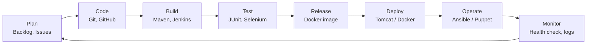
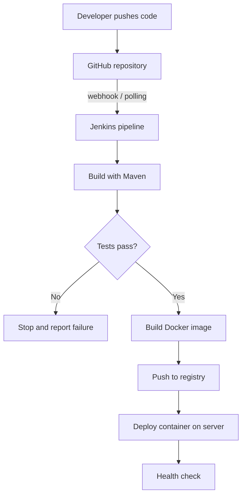

# Task 2: Agile Planning and DevOps Workflow

> **Goal:** Turn the MVP scope from Task 1 into user stories, a backlog and a
> sprint plan, and show how code moves from development to operations.
>
> **Deliverables:** Backlog, task board, sprint plan, Definition of Done and
> DevOps workflow diagram.

---

## 1. User stories with acceptance criteria

A **user story** describes a feature from the user's point of view:
*"As a [user], I want [something] so that [benefit]."*
**Acceptance criteria** are the checks that prove the story is done.

### US1: Register
**As a** player, **I want to** create an account **so that** I can book slots.
- Form asks for name, email and phone.
- Email must be unique; a duplicate shows an error.
- After success, a "Registration successful" message is shown.

### US2: View available slots
**As a** player, **I want to** see free slots for a facility and date **so that**
I know when I can play.
- I can choose a facility and a date.
- Only slots that are not booked are shown.
- If nothing is free, the page says "No slots available".

### US3: Request a booking
**As a** player, **I want to** request a free slot **so that** it is reserved for me.
- I can click "Book" on any free slot.
- A booking is created with status **REQUESTED**.
- The same slot cannot be booked twice (double booking is blocked).

### US4: Confirm a booking
**As a** facility manager, **I want to** confirm booking requests **so that**
players know their slot is final.
- Manager sees a list of REQUESTED bookings.
- Clicking "Confirm" changes the status to **CONFIRMED**.

### US5: Cancel a booking
**As a** player, **I want to** cancel my booking **so that** others can use the slot.
- I can cancel a REQUESTED or CONFIRMED booking.
- Status becomes **CANCELLED** and the slot shows as free again.

### US6: Track booking status
**As a** player, **I want to** see all my bookings and their status **so that**
I know what is confirmed.
- "My Bookings" lists facility, date, time and status.

### US7: Automated build and deploy (DevOps story)
**As a** developer, **I want** every push to be built, tested and deployed
automatically **so that** bugs are caught early.
- Jenkins builds on every push.
- Failing tests stop deployment.

## 2. Product backlog

The **backlog** is the full to-do list, ordered by priority.
Priority: **High** = must have, **Medium** = should have.

| ID | Backlog item | Story | Priority | Estimate (story points) |
|----|-------------|-------|----------|-----------------|
| M1 | Project skeleton (Spring Boot + Maven) | US7 | High | 2 |
| M2 | Home page with app layout | - | High | 1 |
| M3 | `User` model and table | US1 | High | 2 |
| M4 | Registration form | US1 | High | 3 |
| M5 | `Facility` and `Slot` models | US2 | High | 2 |
| M6 | Load sample facilities and slots | US2 | High | 1 |
| M7 | Availability page | US2 | High | 3 |
| M8 | `Booking` model with status | US3 | High | 2 |
| M9 | Booking request form | US3 | High | 3 |
| M10 | Double-booking check | US3 | High | 2 |
| M11 | Manager confirmation | US4 | High | 3 |
| M12 | Cancel booking | US5 | High | 2 |
| M13 | My Bookings page | US6 | Medium | 2 |
| M14 | Validation and error messages | All | Medium | 2 |
| M15 | Health check endpoint | US7 | Medium | 1 |

**Total:** 31 story points

## 3. Sprint plan

We use **Scrum** with **4 sprints of 2 weeks each**. Each sprint ends with
working software. The sprints also line up with the lab tasks.

| Sprint | Weeks | Goal | Backlog items | Lab tasks |
|--------|-------|------|---------------|-----------|
| **Sprint 1** | 1-2 | Plan and set up | M1, M2 | Tasks 1-4 |
| **Sprint 2** | 3-4 | Users and availability | M3, M4, M5, M6, M7 | Task 5 |
| **Sprint 3** | 5-6 | Booking flow | M8, M9, M10, M11, M12, M13 | Task 6 |
| **Sprint 4** | 7-8 | Quality and automation | M14, M15 + CI/CD, Docker, Ansible | Tasks 7-14 |

## 4. Task board (Kanban)

A **Kanban board** shows where each item is right now. This is the board at
the end of Sprint 1:

| To Do | In Progress | Review | Done |
|-------|-------------|--------|------|
| M3 User model | | | M1 Project skeleton |
| M4 Registration form | | | M2 Home page |
| M5 Facility & Slot models | | | |
| M6 Sample data | | | |
| M7 Availability page | | | |
| M8 Booking model | | | |
| M9 Booking form | | | |
| M10 Double-booking check | | | |
| M11 Confirmation | | | |
| M12 Cancel booking | | | |
| M13 My Bookings | | | |
| M14 Validation | | | |
| M15 Health check | | | |

> On GitHub this board can be created under **Projects → New project → Board**,
> with one GitHub Issue per backlog item (see Task 4).

## 5. Definition of Done (DoD)

An item is **Done** only when **all** of these are true:

- [ ] Code is written and works on my machine.
- [ ] Code is on a feature branch and merged through a **Pull Request**.
- [ ] `mvn clean package` builds with **no errors**.
- [ ] All unit tests pass.
- [ ] Acceptance criteria of the story are met.
- [ ] Jenkins build is green (from Task 7 onwards).
- [ ] Docs / README are updated if something changed.
- [ ] The linked GitHub Issue is closed.

## 6. DevOps lifecycle diagram

DevOps is a loop: we **plan**, **code**, **build**, **test**, **release**,
**deploy**, **operate** and **monitor**, then use what we learn to plan again.

### Tools used at each stage

| Stage | What happens | Tool | Lab task |
|-------|-------------|------|----------|
| Plan | Write stories, backlog, board | GitHub Issues / Projects | 1, 2 |
| Code | Write code on branches, review PRs | Git, GitHub | 4, 5, 6 |
| Build | Compile and package the WAR | Maven, Jenkins | 7, 8 |
| Test | Run unit and browser tests | JUnit, Selenium | 9, 10 |
| Release | Build a versioned image | Docker, Docker Hub | 11, 12 |
| Deploy | Put the app on a server | Tomcat, Docker | 8, 12 |
| Operate | Configure servers automatically | Ansible / Puppet | 13, 14 |
| Monitor | Check the app is healthy | `/actuator/health` | 14 |

### Commit-to-deploy flow

