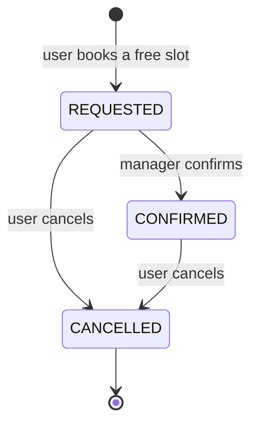
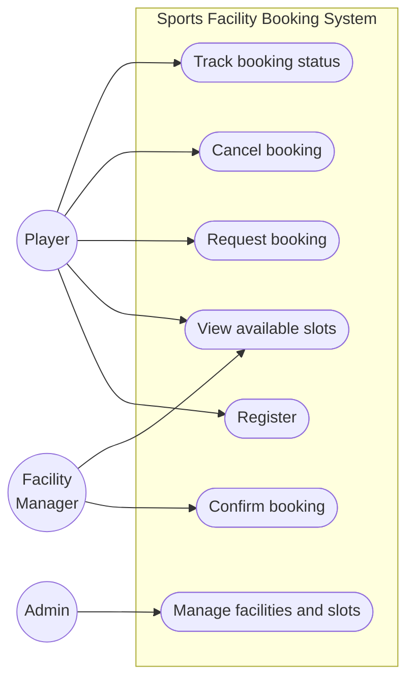
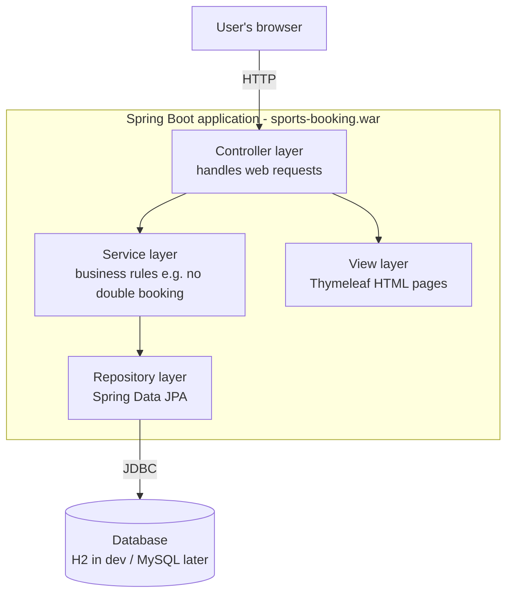
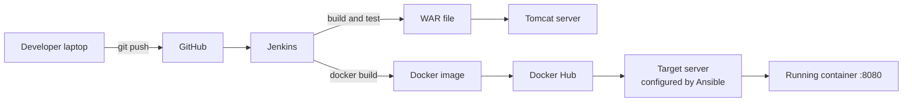
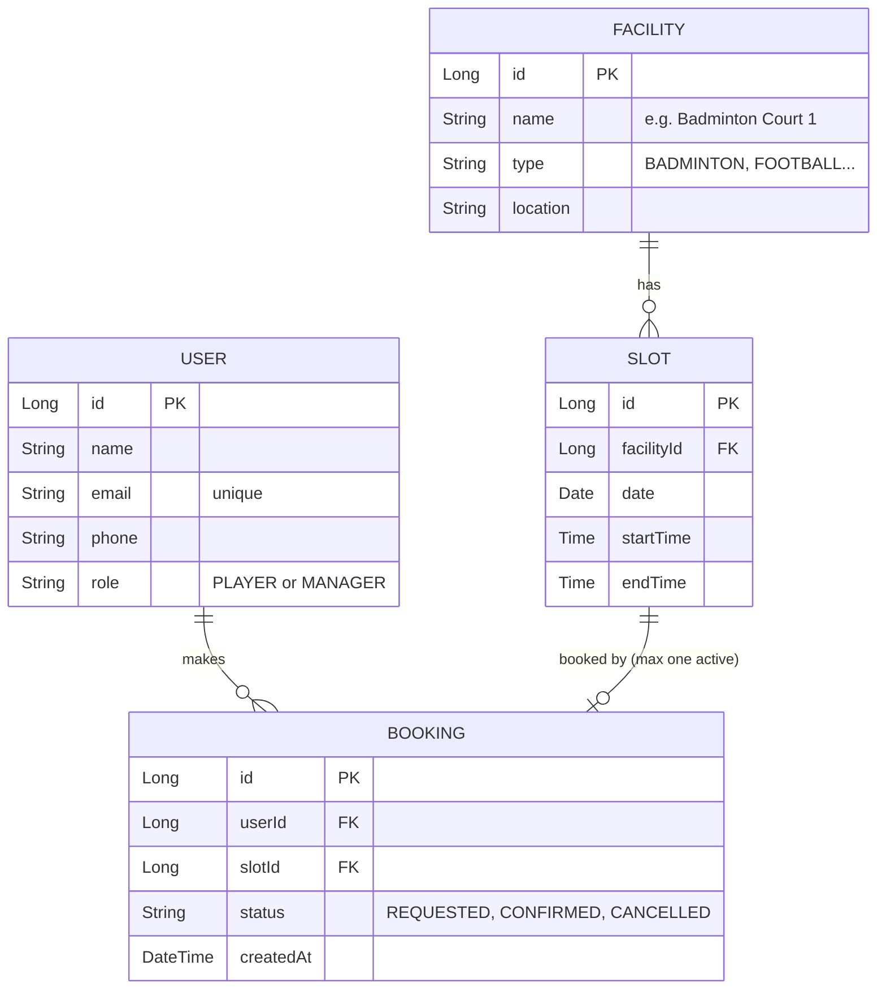

# Task 3: Requirements, Architecture and Technology Setup

> **Goal:** Write down exactly what the system must do, design how it is built,
> choose the tools, and get the project running on my laptop.
>
> **Deliverables:** SRS summary, use-case diagram, architecture diagram, data
> model / API list and working local setup.

---

## 1. SRS summary (Software Requirements Specification)

### 1.1 Functional requirements: what the system does

| ID | Requirement |
|----|-------------|
| FR1 | A user can **register** with name, email and phone. |
| FR2 | A user can **view available slots** for a chosen facility and date. |
| FR3 | A user can **request a booking** for a free slot. |
| FR4 | The system must **block double booking** of the same slot. |
| FR5 | A manager can **confirm** a requested booking. |
| FR6 | A user can **cancel** a booking, and the slot becomes free again. |
| FR7 | A user can **track the status** of all their bookings. |
| FR8 | The system exposes a **health check** URL for monitoring. |

### 1.2 Non-functional requirements: how well it does it

| ID | Requirement |
|----|-------------|
| NFR1 | **Performance:** pages load in under 2 seconds on a local server. |
| NFR2 | **Usability:** a booking takes at most 3 clicks after choosing a slot. |
| NFR3 | **Reliability:** the app restarts cleanly inside Docker. |
| NFR4 | **Portability:** runs on Windows/Linux, standalone, on Tomcat or in Docker. |
| NFR5 | **Testability:** main user journeys are covered by automated tests. |
| NFR6 | **Maintainability:** code is in Git with branches and reviewed PRs. |

### 1.3 Booking status rules

A booking moves through these states:



## 2. Use-case diagram

Shows **who** (actor) can do **what** (use case).



## 3. Architecture

### 3.1 Layered architecture

The app follows a simple **3-layer (MVC) design**. Each layer only talks to
the one below it, so the code stays easy to change and test.



| Layer | Job | Example class |
|-------|-----|---------------|
| Controller | Receives the request, returns a page | `BookingController` |
| Service | Business logic and rules | `BookingService` |
| Repository | Reads/writes the database | `BookingRepository` |
| View | HTML shown to the user | `availability.html` |
| Model | Data objects | `User`, `Facility`, `Slot`, `Booking` |

### 3.2 Deployment architecture (final goal)



## 4. Data model



## 5. API / URL list

These are the pages and endpoints the MVP will have.

| Method | URL | What it does | Requirement |
|--------|-----|--------------|-------------|
| GET | `/` | Home page | - |
| GET | `/register` | Show registration form | FR1 |
| POST | `/register` | Save a new user | FR1 |
| GET | `/facilities` | List all facilities | FR2 |
| GET | `/slots?facilityId={id}&date={yyyy-mm-dd}` | Show free slots | FR2 |
| POST | `/bookings` | Request a booking for a slot | FR3, FR4 |
| GET | `/bookings/my?userId={id}` | My bookings with status | FR7 |
| POST | `/bookings/{id}/confirm` | Manager confirms booking | FR5 |
| POST | `/bookings/{id}/cancel` | Cancel a booking | FR6 |
| GET | `/manager/bookings` | Manager sees pending requests | FR5 |
| GET | `/actuator/health` | Health check (returns `{"status":"UP"}`) | FR8 |

## 6. Technology stack

| Need | Choice | Why |
|------|--------|-----|
| Language | **Java 17** | Widely used, works well with all DevOps tools in this course |
| Framework | **Spring Boot 3** | Quick setup, built-in web server, easy testing |
| Web pages | **Thymeleaf** | Server-side HTML, easy to test with Selenium |
| Database | **H2** (in-memory) for development | No install needed; can switch to MySQL later |
| Build tool | **Maven** | Required by the syllabus; Jenkins supports it directly |
| Packaging | **WAR** file | Runs standalone *and* can be deployed to **Tomcat** |
| Deployment target | **Apache Tomcat 10** | Required by Task 8 |
| Version control | **Git + GitHub** | Tasks 4-6 |
| CI/CD | **Jenkins** | Tasks 7, 8, 10, 12 |
| Testing | **JUnit 5**, **Selenium WebDriver** | Tasks 9, 10 |
| Containers | **Docker** | Tasks 11, 12 |
| Config management | **Ansible** | Tasks 13, 14 |

## 7. Local development setup

### 7.1 Software installed

| Tool | Version | Check command |
|------|---------|---------------|
| JDK | 21 (project targets 17) | `java -version` |
| Maven | 3.9.x | `mvn -v` |
| Git | 2.x | `git --version` |
| IDE | VS Code / IntelliJ IDEA | - |

### 7.2 Run the project

```bash
# 1. Get the code
git clone https://github.com/tanishasharma1827/23102C0077_devops.git
cd 23102C0077_devops

# 2. Build and run tests
mvn clean package

# 3. Start the app
mvn spring-boot:run
```

Then open in a browser:

| URL | Expected result |
|-----|-----------------|
| http://localhost:8080/ | Home page "Sports Facility Booking System" |
| http://localhost:8080/actuator/health | `{"status":"UP"}` |
| http://localhost:8080/h2-console | Database console (JDBC URL: `jdbc:h2:mem:sportsdb`) |

### 7.3 Evidence of working local setup

> Add your screenshots here:
> 1. `java -version` and `mvn -v` output
> 2. `mvn clean package` showing **BUILD SUCCESS**
> 3. Browser showing the home page at `localhost:8080`
> 4. Browser showing `/actuator/health` → `UP`
