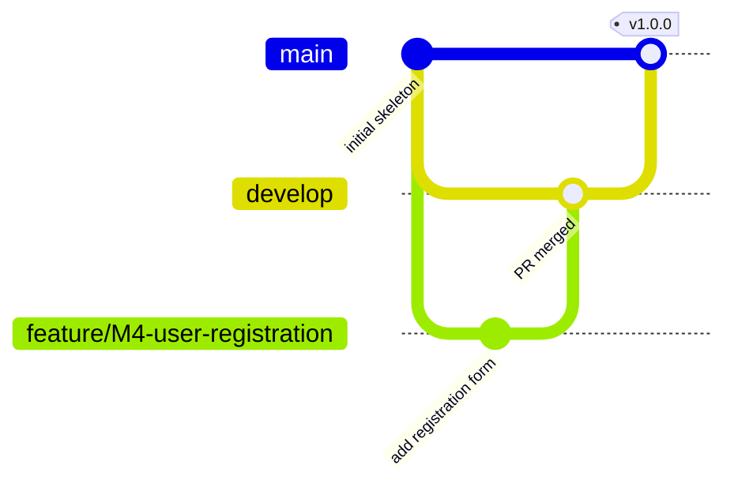

# Task 4: Git and GitHub Repository Initialization

> **Goal:** Put the project on GitHub in a clean, organized way so that all
> future work follows the same rules.
>
> **Deliverables:** Repository URL, README, initial commits, issues and branch
> policy.

---

## 1. Repository

**URL:** https://github.com/tanishasharma1827/23102C0077_devops

## 2. Folder structure

```text
23102C0077_devops/
├── .github/
│   ├── ISSUE_TEMPLATE/
│   │   ├── bug_report.md          # template for reporting bugs
│   │   ├── feature_request.md     # template for new features / user stories
│   │   └── task.md                # template for DevOps / setup tasks
│   └── pull_request_template.md   # checklist shown on every PR
├── docs/                          # one document per lab task
├── src/
│   ├── main/
│   │   ├── java/com/sportsbooking/        # Java source code
│   │   │   ├── SportsBookingApplication.java
│   │   │   └── controller/HomeController.java
│   │   └── resources/
│   │       ├── application.properties     # app settings
│   │       ├── static/css/style.css       # styling
│   │       └── templates/index.html       # home page
│   └── test/java/com/sportsbooking/       # automated tests
├── .gitignore                     # files Git should ignore
├── CONTRIBUTING.md                # branch and commit rules
├── pom.xml                        # Maven build file
└── README.md                      # project overview
```

## 3. Important files

| File | Why it exists |
|------|---------------|
| `README.md` | First thing anyone sees: what the project is and how to run it |
| `.gitignore` | Stops build output (`target/`), IDE files and secrets from being committed |
| `pom.xml` | Tells Maven what libraries to download and how to build the WAR |
| `CONTRIBUTING.md` | Branch naming and commit message rules |
| `.github/ISSUE_TEMPLATE/*` | Ready-made forms so every issue has the same format |
| `.github/pull_request_template.md` | Checklist (Definition of Done) on every pull request |

## 4. Steps followed

```bash
# 1. Create an empty repository on github.com named 23102C0077_devops

# 2. Clone it to the laptop
git clone https://github.com/tanishasharma1827/23102C0077_devops.git
cd 23102C0077_devops

# 3. Set my identity (one-time)
git config user.name  "tanishasharma1827"
git config user.email "<my email>"

# 4. Add files in small, meaningful commits
git add .gitignore README.md
git commit -m "chore: add README and .gitignore"

git add pom.xml src/
git commit -m "feat: add Spring Boot application skeleton with home page"

git add .github/ CONTRIBUTING.md
git commit -m "chore: add issue templates, PR template and branch policy"

git add docs/
git commit -m "docs: add documentation for tasks 1 to 4"

# 5. Push main to GitHub
git push -u origin main

# 6. Create the develop branch
git checkout -b develop
git push -u origin develop

# 7. Check the history
git log --oneline
```

## 5. Branch policy

We use a simple **Git Flow** style. Full rules are in
[CONTRIBUTING.md](../CONTRIBUTING.md).



| Branch | Purpose | Who can push directly? |
|--------|---------|------------------------|
| `main` | Stable, release-ready code only | Nobody; merge from `develop` via PR |
| `develop` | Latest working code; features are merged here | Nobody; merge via PR |
| `feature/<id>-<short-name>` | One new feature | Developer |
| `bugfix/<id>-<short-name>` | Fix a bug | Developer |
| `hotfix/<short-name>` | Urgent fix to `main` | Developer |
| `release/<version>` | Prepare a release | Developer |

**Examples:** `feature/M4-user-registration`, `feature/M7-availability-page`,
`bugfix/M10-double-booking`, `release/v1.0.0`

### Recommended GitHub settings

On GitHub: **Settings → Branches → Add branch protection rule** for `main`:
- ✅ Require a pull request before merging
- ✅ Require status checks to pass (after Jenkins is set up in Task 7)

## 6. Commit message rules

Format: `type: short description`

| Type | Use for | Example |
|------|---------|---------|
| `feat` | New feature | `feat: add booking request form` |
| `fix` | Bug fix | `fix: block double booking of same slot` |
| `docs` | Documentation | `docs: add task 5 report` |
| `test` | Tests | `test: add selenium test for login` |
| `chore` | Setup, config, tools | `chore: add .gitignore` |
| `ci` | Jenkins / pipeline | `ci: add Jenkinsfile` |

## 7. GitHub Issues

One issue is created for each backlog item from Task 2, using the templates.

**How to create:** GitHub repo → **Issues** → **New issue** → choose a template.

| Issue title | Template | Label |
|-------------|----------|-------|
| M1: Project skeleton (Spring Boot + Maven) | Task | setup (close it, already done) |
| M2: Home page with app layout | Feature | feature (close it, already done) |
| M3: User model and table | Feature | feature |
| M4: Registration form | Feature | feature |
| M5: Facility and Slot models | Feature | feature |
| M6: Load sample facilities and slots | Feature | feature |
| M7: Availability page | Feature | feature |
| M8: Booking model with status | Feature | feature |
| M9: Booking request form | Feature | feature |
| M10: Double-booking check | Feature | feature |
| M11: Manager confirmation | Feature | feature |
| M12: Cancel booking | Feature | feature |
| M13: My Bookings page | Feature | feature |
| M14: Validation and error messages | Feature | feature |
| M15: Health check endpoint | Task | devops |

## 8. Evidence

> Add your screenshots here:
> 1. Repository home page on GitHub showing files and README
> 2. `git log --oneline` output showing the initial commits
> 3. Branches page showing `main` and `develop`
> 4. Issues page showing the backlog issues
> 5. "New issue" page showing the 3 templates
