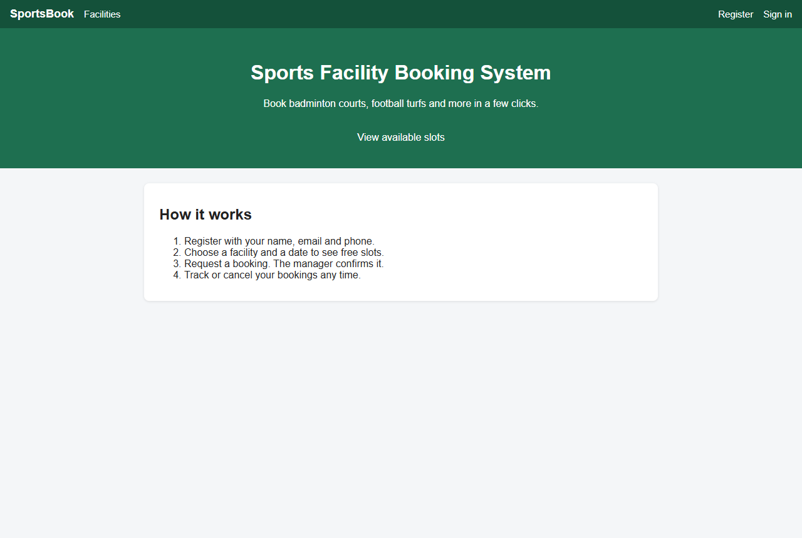
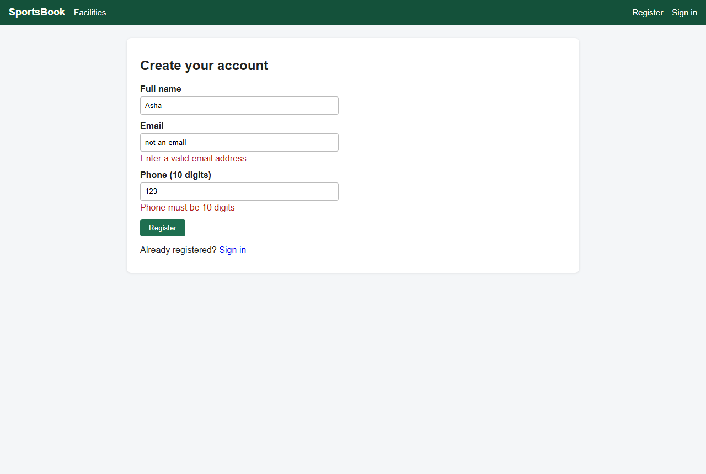
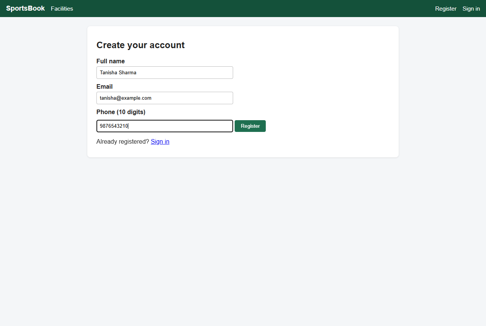
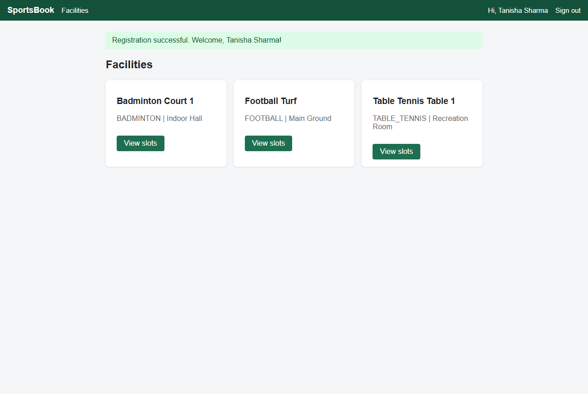
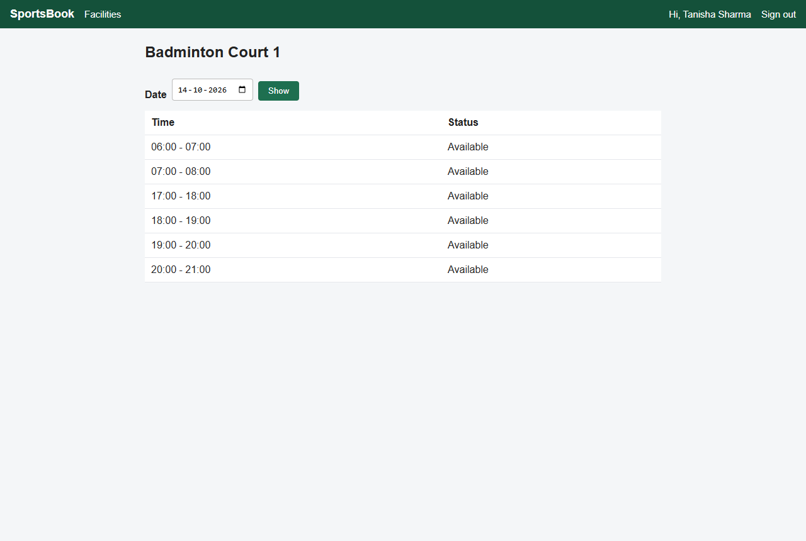
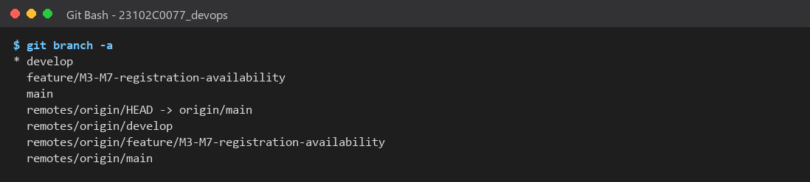
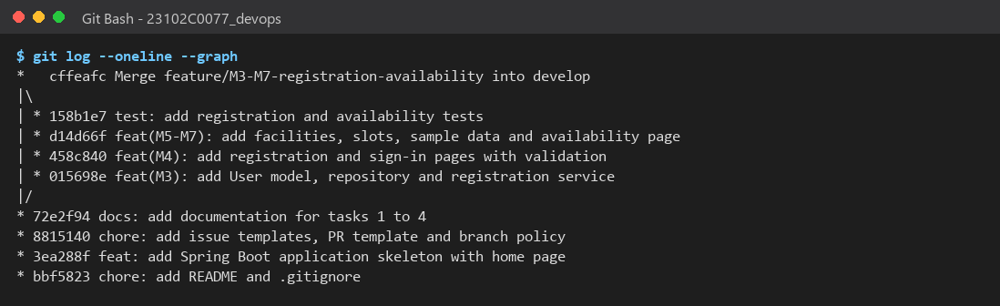
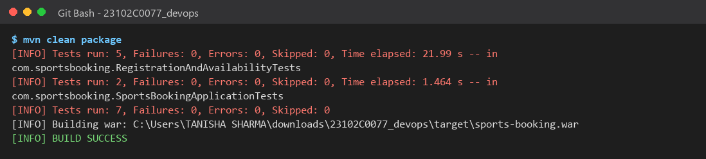
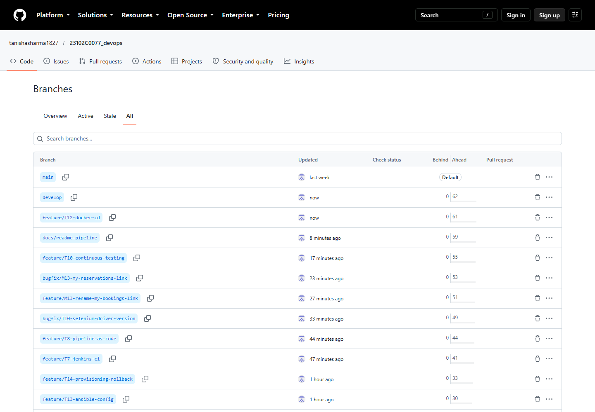
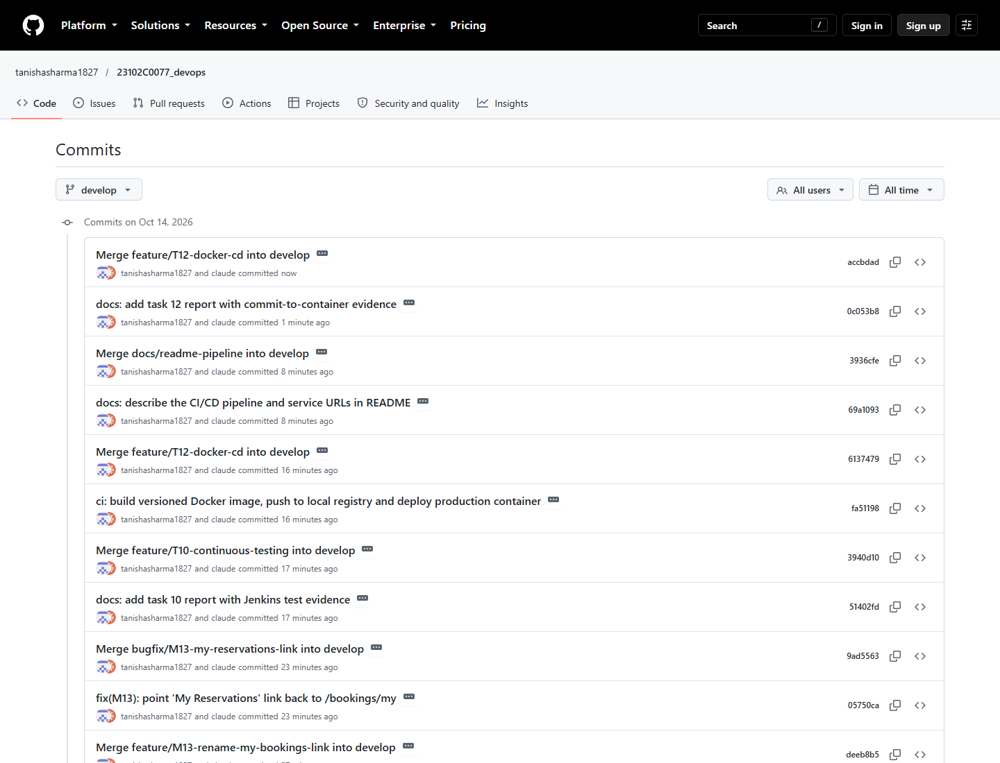

# Task 5: Feature Development with Branching

> **Goal:** Build the first core workflow of the app on a separate feature
> branch, using Git commands, then review and merge it into `develop`.
>
> **Deliverables:** Working feature 1, feature branch, pull request, review
> comments and merge evidence.

---

## 1. What feature was built?

**Feature 1 = Registration + Slot availability** (backlog items M3 to M7).

| ID | Item | Files |
|----|------|-------|
| M3 | `User` model and table | `model/User.java`, `model/Role.java`, `repository/UserRepository.java` |
| M4 | Registration form (+ simple sign-in) | `controller/UserController.java`, `templates/register.html`, `templates/signin.html` |
| M5 | `Facility` and `Slot` models | `model/Facility.java`, `model/Slot.java` |
| M6 | Sample data (3 facilities, 6 slots/day for 7 days, 1 manager) | `config/DataLoader.java` |
| M7 | Availability page | `controller/SlotController.java`, `templates/facilities.html`, `templates/slots.html` |

How it works in simple words:

1. A player opens **Register**, enters name, email and phone.
2. The app checks the input (valid email, 10-digit phone, email not already used).
3. On success the player is signed in and sent to the **Facilities** page.
4. The player clicks **View slots** and picks a date to see the time slots.

## 2. Git workflow followed

```bash
# 1. Start from the latest develop
git checkout develop
git pull

# 2. Create the feature branch (name follows CONTRIBUTING.md)
git checkout -b feature/M3-M7-registration-availability

# 3. Small commits, one per backlog item
git add src/main/java/com/sportsbooking/model/User.java ...
git commit -m "feat(M3): add User model, repository and registration service"
git commit -m "feat(M4): add registration and sign-in pages with validation"
git commit -m "feat(M5-M7): add facilities, slots, sample data and availability page"
git commit -m "test: add registration and availability tests"

# 4. Push the branch to GitHub
git push -u origin feature/M3-M7-registration-availability

# 5. Check history
git log --oneline --graph

# 6. Review, then merge into develop with a merge commit
git checkout develop
git merge --no-ff feature/M3-M7-registration-availability
git push origin develop

# 7. Pull to stay up to date
git pull
```

`--no-ff` makes Git always create a **merge commit**, so the history clearly
shows that a feature branch was merged (see the graph in screenshot 07).

## 3. Pull request and review

The pull request is **`feature/M3-M7-registration-availability` → `develop`**.

**Review checklist (from `.github/pull_request_template.md`):**

- [x] Branch name follows `feature/<id>-<name>`
- [x] `mvn clean package` builds with no errors
- [x] All tests pass (7 / 7)
- [x] Acceptance criteria of US1 and US2 are met
- [x] Docs updated

**Review comments:**

| # | Comment | Action |
|---|---------|--------|
| 1 | Email should be unique even if typed in capitals | Emails are saved in lowercase and checked with `existsByEmailIgnoreCase` |
| 2 | Phone should only accept 10 digits | Added `@Pattern(regexp = "\\d{10}")` with a clear error message |
| 3 | Show "No slots available" when a date has no slots | Added in `slots.html` and covered by a test |
| 4 | Jenkins already uses port 8080 on the lab PC | App now runs on **8081** locally (`SERVER_PORT` can override) |

> **How to raise the PR on GitHub:** open the repository → **Pull requests** →
> **New pull request** → base: `develop`, compare: your feature branch →
> fill in the template → **Create pull request** → add the review comments
> above → **Merge pull request**.

## 4. Tests

| Test | What it checks |
|------|----------------|
| `registersNewPlayerAndRedirectsToFacilities` | Valid registration saves the user and redirects |
| `rejectsDuplicateEmail` | Same email (any case) cannot register twice |
| `rejectsInvalidPhone` | Phone with less than 10 digits shows an error |
| `listsSeededFacilities` | Facilities page shows the sample facilities |
| `showsSlotsForTodayAndNoneForFarFuture` | Slots appear for today; "No slots available" for a far date |

Result: **Tests run: 7, Failures: 0, Errors: 0 — BUILD SUCCESS**

## 5. Evidence (screenshots)

| # | Screenshot |
|---|-----------|
| 01 | Home page:  |
| 02 | Validation errors on wrong input:  |
| 03 | Registration form filled:  |
| 04 | Registration success → Facilities page:  |
| 05 | Available slots for today:  |
| 06 | `git branch -a` showing the feature branch:  |
| 07 | `git log --graph` showing the feature merge:  |
| 08 | Maven test results:  |

| 09 | GitHub: all branches:  |
| 10 | GitHub: commit history of `develop`:  |
