# Task 6: MVP Completion and Git Collaboration

> **Goal:** Finish the remaining MVP features, show a second feature branch,
> create and resolve a merge conflict, and tag a release-ready version.
>
> **Deliverables:** Functional MVP, resolved merge conflict, tagged version and
> updated backlog.

---

## 1. Features completed in this task

| ID | Feature | Where |
|----|---------|-------|
| M8 | `Booking` model with status (REQUESTED / CONFIRMED / CANCELLED) | `model/Booking.java`, `model/BookingStatus.java` |
| M9 | Booking request ("Book" button on each free slot) | `BookingController`, `slots.html` |
| M10 | **Double-booking check**: a slot with an active booking cannot be booked again | `BookingService.request()` |
| M11 | Manager confirmation page | `manager-bookings.html`, `/manager/bookings` |
| M12 | Cancel booking; the slot becomes free again | `BookingService.cancel()` |
| M13 | "My Bookings" page with status | `my-bookings.html`, `/bookings/my` |
| M14 | Clearer navigation + friendly error page for bad input | `fragments.html`, `ErrorHandlingAdvice`, `error-page.html` |
| M15 | Health and version endpoints | `/actuator/health`, `/actuator/info` |

**Sample logins:** the manager account is `manager@sports.local` (sign in with
email only). Players register themselves.

## 2. Two feature branches worked on in parallel

```bash
# Branch 2: booking flow (M8-M13)
git checkout -b feature/M8-M13-booking-flow develop
# ...4 commits...
git push -u origin feature/M8-M13-booking-flow

# Branch 3: navigation and health (M14-M15), also started from develop
git checkout -b feature/M14-M15-navigation-health develop
# ...4 commits...
git push -u origin feature/M14-M15-navigation-health
```

Both branches changed **the same lines** of the navigation bar in
`src/main/resources/templates/fragments.html`:

| Branch | Change to the navigation bar |
|--------|------------------------------|
| `feature/M8-M13-booking-flow` | Added **My Bookings** and **Manager** links |
| `feature/M14-M15-navigation-health` | Added a **Home** link and renamed "Facilities" to **Book a Slot** |

## 3. Merge conflict: created and resolved

```bash
git checkout develop
git merge --no-ff feature/M8-M13-booking-flow          # merges cleanly
git merge --no-ff feature/M14-M15-navigation-health    # CONFLICT!
```

Git stopped and marked the conflict inside the file:

```html
<<<<<<< HEAD
    <a id="nav-facilities" th:href="@{/facilities}">Facilities</a>
    <a id="nav-my-bookings" ...>My Bookings</a>
    <a id="nav-manager" ...>Manager</a>
=======
    <a id="nav-home" th:href="@{/}">Home</a>
    <a id="nav-facilities" th:href="@{/facilities}">Book a Slot</a>
>>>>>>> feature/M14-M15-navigation-health
```

- The part between `<<<<<<< HEAD` and `=======` is what `develop` already had.
- The part between `=======` and `>>>>>>>` is what the incoming branch wanted.

**Resolution:** both changes are useful, so we **kept both**. We removed the
markers and wrote the final version by hand:

```html
    <a id="nav-home" th:href="@{/}">Home</a>
    <a id="nav-facilities" th:href="@{/facilities}">Book a Slot</a>
    <a id="nav-my-bookings" ...>My Bookings</a>
    <a id="nav-manager" ...>Manager</a>
```

```bash
mvn clean package            # 19 tests pass after the fix
git add src/main/resources/templates/fragments.html
git commit                   # completes the merge
git push origin develop
```

## 4. Release tag

```bash
# set <version>1.0.0</version> in pom.xml
git commit -m "chore: release version 1.0.0"
git tag -a v1.0.0 -m "v1.0.0 - MVP release"
git push origin v1.0.0
```

`v1.0.0` marks the **release-ready source baseline**: the full MVP with all
tests passing. `/actuator/info` reports `"version":"1.0.0"`.

## 5. Tests (19 in total, all passing)

| Test class | Tests | Covers |
|------------|-------|--------|
| `BookingFlowTests` | 8 | Request → REQUESTED, double booking blocked, manager confirms, player cannot confirm, cancel frees slot, cannot cancel others' bookings, web flow, manager page protected |
| `RegistrationAndAvailabilityTests` | 5 | Registration, duplicate email, phone validation, facilities, slots |
| `ValidationAndHealthTests` | 4 | Friendly error page (2), `/actuator/health`, `/actuator/info` |
| `SportsBookingApplicationTests` | 2 | App starts, home page loads |

## 6. Updated backlog: all MVP items done

| To Do | In Progress | Review | Done |
|-------|-------------|--------|------|
| | | | M1 Skeleton, M2 Home page |
| | | | M3 User model, M4 Registration |
| | | | M5 Facility & Slot, M6 Sample data, M7 Availability |
| | | | M8 Booking model, M9 Booking form, M10 Double-booking check |
| | | | M11 Confirmation, M12 Cancel, M13 My Bookings |
| | | | M14 Validation & navigation, M15 Health check |

> On GitHub: close issues M3 to M15 (or move them to **Done** on the project board).

## 7. Evidence (screenshots)

| # | Screenshot |
|---|-----------|
| 01 | Merge conflict reported by Git: 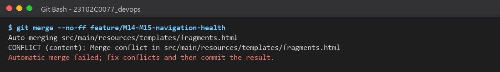 |
| 02 | `git status` during the conflict: 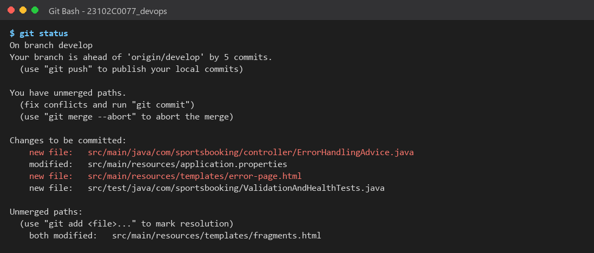 |
| 03 | Conflict markers in the file: 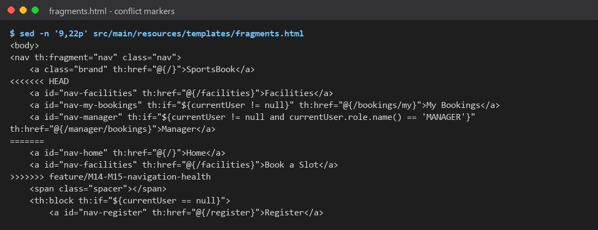 |
| 04 | File after resolution: 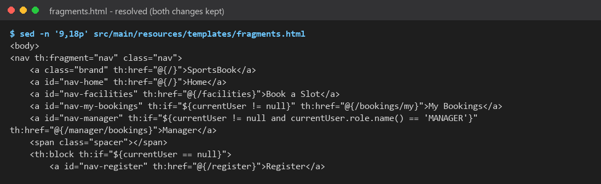 |
| 05 | `git log --graph` with both merges and the tag: 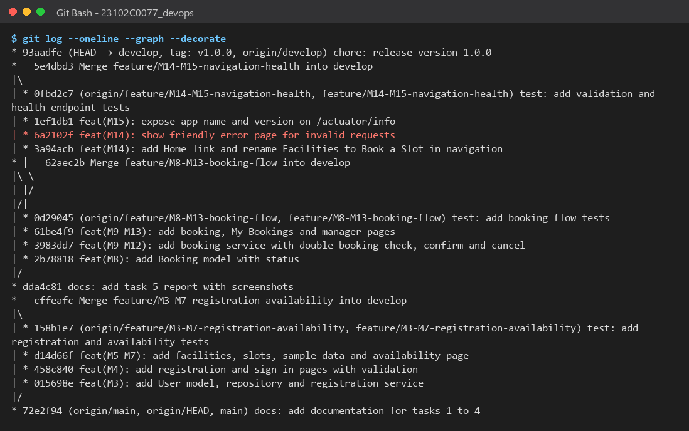 |
| 06 | Tag `v1.0.0`: 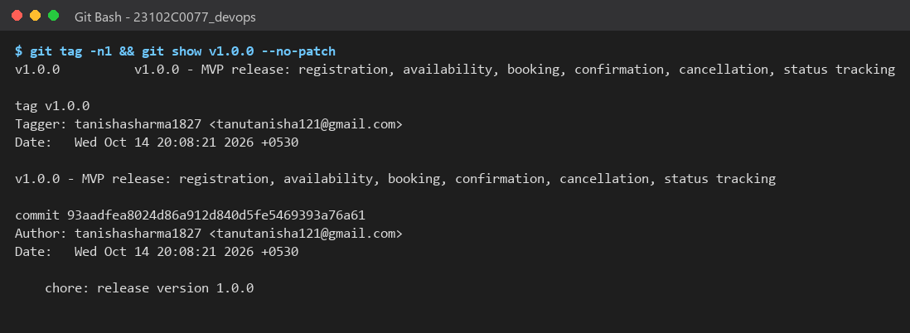 |
| 07 | 19 tests passing: 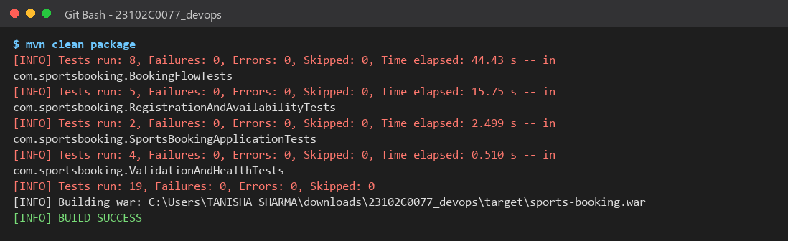 |
| 08 | Slots page with Book buttons: 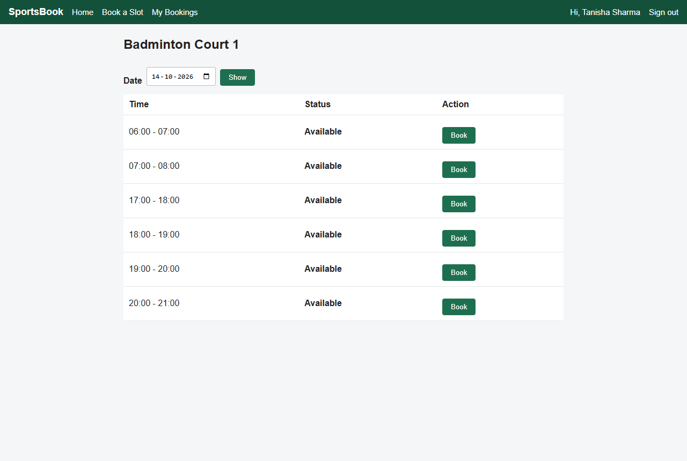 |
| 09 | Booking requested, slot shows Booked: 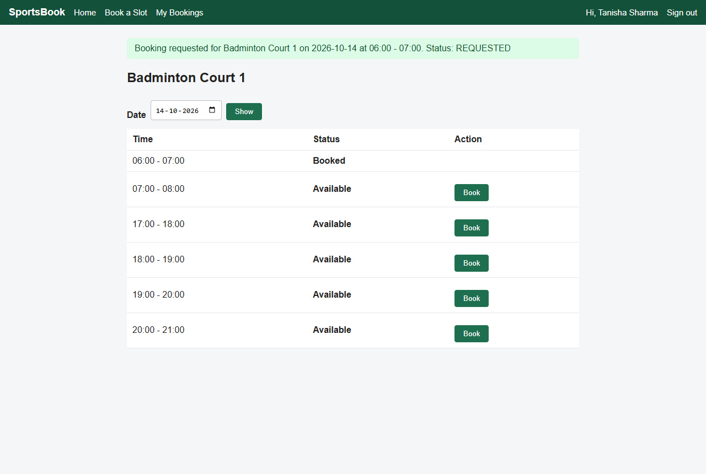 |
| 10 | My Bookings: REQUESTED:  |
| 11 | Second user blocked from double booking: 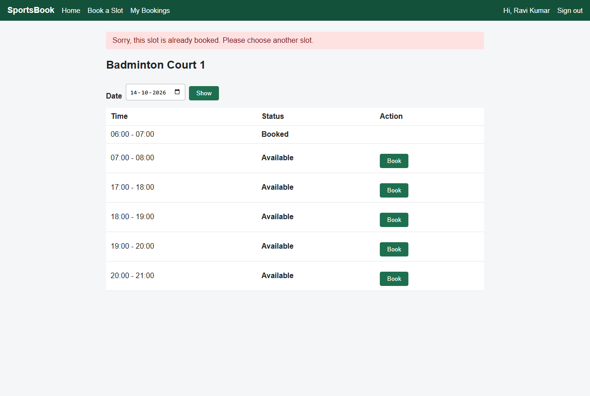 |
| 12 | Manager sees pending requests: 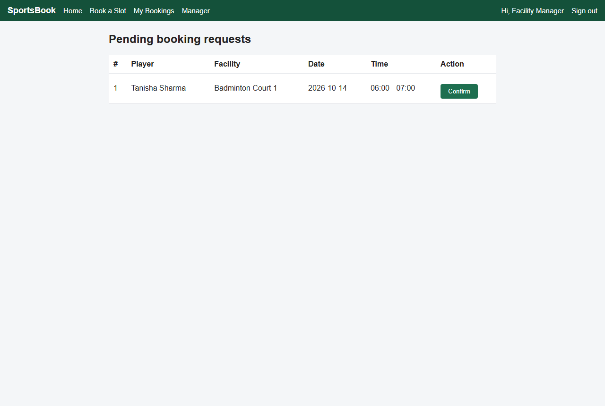 |
| 13 | Manager confirmed the booking: 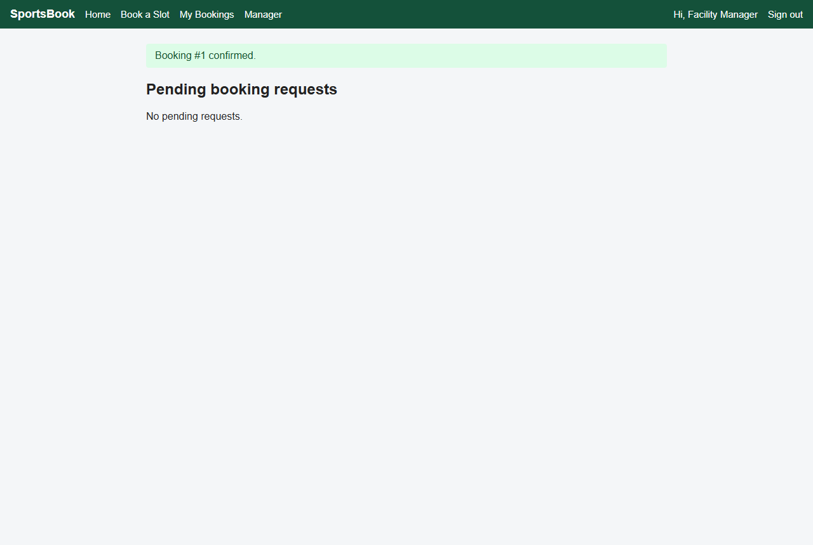 |
| 14 | Player sees CONFIRMED: 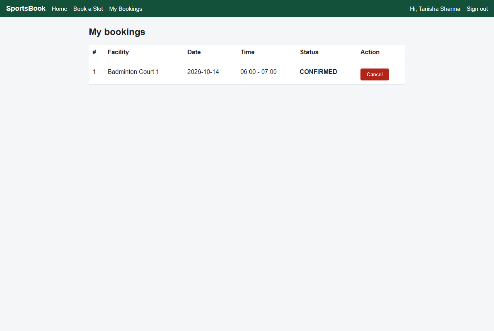 |
| 15 | Booking cancelled: 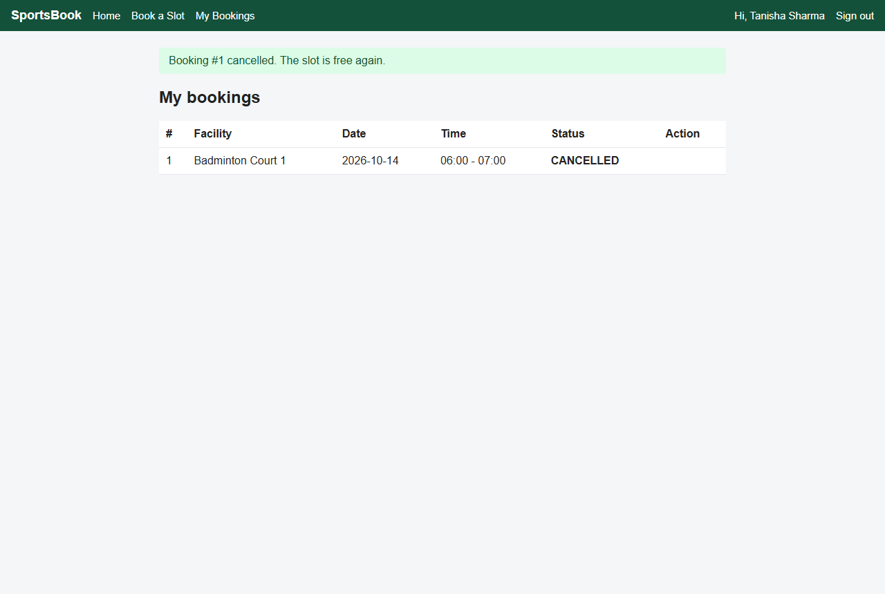 |
| 16 | Slot available again after cancel:  |
| 17 | Friendly error page: 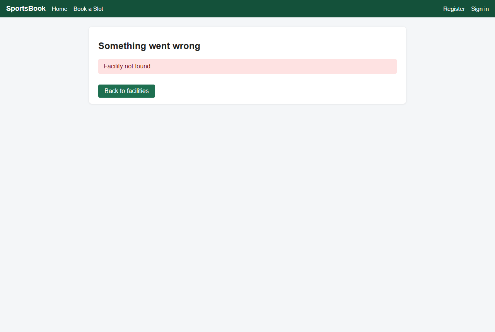 |
| 18 | Health check UP: 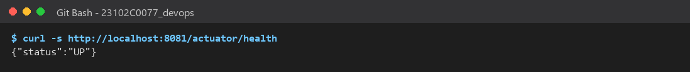 |
| 19 | Version 1.0.0 on `/actuator/info`: 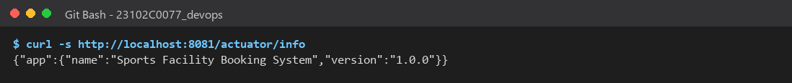 |

> **Add yourself (needs GitHub login):** the **Tags** page showing `v1.0.0`
> and the **Branches** page showing all three feature branches.
