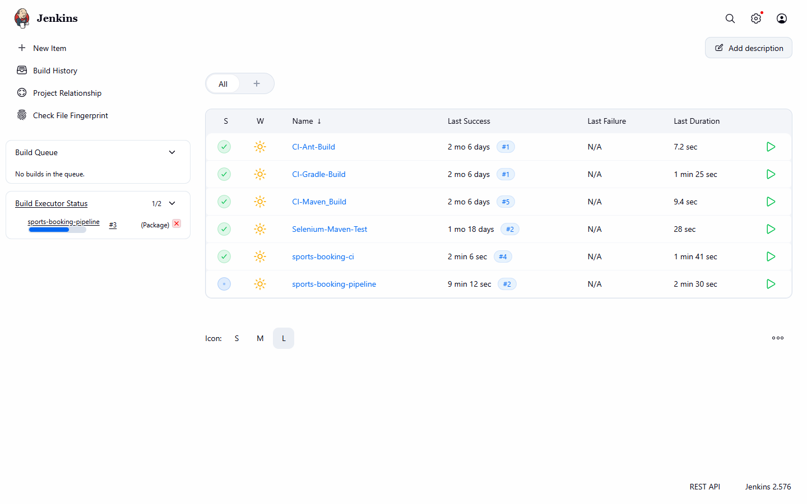
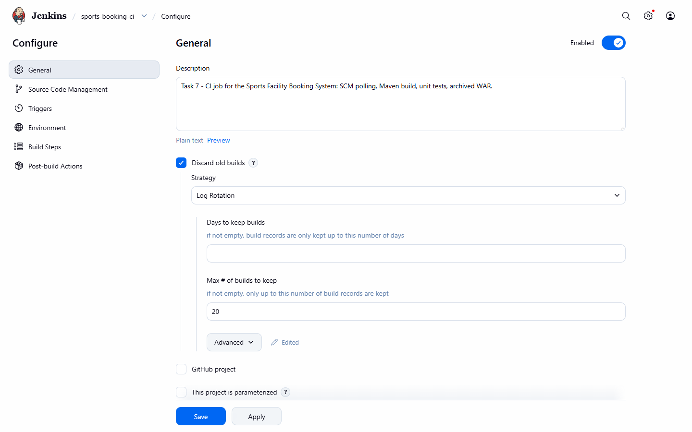
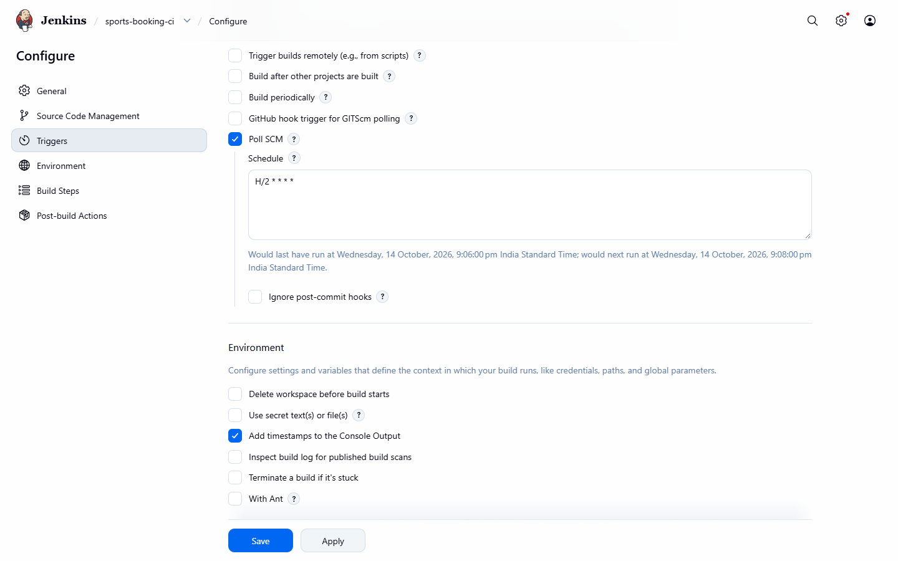
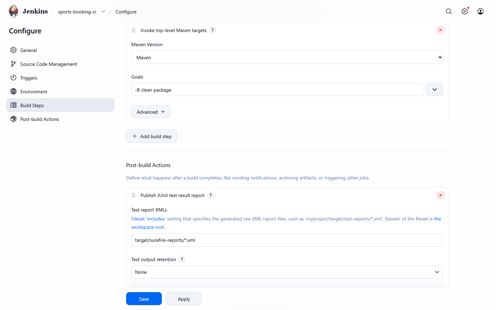
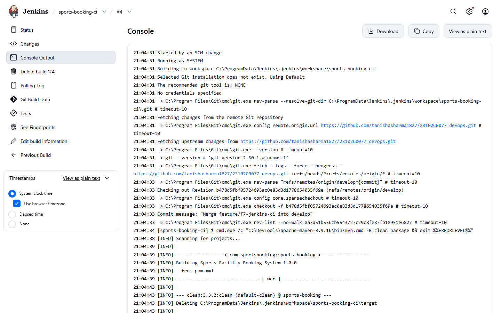
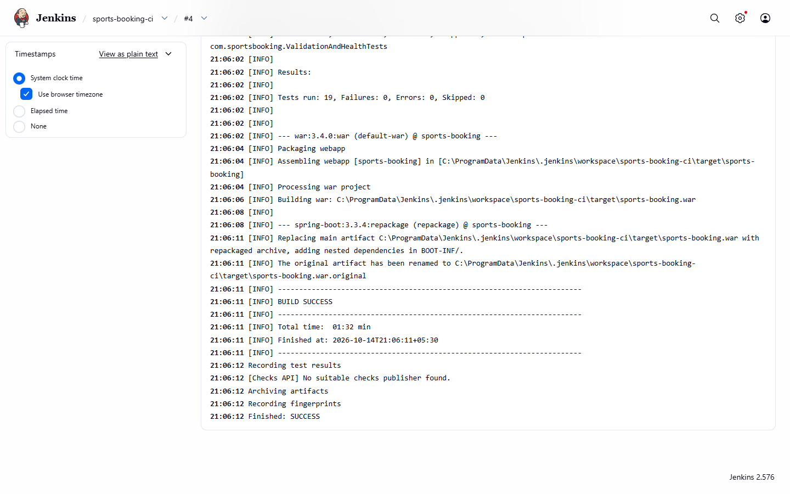
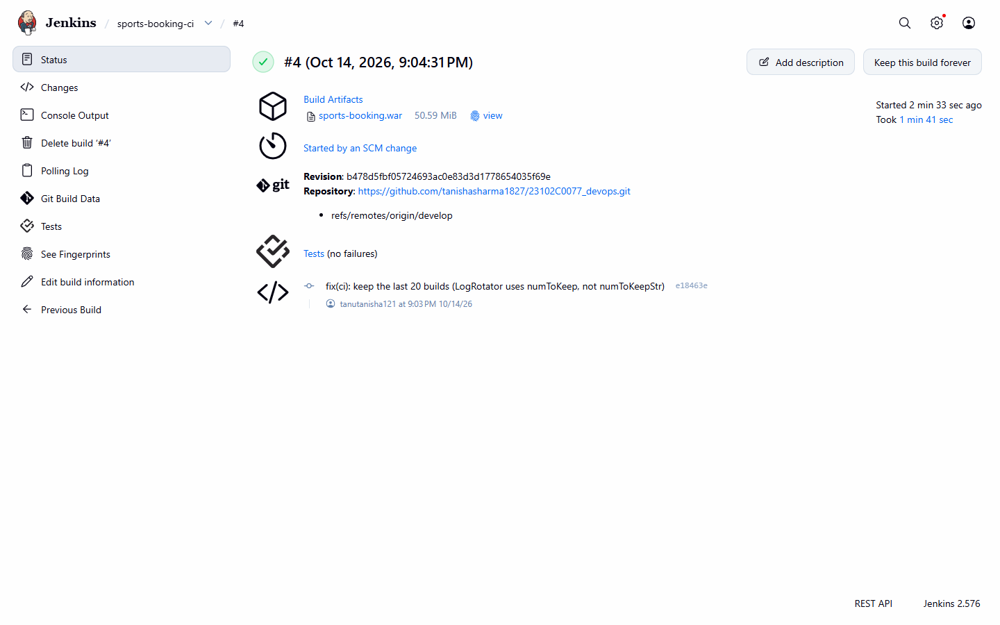
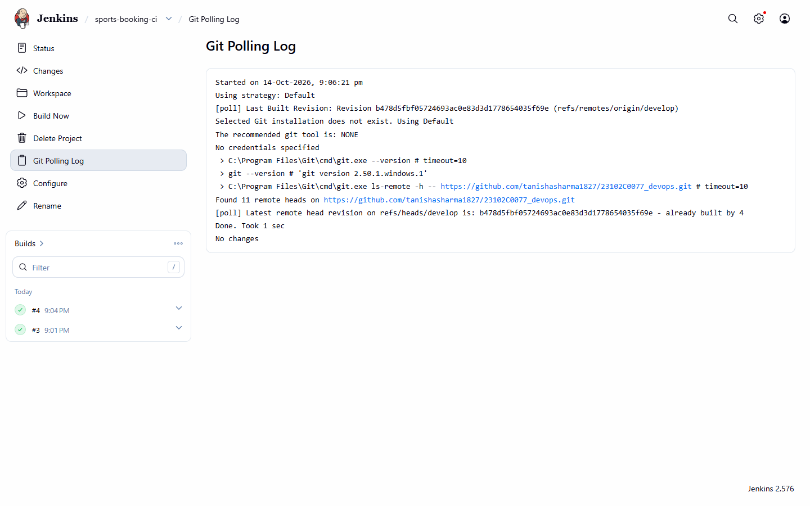
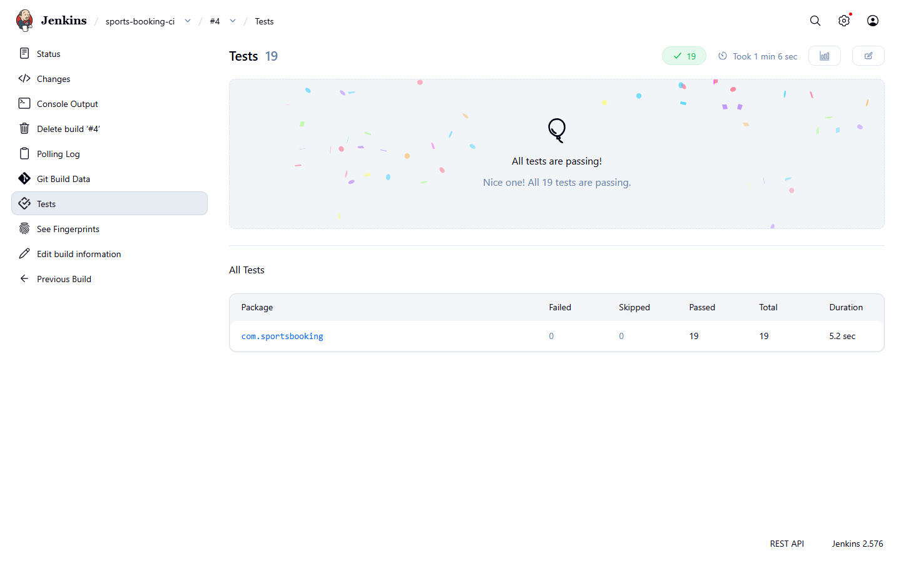
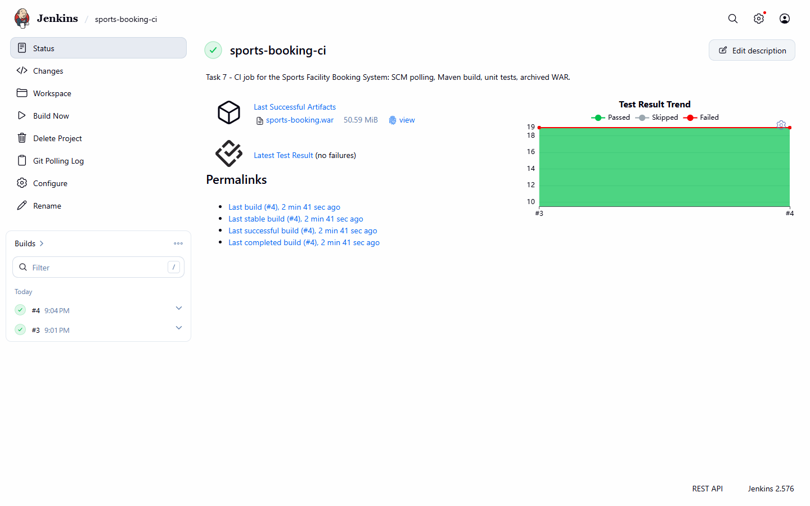

# Task 7: Jenkins Installation and Continuous Integration Job

> **Goal:** Install and configure Jenkins, connect it to the GitHub repository,
> and create a Maven build job that starts automatically when code changes.
>
> **Deliverables:** Configured Jenkins job, successful build log, trigger
> evidence and archived artefact.

---

## 1. Jenkins installation

| Item | Value |
|------|-------|
| Jenkins version | **2.576** (Windows installer, LTS line) |
| Runs as | Windows service `Jenkins`, account `NT AUTHORITY\SYSTEM` |
| URL | <http://localhost:8080> |
| Java used by Jenkins | JDK 21 (`C:\Program Files\Java\jdk-21`) |
| Home folder | `C:\ProgramData\Jenkins\.jenkins` |
| Admin user | `tanisha` |

**Installation steps followed:**

1. Download the Windows installer (`jenkins.msi`) from <https://www.jenkins.io/download/>.
2. Run it, choose **Run service as LocalSystem**, port **8080**, and JDK 21.
3. Open <http://localhost:8080>, unlock it with the password from
   `C:\ProgramData\Jenkins\.jenkins\secrets\initialAdminPassword`.
4. **Install suggested plugins** and create the admin user.
5. **Manage Jenkins → Tools → Maven installations** → add one named **`Maven`**
   (version 3.9.x, install automatically).

**Plugins used by this project** (all from "suggested plugins"): Git, GitHub,
Pipeline (`workflow-aggregator`), Pipeline Graph View, JUnit, Credentials
Binding, Timestamper, Workspace Cleanup.

## 2. The CI job: `sports-booking-ci`

A **Freestyle** job. The full definition is stored in the repository as
[`jenkins/ci-job-config.xml`](../jenkins/ci-job-config.xml), so it can be
recreated at any time:

```bash
curl -u USER:PASSWORD -H "Jenkins-Crumb: ..." -H "Content-Type: application/xml" \
     --data-binary @jenkins/ci-job-config.xml \
     "http://localhost:8080/createItem?name=sports-booking-ci"
```

| Section | Setting | Why |
|---------|---------|-----|
| **Source Code Management** | Git, `https://github.com/tanishasharma1827/23102C0077_devops.git`, branch `*/develop` | `develop` gets every merged feature |
| **Build Triggers** | **Poll SCM**, schedule `H/2 * * * *` | Jenkins asks GitHub every 2 minutes "is there a new commit?". If yes, it builds |
| **Build Environment** | Add timestamps to the console output | Easier to read the log |
| **Build Steps** | Invoke top-level Maven targets: `-B clean package` using Maven `Maven` | Compiles, runs the 19 unit tests, builds `sports-booking.war` |
| **Post-build** | Publish JUnit test results `target/surefire-reports/*.xml` | Test results and trend graph in Jenkins |
| | Archive artifacts `target/sports-booking.war` (+ fingerprint) | The WAR can be downloaded from every successful build |
| **Discard old builds** | Keep 20 builds, artifacts of 5 | Saves disk space |

> **Why polling and not a webhook?** A GitHub webhook needs GitHub to reach
> Jenkins over the internet, but this Jenkins runs on `localhost`. Polling works
> from inside the network. The **"GitHub hook trigger"** option can be enabled
> later if Jenkins is put on a public URL.

## 3. Build results

| Build | Started by | Result | Details |
|-------|-----------|--------|---------|
| #3 | **Build Now** clicked by user `tanisha` | ✅ SUCCESS | `mvn -B clean package`: 19 tests passed, WAR archived |
| #4 | **"Started by an SCM change"** | ✅ SUCCESS | Triggered automatically by the push of commit `fix(ci): keep the last 20 builds ...` |

The build log shows the whole flow:

```text
Started by an SCM change
Checking out Revision b478d5f... (refs/remotes/origin/develop)
[INFO] Tests run: 19, Failures: 0, Errors: 0, Skipped: 0
[INFO] Building war: ...\target\sports-booking.war
[INFO] BUILD SUCCESS
Recording test results
Archiving artifacts
Finished: SUCCESS
```

**Trigger evidence:** the **Git Polling Log** shows Jenkins checking GitHub
every 2 minutes ("No changes" when nothing was pushed). After a push, the next
poll found the new commit and started a build. The build page shows
**"Started by an SCM change"** together with the commit message.

**Archived artefact:** `sports-booking.war` (about 50.6 MB) is available under
**Build Artifacts** / **Last Successful Artifacts** on the job page.

> **Lesson learned:** the first version of the job XML used `numToKeepStr`
> in the "Discard old builds" setting. Jenkins read it as "keep 0 builds" and
> removed older builds. It was fixed to `numToKeep` (commit
> `fix(ci): keep the last 20 builds ...`).

## 4. Evidence (screenshots)

| # | Screenshot |
|---|-----------|
| 01 | Jenkins dashboard with the project jobs:  |
| 02 | Job config: Git repository and branch:  |
| 03 | Job config: Poll SCM `H/2 * * * *`:  |
| 04 | Job config: Maven build step and post-build actions:  |
| 05 | Console log: start of a build:  |
| 06 | Console log: tests, WAR, `Finished: SUCCESS`:  |
| 07 | Build **Started by an SCM change** with the archived WAR:  |
| 08 | Git polling log:  |
| 09 | Test results: 19 passed:  |
| 10 | Job page: build history, test trend, last successful artefact:  |
