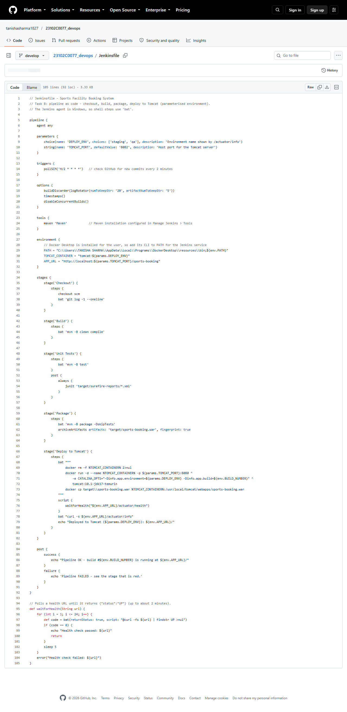
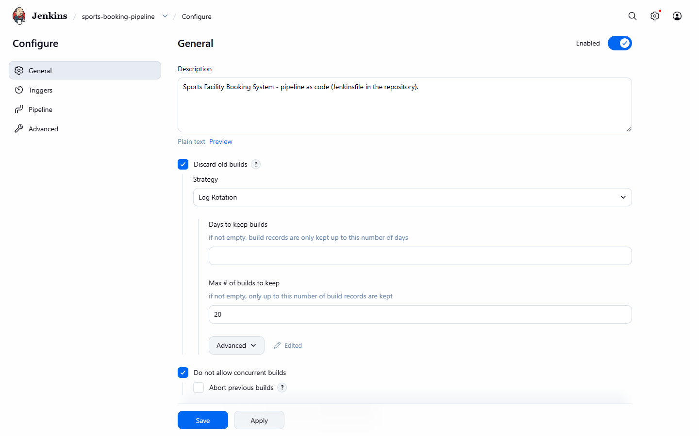
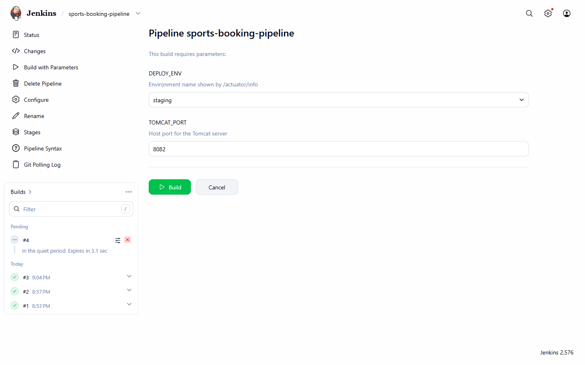
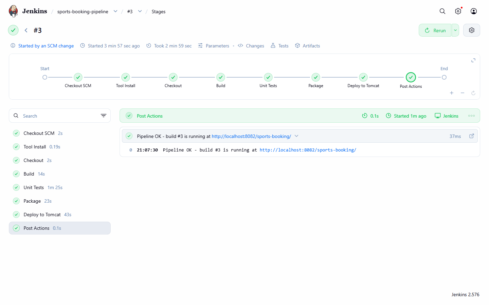
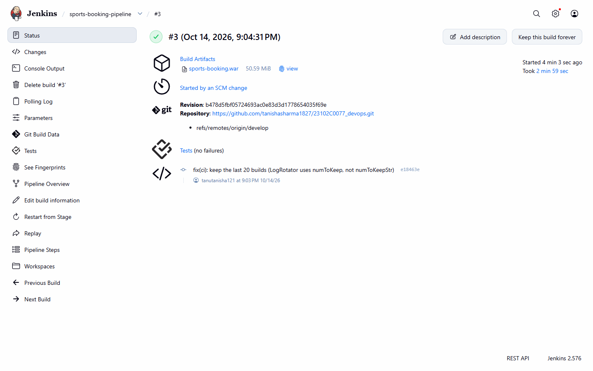
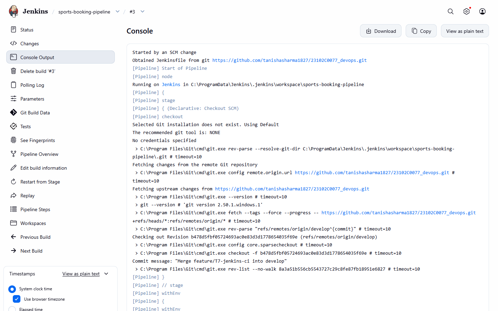
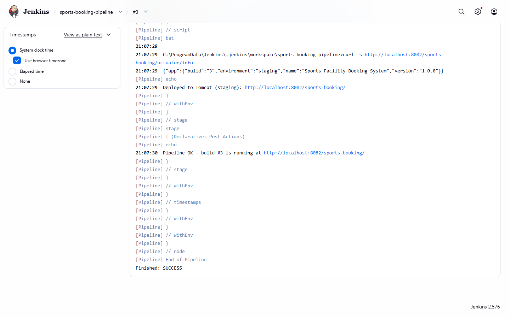
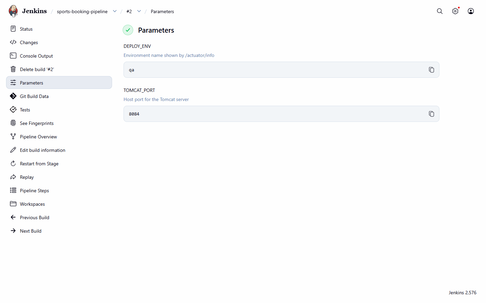
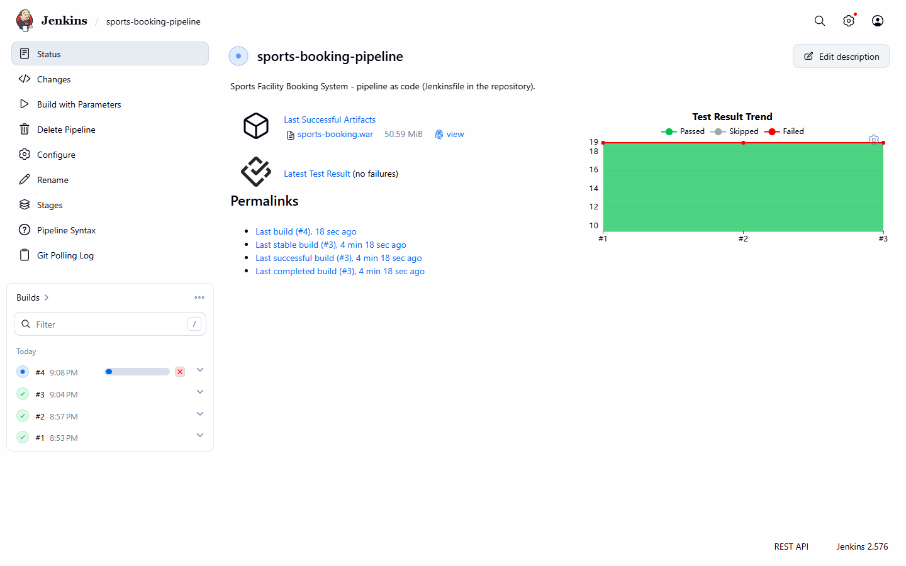
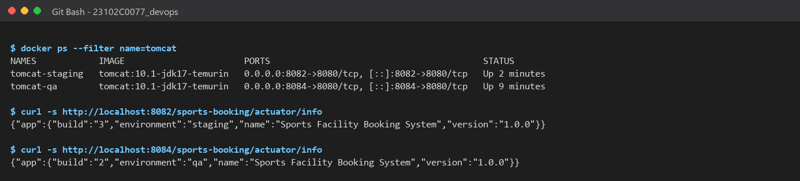

# Task 8: Pipeline as Code and Server Deployment

> **Goal:** Describe the whole build-and-deploy process in a `Jenkinsfile`
> stored in Git, deploy the app to a Tomcat server, and make at least one
> environment setting a parameter.
>
> **Deliverables:** Jenkinsfile, successful pipeline run, deployed application
> URL/screenshot and configuration evidence.

---

## 1. Why "pipeline as code"?

In Task 7 the job was configured by clicking in the Jenkins UI. With a
**Jenkinsfile**, the pipeline is a text file in the repository:

- It is **versioned** with the code. We can see who changed the pipeline, and when.
- It is **reviewed** in pull requests like any other code.
- If Jenkins is reinstalled, the job can be recreated in minutes.

## 2. The Jenkinsfile (repository root)

```groovy
pipeline {
    agent any

    parameters {
        choice(name: 'DEPLOY_ENV', choices: ['staging', 'qa'], description: 'Environment name shown by /actuator/info')
        string(name: 'TOMCAT_PORT', defaultValue: '8082', description: 'Host port for the Tomcat server')
    }
    triggers { pollSCM('H/2 * * * *') }
    options  { buildDiscarder(logRotator(numToKeepStr: '20', artifactNumToKeepStr: '5')); timestamps(); disableConcurrentBuilds() }
    tools    { maven 'Maven' }
    environment {
        PATH = "C:\\Users\\TANISHA SHARMA\\AppData\\Local\\Programs\\DockerDesktop\\resources\\bin;${env.PATH}"
        TOMCAT_CONTAINER = "tomcat-${params.DEPLOY_ENV}"
        APP_URL = "http://localhost:${params.TOMCAT_PORT}/sports-booking"
    }

    stages {
        stage('Checkout')   { steps { checkout scm; bat 'git log -1 --oneline' } }
        stage('Build')      { steps { bat 'mvn -B clean compile' } }
        stage('Unit Tests') { steps { bat 'mvn -B test' }
                              post  { always { junit 'target/surefire-reports/*.xml' } } }
        stage('Package')    { steps { bat 'mvn -B package -DskipTests'
                                      archiveArtifacts artifacts: 'target/sports-booking.war', fingerprint: true } }
        stage('Deploy to Tomcat') {
            steps {
                bat """
                    docker rm -f %TOMCAT_CONTAINER% 2>nul
                    docker run -d --name %TOMCAT_CONTAINER% -p ${params.TOMCAT_PORT}:8080 ^
                        -e CATALINA_OPTS="-Dinfo.app.environment=${params.DEPLOY_ENV} -Dinfo.app.build=${env.BUILD_NUMBER}" ^
                        tomcat:10.1-jdk17-temurin
                    docker cp target\\sports-booking.war %TOMCAT_CONTAINER%:/usr/local/tomcat/webapps/sports-booking.war
                """
                script { waitForHealth("${env.APP_URL}/actuator/health") }
                bat "curl -s ${env.APP_URL}/actuator/info"
            }
        }
    }
}
```

(Full file: [`Jenkinsfile`](../Jenkinsfile). `waitForHealth()` checks
`/actuator/health` every 5 s for up to 2 minutes and fails the stage if the
app never reports `UP`.)

### Stages

| Stage | What it does | Output |
|-------|--------------|--------|
| **Checkout** | Gets the commit that triggered the build | `git log -1` |
| **Build** | `mvn clean compile` | Compiled classes |
| **Unit Tests** | `mvn test`; results published to Jenkins | 19 tests passed |
| **Package** | `mvn package`; WAR archived and fingerprinted | `sports-booking.war` |
| **Deploy to Tomcat** | Starts a fresh **Apache Tomcat 10.1** server, copies the WAR into `webapps/`, waits for the health check | App live at `http://localhost:<TOMCAT_PORT>/sports-booking/` |

### Tomcat deployment

The deployment target is the official **Apache Tomcat 10.1 (JDK 17)** server,
run as a Docker container so Jenkins can create a clean server on every
build. Copying `sports-booking.war` into Tomcat's `webapps/` folder deploys it
at the context path `/sports-booking`. (This works because
`SportsBookingApplication` extends `SpringBootServletInitializer`, so the same
WAR runs standalone or inside Tomcat.)

### Parameterised environment settings

| Parameter | Type | Default | Used for |
|-----------|------|---------|----------|
| `DEPLOY_ENV` | choice: `staging` / `qa` | `staging` | Container name `tomcat-<env>` and the `info.app.environment` setting passed to Tomcat via `CATALINA_OPTS` |
| `TOMCAT_PORT` | string | `8082` | Host port of the Tomcat server, so two environments can run side by side |

The app shows the setting at `/actuator/info`, so we can check which
environment and build is running:

```text
staging (build #3, port 8082):  {"app":{"build":"3","environment":"staging","name":"Sports Facility Booking System","version":"1.0.0"}}
qa      (build #2, port 8084):  {"app":{"build":"2","environment":"qa","name":"Sports Facility Booking System","version":"1.0.0"}}
```

## 3. The Jenkins job

Job **`sports-booking-pipeline`**, type **Pipeline**, definition
**"Pipeline script from SCM"**: Git repository `…/23102C0077_devops.git`,
branch `*/develop`, script path `Jenkinsfile`. Saved in the repo as
[`jenkins/pipeline-job-config.xml`](../jenkins/pipeline-job-config.xml).

## 4. Pipeline runs

| Build | Started by | Parameters | Result |
|-------|-----------|------------|--------|
| #1 | User (first run registers the parameters) | defaults (staging, 8082) | ✅ SUCCESS |
| #2 | User, **Build with Parameters** | `DEPLOY_ENV=qa`, `TOMCAT_PORT=8084` | ✅ SUCCESS |
| #3 | **SCM change** (push to `develop`) | `staging`, `8082` | ✅ SUCCESS, all stages green |

**Deployed application URLs:**

- Staging: <http://localhost:8082/sports-booking/>
- QA: <http://localhost:8084/sports-booking/>

## 5. Evidence (screenshots)

| # | Screenshot |
|---|-----------|
| 01 | Jenkinsfile in the GitHub repository:  |
| 02 | Job: Pipeline script from SCM:  |
| 03 | Build with Parameters (`DEPLOY_ENV`, `TOMCAT_PORT`):  |
| 04 | Stage graph: all stages green:  |
| 05 | Build #3 started by an SCM change:  |
| 06 | Console: Deploy to Tomcat stage:  |
| 07 | Console: health check passed, `Finished: SUCCESS`:  |
| 08 | Build #2 parameters (`qa`, `8084`):  |
| 09 | Pipeline job page:  |
| 10 | App deployed on Tomcat (staging):  |
| 11 | Facilities page served by Tomcat:  |
| 12 | Two environments side by side (`docker ps`, `/actuator/info`):  |
