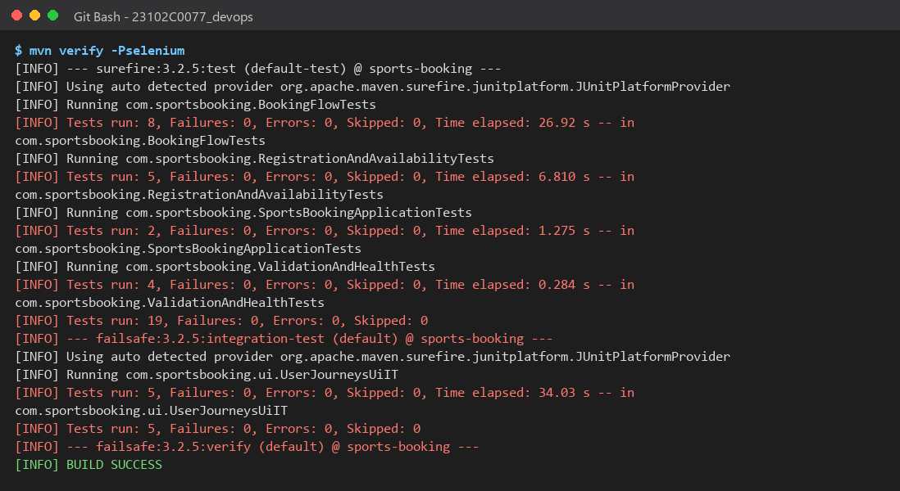
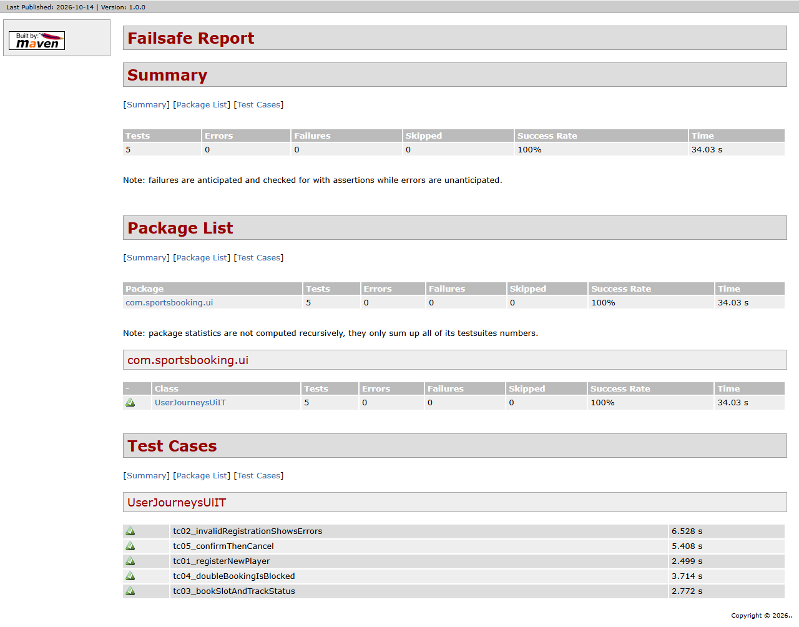
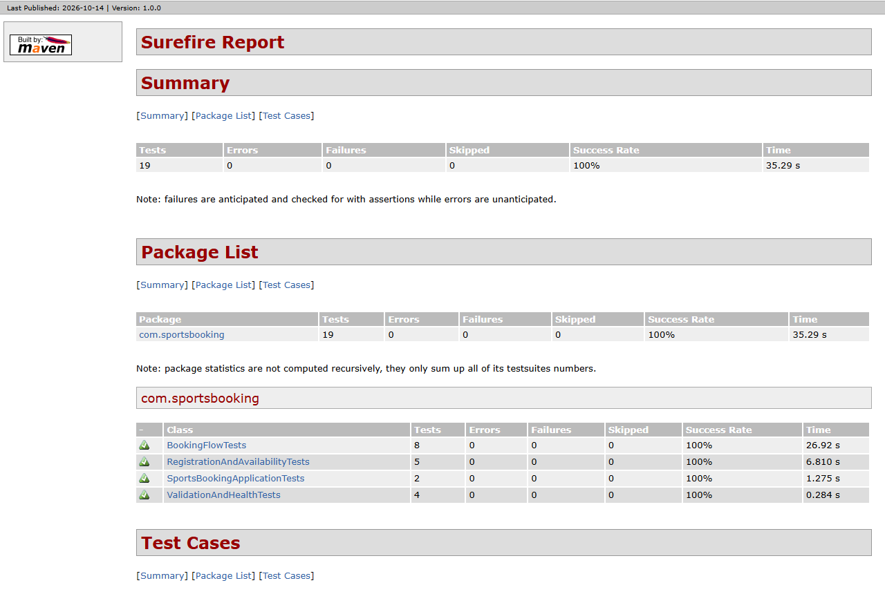
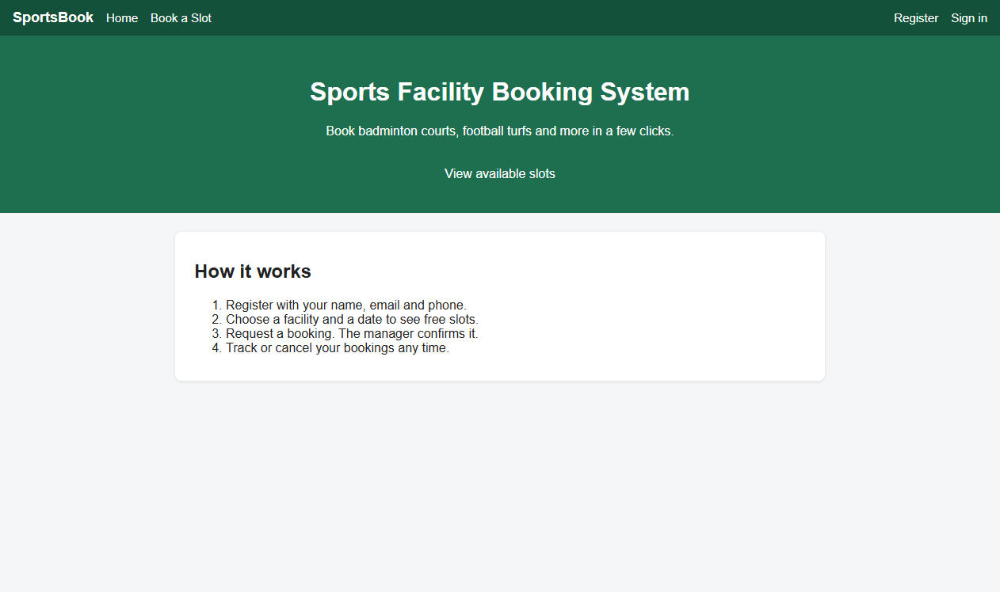

# Task 9: Selenium Test Design and Local Execution

> **Goal:** Pick the most important user journeys, automate them in a real
> browser with Selenium WebDriver, and run them locally through Maven.
>
> **Deliverables:** Test plan, Selenium scripts, local test report and failure
> screenshot mechanism.

---

## 1. Test plan

**Scope:** the 5 journeys a real user depends on most. If any of these break,
the app is not usable.

**Tools:** Selenium WebDriver 4 (Java) + headless Google Chrome + JUnit 5,
run by the Maven **Failsafe** plugin. Selenium Manager downloads a matching
`chromedriver` automatically.

**Environment:** each run starts the app on a random free port inside the test,
so no server needs to be running. To test a deployed server instead, pass
`-Dapp.baseUrl=...` (used in Task 10).

| ID | Journey | Steps | Expected result | Test data |
|----|---------|-------|-----------------|-----------|
| TC-01 | Register | Open Register → fill valid name, email, phone → submit | "Registration successful", nav shows "Hi, Tanisha Sharma", Facilities page | Unique email per run |
| TC-02 | Invalid registration | Submit email `not-an-email`, phone `123` | "Enter a valid email address" and "Phone must be 10 digits" | Invalid values |
| TC-03 | Book and track | Register → open Football Turf (tomorrow) → Book first free slot → My Bookings | Success message with time; My Bookings shows slot as **REQUESTED** | Facility 2, tomorrow |
| TC-04 | No double booking | Player 1 books a slot, signs out. Player 2 opens same date, then forces a POST for the same slot | Slot shows **Booked**; forced request shows "already booked" | Facility 3, tomorrow |
| TC-05 | Confirm and cancel | Player books → manager signs in and **Confirms** → player sees **CONFIRMED** → **Cancel** | Status **CANCELLED**, slot shows **Available** again | Facility 1, day after tomorrow; manager `manager@sports.local` |

**Entry criteria:** `mvn clean package` passes (unit tests green).
**Exit criteria:** all 5 UI tests pass; any failure produces a screenshot.

## 2. Selenium scripts

| File | Purpose |
|------|---------|
| `src/test/java/com/sportsbooking/ui/BaseUiTest.java` | Starts Chrome (headless), finds the base URL, and holds helper steps such as `register()`, `signIn()`, `signOut()`, `bookFirstFreeSlot()` |
| `src/test/java/com/sportsbooking/ui/UserJourneysUiIT.java` | The 5 test cases TC-01 to TC-05 |
| `src/test/java/com/sportsbooking/ui/ScreenshotOnFailure.java` | JUnit 5 extension that saves a screenshot when a test fails |

Example (TC-03):

```java
@Test
@DisplayName("TC-03 Player books a free slot and sees it as REQUESTED in My Bookings")
void tc03_bookSlotAndTrackStatus() {
    register("Ravi Kumar", uniqueEmail("ravi"), "9876543211");

    String time = bookFirstFreeSlot(2, TOMORROW);

    assertThat(flashMessage()).contains("Booking requested").contains(time);
    find("#nav-my-bookings").click();
    assertThat(find("#bookings-table").getText()).contains("Football Turf", time, "REQUESTED");
}
```

Every element has a stable `id` in the HTML (for example `#register-submit` and
`#nav-my-bookings`), so the tests don't break when text or styling changes.
Waits use `WebDriverWait` (up to 10 s) instead of fixed sleeps.

## 3. Failure screenshot mechanism

`ScreenshotOnFailure` is a JUnit 5 `TestWatcher`. When a test fails it:

1. takes a screenshot of the browser,
2. saves it as `target/selenium-screenshots/<TestClass>_<testMethod>.png`,
3. prints the path in the Maven output, then closes the browser.

**It worked during development.** The first run of TC-05 failed because the
test opened the sign-in page before the sign-out redirect had finished.
The saved screenshot (`04-failure-screenshot-captured.png`) showed the browser
was still on the home page, which explained the problem straight away.
**Fix:** `signOut()` now waits until the "Register" link is visible. All 5
tests then passed.

## 4. How to run locally

```bash
mvn verify -Pselenium                           # unit tests + 5 Selenium tests (headless)
mvn verify -Pselenium -Dselenium.headless=false # watch Chrome do the steps
mvn verify -Pselenium -Dapp.baseUrl=http://localhost:8082/sports-booking   # test a deployed server

# HTML reports
mvn surefire-report:failsafe-report-only surefire-report:report-only
#   -> target/site/failsafe-report.html  and  target/site/surefire-report.html
```

The `selenium` Maven profile adds the Failsafe plugin, which runs classes ending in
`UiIT` during `integration-test` and fails the build in `verify`.
A plain `mvn package` still runs only the fast unit tests.

## 5. Local test report

| Suite | Tests | Failures | Errors | Result |
|-------|-------|----------|--------|--------|
| Unit tests (Surefire) | 19 | 0 | 0 | ✅ |
| Selenium UI tests (Failsafe) | 5 | 0 | 0 | ✅ |

## 6. Evidence (screenshots)

| # | Screenshot |
|---|-----------|
| 01 | `mvn verify -Pselenium`: 19 unit + 5 UI tests pass:  |
| 02 | Failsafe HTML report (Selenium):  |
| 03 | Surefire HTML report (unit tests):  |
| 04 | Screenshot captured automatically by the failure mechanism:  |
