# Task 10: Continuous Testing in Jenkins

> **Goal:** Run the Selenium suite automatically in the Jenkins pipeline,
> publish the reports, and make sure failed tests **stop deployment**. Then put
> a defect in on purpose, watch the pipeline catch it, fix it and rerun.
>
> **Deliverables:** Jenkins test report, failed pipeline evidence, defect
> correction commit and successful rerun.

---

## 1. New pipeline stages

The Task 8 `Jenkinsfile` got two more stages:

```text
Checkout → Build → Unit Tests → Package → Deploy to Tomcat (staging :8082)
        → Selenium Tests (against staging) → Deploy to Production (:8086)
```

```groovy
// Browser tests against the server that was just deployed.
// If any Selenium test fails, this stage fails and the production stage below is skipped.
stage('Selenium Tests') {
    steps {
        bat "mvn -B verify -Pselenium -Dapp.baseUrl=${env.APP_URL} -Dtest=NoUnitTests -Dsurefire.failIfNoSpecifiedTests=false"
    }
    post {
        always {
            junit 'target/failsafe-reports/*.xml'                                   // publish test report
            archiveArtifacts artifacts: 'target/selenium-screenshots/*.png', allowEmptyArchive: true   // failure screenshots
        }
        failure {
            echo 'Selenium tests FAILED - deployment to production is blocked. See Tests and the archived screenshots.'
        }
    }
}

stage('Deploy to Production') {
    steps {
        // fresh Tomcat on port 8086 with environment=production, then health check
    }
}
```

| Setting | Meaning |
|---------|---------|
| `-Pselenium` | Turns on the Failsafe plugin that runs the 5 `*UiIT` browser tests (Task 9) |
| `-Dapp.baseUrl=http://localhost:8082/sports-booking` | Tests run against the **real deployed staging server**, not a local copy |
| `-Dtest=NoUnitTests ...` | Skips the unit tests here (they already passed in the Unit Tests stage) |
| `junit 'target/failsafe-reports/*.xml'` | Jenkins shows the Selenium results on the **Tests** page and in the trend graph |
| `archiveArtifacts .../selenium-screenshots/*.png` | Failure screenshots can be downloaded from the build |

**How "failed tests stop deployment" works:** in a declarative pipeline, when
one stage fails, all later stages are **skipped**. Because *Deploy to
Production* comes after *Selenium Tests*, broken code can never reach
production.

## 2. Pipeline history for this task

| Build | Commit | What happened | Production |
|-------|--------|---------------|------------|
| #6 | `ci: run Selenium tests on staging...` | ❌ Selenium stage failed: **environment problem**. The Jenkins service got a ChromeDriver for Chrome 151, but Chrome 155 is installed | Not deployed (skipped) |
| #7 | `fix(test): upgrade Selenium to 4.51.0...` | ✅ All stages green, 5/5 Selenium tests passed | **Deployed** (build 7) |
| #8 | `feat(M13): rename 'My Bookings' menu item...` (**deliberate defect**) | ❌ 19/19 unit tests passed, but **Selenium TC-03 and TC-05 failed** | **Blocked**: still build 7 |
| #9 | `fix(M13): point 'My Reservations' link back to /bookings/my` (**defect correction**) | ✅ All stages green, 5/5 Selenium tests passed | **Deployed** (build 9) |

All four builds were started automatically by **SCM polling** after the push.

## 3. The deliberate defect

A small UI change: rename the menu item "My Bookings" to "My Reservations".
While doing it, the link URL was "accidentally" changed too:

```diff
- <a id="nav-my-bookings" th:if="${currentUser != null}" th:href="@{/bookings/my}">My Bookings</a>
+ <a id="nav-my-bookings" th:if="${currentUser != null}" th:href="@{/bookings/mine}">My Reservations</a>
```

- **Unit tests: 19 / 19 passed.** They call `/bookings/my` directly and never
  click the menu, so they can't see this bug.
- **Selenium: 2 errors.** TC-03 and TC-05 click the menu link like a real
  user, land on a **404 page**, and can't find `#bookings-table`:

```text
[selenium] Failure screenshot saved: ...\selenium-screenshots\UserJourneysUiIT_tc05_confirmThenCancel.png
[selenium] Failure screenshot saved: ...\selenium-screenshots\UserJourneysUiIT_tc03_bookSlotAndTrackStatus.png
[ERROR] Tests run: 5, Failures: 0, Errors: 2, Skipped: 0
Selenium tests FAILED - deployment to production is blocked. See Tests and the archived screenshots.
Stage "Deploy to Production" skipped due to earlier failure(s)
Finished: FAILURE
```

The archived failure screenshot shows the 404 "Whitelabel Error Page",
which points straight at the broken link.

## 4. Defect correction and rerun

Branch `bugfix/M13-my-reservations-link`, commit
`fix(M13): point 'My Reservations' link back to /bookings/my`:

```diff
- th:href="@{/bookings/mine}">My Reservations</a>
+ th:href="@{/bookings/my}">My Reservations</a>
```

Build **#9** (started by SCM change): every stage green, **5/5 Selenium tests
passed**, and production was updated:

```text
production after build #8:  {"app":{"build":"7","environment":"production",...}}   <- defect never reached production
production after build #9:  {"app":{"build":"9","environment":"production",...}}
```

## 5. What this shows

1. **Unit tests alone are not enough.** This defect was only visible when a
   real browser clicked through the app.
2. **Testing the deployed server** finds problems that only show up after
   deployment, such as wrong links, missing pages and configuration.
3. **The quality gate works.** A red Selenium stage kept the bad build out of
   production, and users kept the last good version (build 7).
4. **Feedback is fast.** The failure screenshot and test report told us
   exactly what was broken, so the fix took one line.

## 6. Evidence (screenshots)

| # | Screenshot |
|---|-----------|
| 01 | Jenkinsfile: Selenium and production stages: 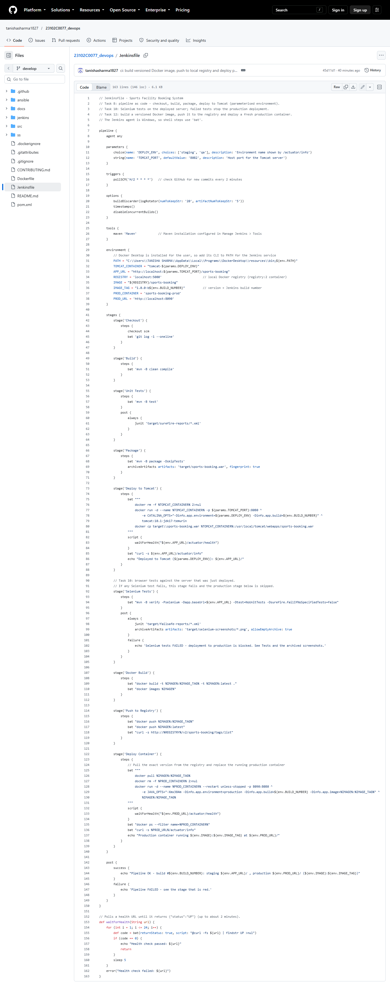 |
| 02 | Deliberate defect commit: 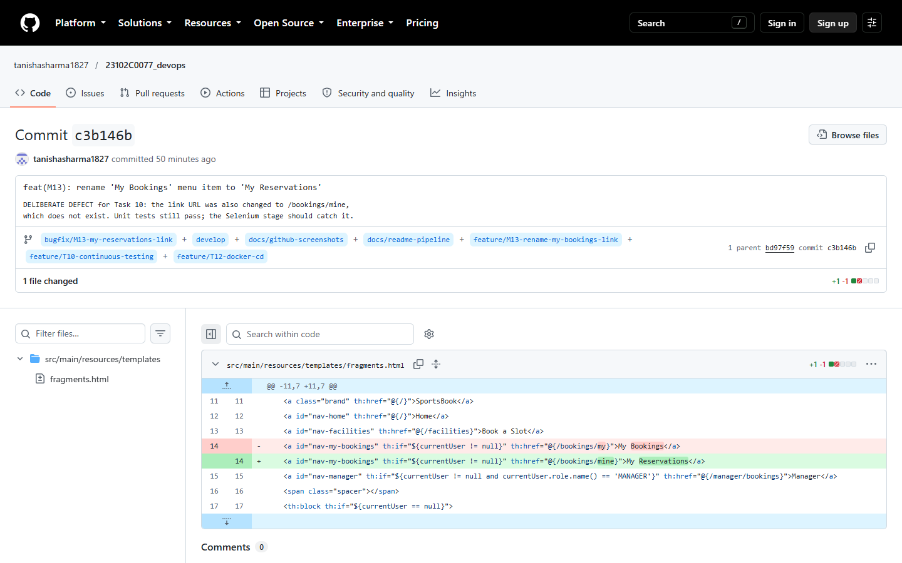 |
| 03 | Build #8: Selenium Tests red, Deploy to Production skipped: 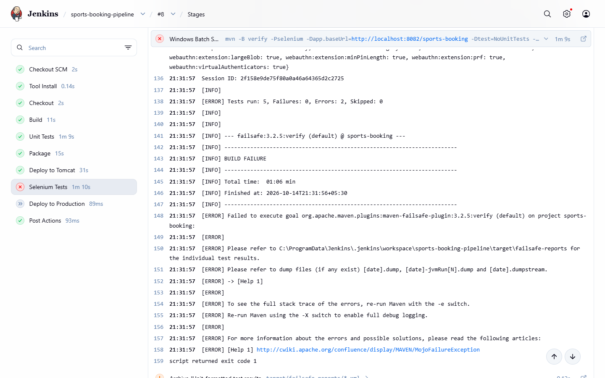 |
| 04 | Build #8 test report: 2 failures: 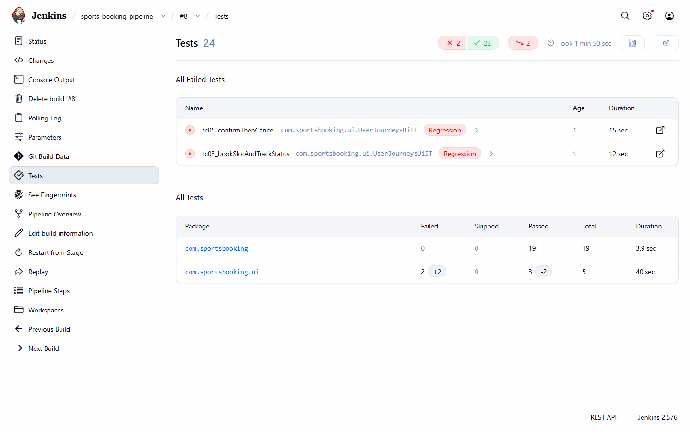 |
| 05 | Failed test detail (TC-03): 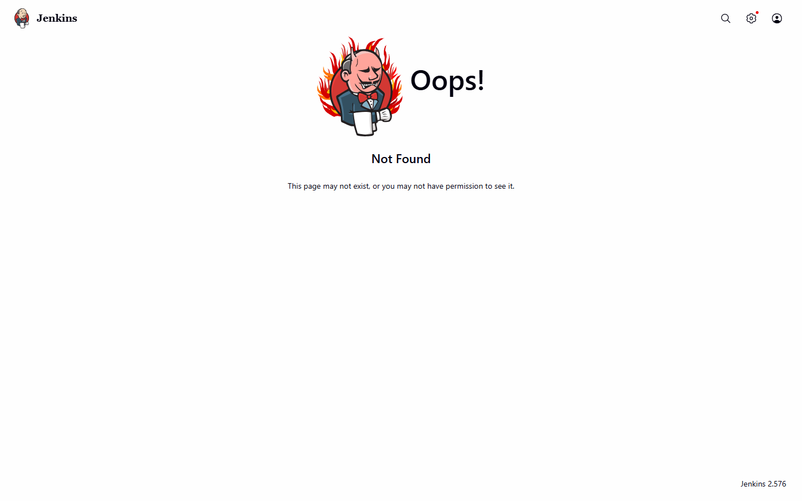 |
| 06 | Build #8 console: "deployment to production is blocked": 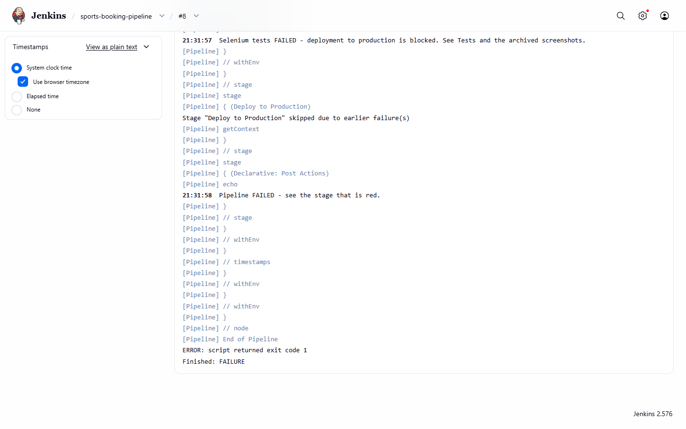 |
| 07 | Failure screenshot archived by Jenkins (404 page): 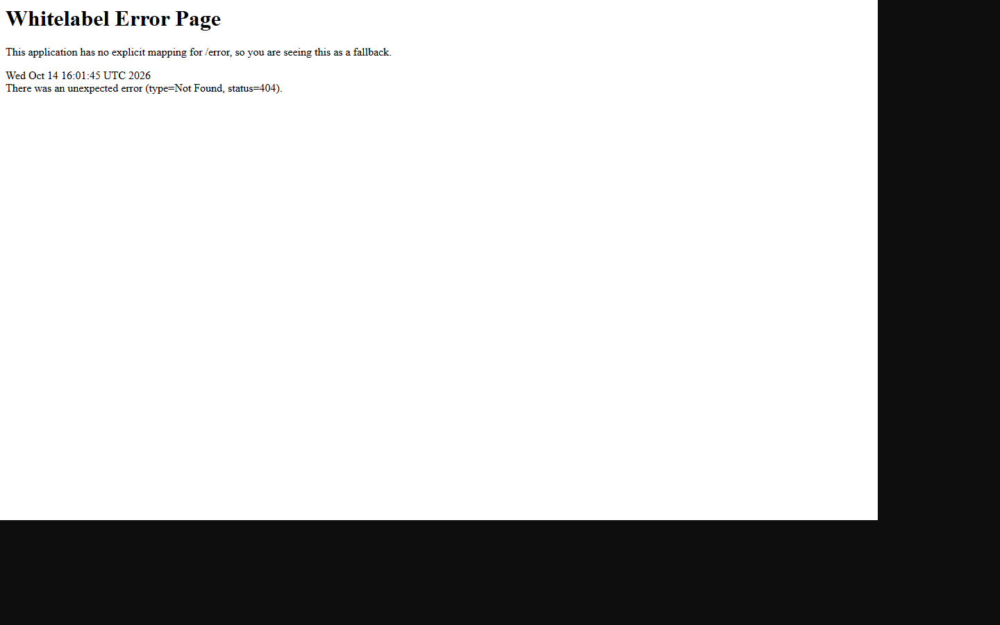 |
| 08 | Defect correction commit: 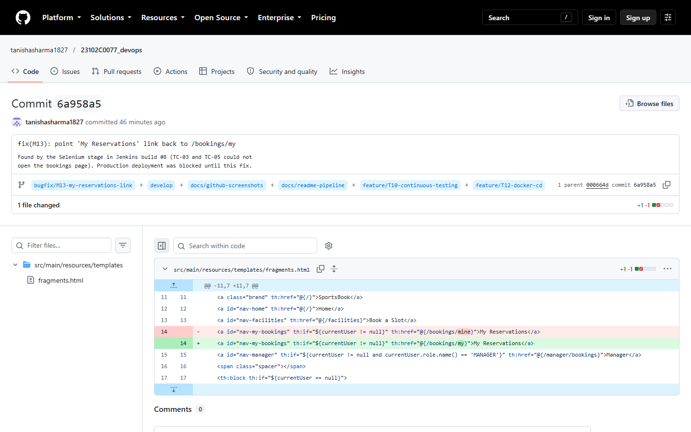 |
| 09 | Build #9: all stages green: 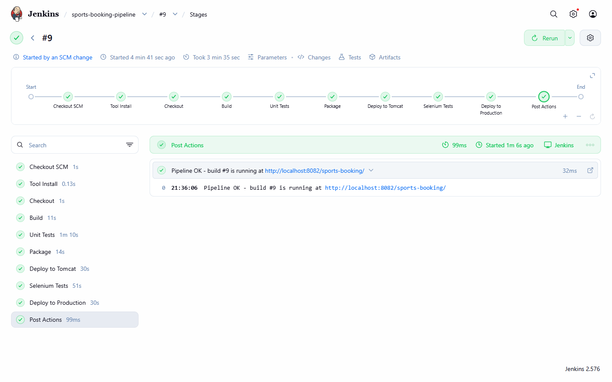 |
| 10 | Build #9 test report: all passed: 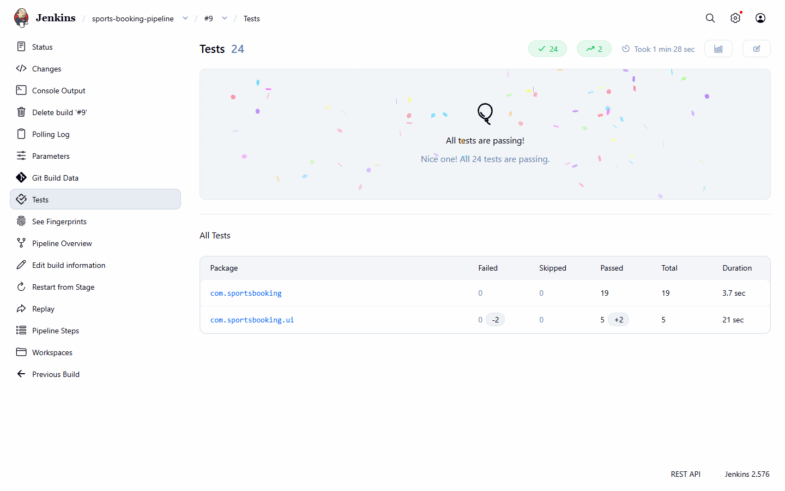 |
| 11 | Pipeline history: #8 red, #9 green, test trend: 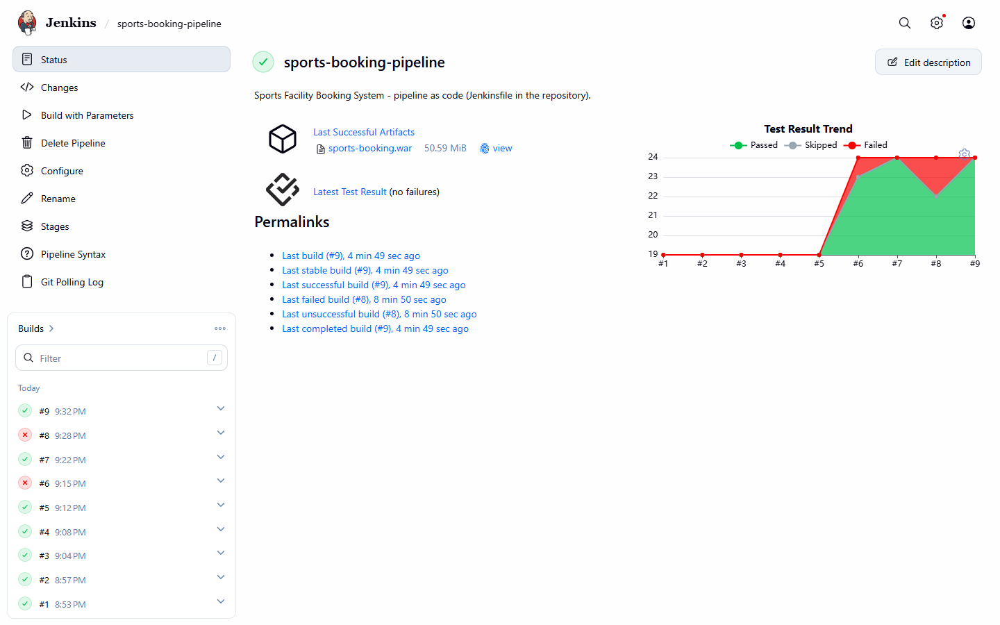 |
| 12 | Production app after the fix:  |
| 13 | Production build number before and after: 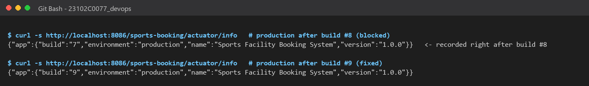 |
