# Task 11: Docker Image and Container Lifecycle

> **Goal:** Package the app as a Docker image, run it as a container, and go
> through the full container lifecycle.
>
> **Deliverables:** Dockerfile, image details, Docker command log and running
> container evidence.

---

## 1. What is Docker doing here?

- An **image** is a read-only package: the operating system layer, Java 17
  and our `app.war`. It's built once.
- A **container** is a running copy of an image. We can start, stop, restart
  and delete containers without touching the image.
- Because the image has everything inside it, the app runs **the same way on
  any machine** that has Docker. That solves the "works on my machine" problem.

## 2. Dockerfile

```dockerfile
FROM eclipse-temurin:17-jre                      # 1. base image: Ubuntu + Java 17 runtime

LABEL org.opencontainers.image.title="sports-booking" ...

RUN groupadd --system app && useradd --system --gid app --home /app app   # 2. non-root user
WORKDIR /app

COPY --chown=app:app target/sports-booking.war app.war                     # 3. our app

USER app                                         # 4. run as 'app', not root

ENV SERVER_PORT=8080 JAVA_OPTS="-Xms128m -Xmx384m"
EXPOSE 8080                                      # 5. app port inside the container

HEALTHCHECK --interval=15s --timeout=5s --start-period=60s --retries=3 \
  CMD curl -fs http://localhost:8080/actuator/health | grep -q UP || exit 1   # 6. health

ENTRYPOINT ["sh", "-c", "exec java $JAVA_OPTS -jar /app/app.war"]          # 7. start command
```

| Line | Why |
|------|-----|
| `FROM eclipse-temurin:17-jre` | Official Java 17 runtime image. It's a JRE, not a JDK, so the image stays smaller |
| `useradd` + `USER app` | Security: if the app is attacked, the attacker is not root |
| `COPY target/sports-booking.war` | Maven builds the WAR first; Docker just packages it |
| `ENV SERVER_PORT=8080` | The app reads this (`server.port=${SERVER_PORT:8081}`), so the container always uses 8080 |
| `HEALTHCHECK` | Docker marks the container **healthy** or **unhealthy** using `/actuator/health` |
| `exec java ...` | Java becomes process 1, so `docker stop` shuts it down cleanly |

`.dockerignore` sends only `target/sports-booking.war` to Docker, which makes the build fast.

## 3. Image details

| Property | Value |
|----------|-------|
| Name : tags | `sports-booking:1.0.0` (+ `sports-booking:latest`) |
| Base image | `eclipse-temurin:17-jre` (Ubuntu, Temurin 17.0.20) |
| Content size | 160 MB (538 MB unpacked on disk) |
| Exposed port | 8080 |
| Runs as user | `app` |
| Health check | `GET /actuator/health` every 15 s |

## 4. Container lifecycle: command log

```bash
mvn clean package                                            # build the WAR

docker build -t sports-booking:1.0.0 .                       # 1. BUILD the image
docker tag sports-booking:1.0.0 sports-booking:latest        # 2. TAG it
docker images sports-booking                                 #    list images

docker run -d --name sports-booking -p 8090:8080 sports-booking:1.0.0   # 3. RUN (host 8090 -> container 8080)
docker ps --filter name=sports-booking                       #    status: Up (healthy)
docker logs --tail 12 sports-booking                         # 4. LOGS
curl http://localhost:8090/actuator/health                   #    {"status":"UP"}
docker inspect --format "..." sports-booking                 # 5. INSPECT (health, user, ports)
docker exec sports-booking sh -c "whoami && ls -la /app && java -version"   # 6. EXEC inside

docker stop sports-booking                                   # 7. STOP  -> Exited (143)
docker ps -a --filter name=sports-booking
docker start sports-booking                                  # 8. START again
docker restart sports-booking                                # 9. RESTART
docker stats --no-stream sports-booking                      # 10. resource usage

docker rm -f sports-booking                                  # 11. REMOVE the container
docker rmi sports-booking:latest                             # 12. REMOVE an image tag
```

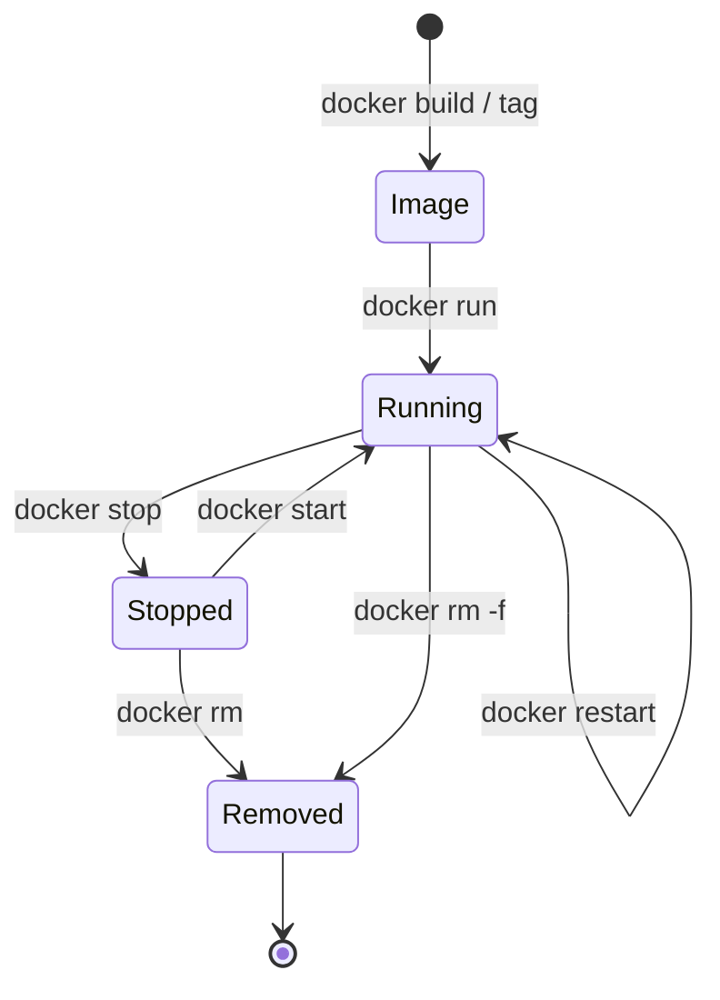

**Port 8090?** Jenkins already uses 8080 on this laptop, so the container's port
8080 is published on host port **8090**: <http://localhost:8090>.

## 5. Results

| Check | Result |
|-------|--------|
| Image builds | ✅ `sports-booking:1.0.0` |
| Container starts | ✅ Spring Boot started in about 12 s |
| Docker health status | ✅ `healthy` |
| App reachable from host | ✅ <http://localhost:8090> |
| Runs as non-root | ✅ `whoami` → `app` |
| Stop / start / restart | ✅ healthy again after restart |
| Memory use | about 314 MiB |

## 6. Evidence (screenshots)

| # | Screenshot |
|---|-----------|
| 01 | `docker build`: 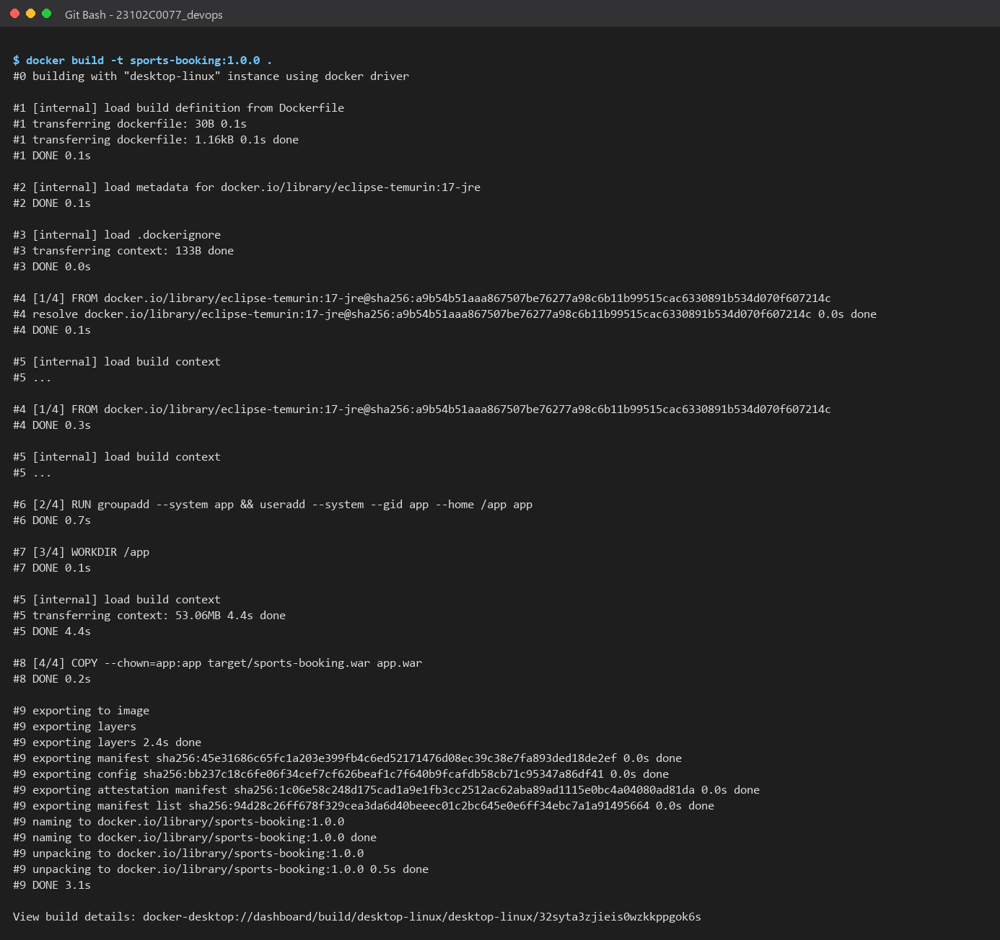 |
| 02 | `docker tag` and `docker images`: 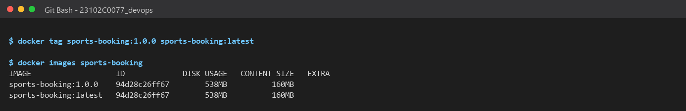 |
| 03 | `docker run` and `docker ps` (healthy): 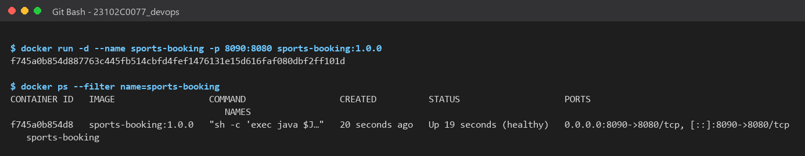 |
| 04 | `docker logs`: 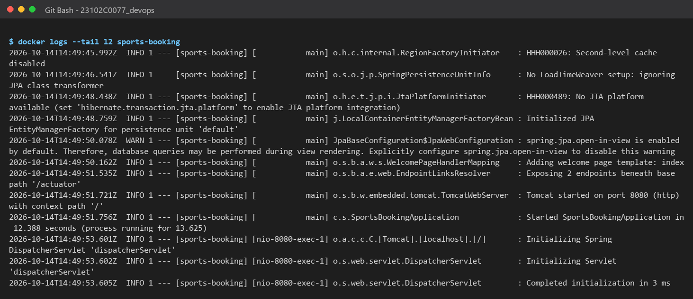 |
| 05 | Health check from host and `docker inspect`: 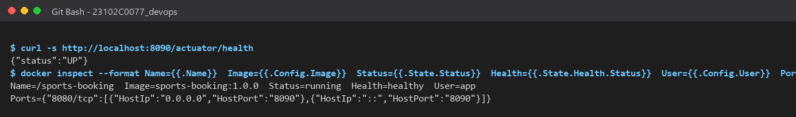 |
| 06 | `docker exec` inside the container: 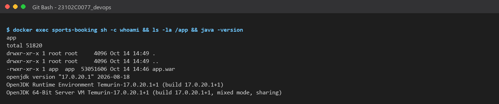 |
| 07 | Stop, start, restart: 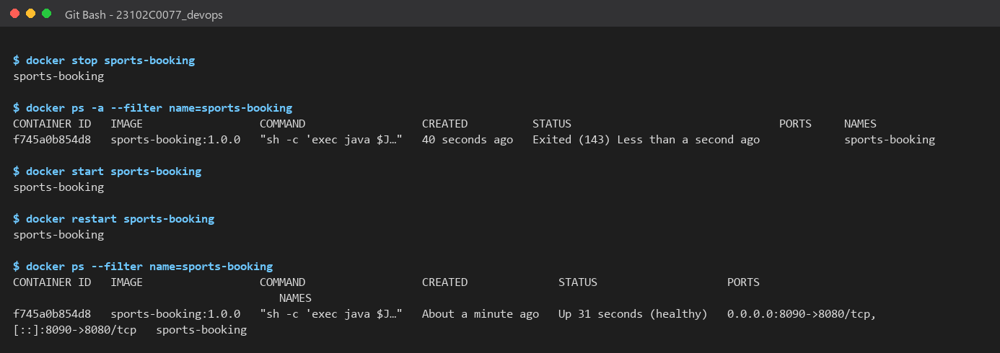 |
| 08 | App in the browser from the container (port 8090): 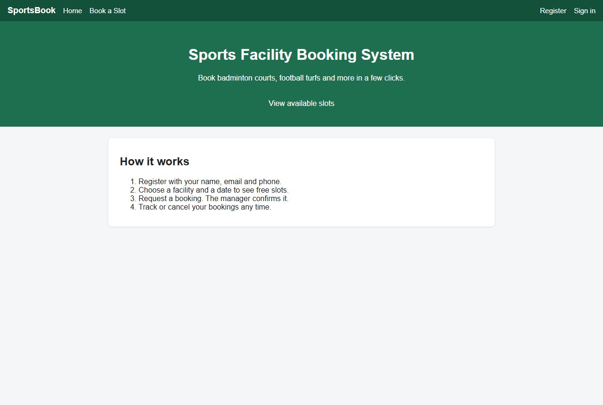 |
| 09 | Slots page served by the container: 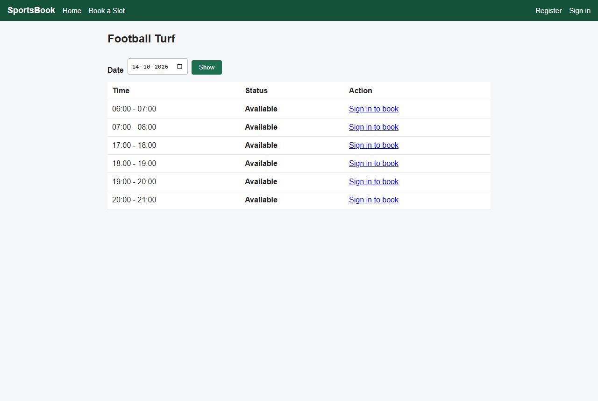 |
| 10 | `docker stats`: 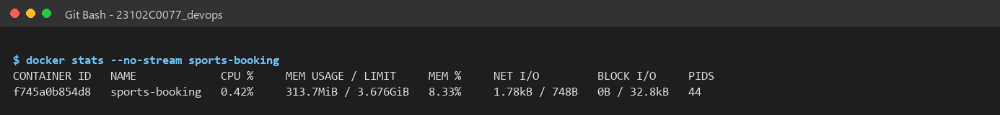 |
| 11 | Remove container and image tag: 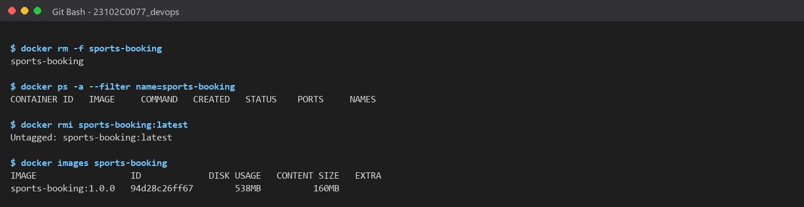 |

> **Optional, add yourself:** Docker Desktop → **Containers** and **Images** tabs.
