# Task 12: Jenkins-Docker Continuous Deployment

> **Goal:** Extend the pipeline so that after the tests pass, Jenkins builds a
> **versioned Docker image**, publishes it to a registry, and automatically
> deploys a **fresh container**.
>
> **Deliverables:** Versioned image, registry evidence and an end-to-end
> commit-to-container pipeline.

---

## 1. The complete pipeline

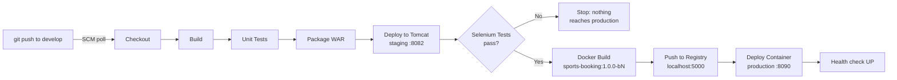

A single `git push` goes all the way to a running production container. There
are **no manual steps**.

## 2. New Jenkinsfile stages

```groovy
environment {
    REGISTRY       = 'localhost:5000'                  // local Docker registry
    IMAGE          = "${REGISTRY}/sports-booking"
    IMAGE_TAG      = "1.0.0-b${env.BUILD_NUMBER}"      // app version + Jenkins build number
    PROD_CONTAINER = 'sports-booking-prod'
    PROD_URL       = 'http://localhost:8090'
}

stage('Docker Build') {
    steps {
        bat "docker build -t %IMAGE%:%IMAGE_TAG% -t %IMAGE%:latest ."
        bat "docker images %IMAGE%"
    }
}

stage('Push to Registry') {
    steps {
        bat "docker push %IMAGE%:%IMAGE_TAG%"
        bat "docker push %IMAGE%:latest"
        bat "curl -s http://%REGISTRY%/v2/sports-booking/tags/list"
    }
}

stage('Deploy Container') {
    steps {
        bat """
            docker pull %IMAGE%:%IMAGE_TAG%
            docker rm -f %PROD_CONTAINER% 2>nul
            docker run -d --name %PROD_CONTAINER% --restart unless-stopped -p 8090:8080 ^
                -e JAVA_OPTS="-Xmx384m -Dinfo.app.environment=production -Dinfo.app.build=${env.BUILD_NUMBER} -Dinfo.app.image=%IMAGE%:%IMAGE_TAG%" ^
                %IMAGE%:%IMAGE_TAG%
        """
        script { waitForHealth("${env.PROD_URL}/actuator/health") }
        bat "docker ps --filter name=%PROD_CONTAINER%"
        bat "curl -s %PROD_URL%/actuator/info"
    }
}
```

| Decision | Reason |
|----------|--------|
| **Tag = `1.0.0-b<build>`** plus `latest` | Every build gets its own image version, so any earlier version can be redeployed (`docker run ...:1.0.0-b11`) |
| **Local registry** (`registry:2` on port 5000) instead of Docker Hub | No account or password is needed, and it works offline. The task allows "Docker Hub **or a local registry**". To switch to Docker Hub, change `REGISTRY` to your Docker Hub username and add a `docker login` step with a Jenkins credential |
| `docker pull` before `docker run` | Production runs the image **from the registry**, the same way a separate production server would |
| `docker rm -f` then `docker run` | Every deploy creates a **fresh container**. Nothing is left over from the previous version |
| `--restart unless-stopped` | The container starts again if Docker or the PC restarts |
| Health check after deploy | The build fails if the new container doesn't report `UP` |
| Docker stages come **after** Selenium | A broken build never becomes an image (Task 10's quality gate still applies) |

The Dockerfile from Task 11 is reused unchanged.

### Local registry setup (one time)

```bash
docker run -d --name registry --restart unless-stopped -p 5000:5000 registry:2
curl http://localhost:5000/v2/_catalog       # {"repositories":[]}
```

## 3. Results

| Build | Started by | Image | Result |
|-------|-----------|-------|--------|
| #11 | SCM change (`ci: build versioned Docker image, push to local registry...`) | `localhost:5000/sports-booking:1.0.0-b11` | ✅ all 11 stages green, container deployed |
| #12 | SCM change (`docs: describe the CI/CD pipeline ... in README`) | `localhost:5000/sports-booking:1.0.0-b12` | ✅ all stages green, container **replaced** with b12 |

**Registry evidence:**

```text
$ curl -s http://localhost:5000/v2/_catalog
{"repositories":["sports-booking"]}

$ curl -s http://localhost:5000/v2/sports-booking/tags/list
{"name":"sports-booking","tags":["1.0.0-b12","latest","1.0.0-b11"]}
```

**Production container after build #12:**

```text
$ docker ps --filter name=sports-booking-prod
IMAGE                                     STATUS                    PORTS
localhost:5000/sports-booking:1.0.0-b12   Up 17 seconds (healthy)   0.0.0.0:8090->8080/tcp

$ curl -s http://localhost:8090/actuator/info
{"app":{"image":"localhost:5000/sports-booking:1.0.0-b12","build":"12","environment":"production",
        "name":"Sports Facility Booking System","version":"1.0.0"}}
```

The info endpoint shows **which image and build** is live in production, so
any running container can be traced back to its Jenkins build and Git commit.

## 4. End-to-end timing (build #12)

| Stage | Time |
|-------|------|
| Checkout + Build | ~15 s |
| Unit Tests (19) | 1 min 9 s |
| Package | 14 s |
| Deploy to Tomcat (staging) | 35 s |
| Selenium Tests (5) | 51 s |
| Docker Build | 24 s |
| Push to Registry | 6 s |
| Deploy Container | 20 s |
| **Total, commit → production** | **about 4 minutes** |

## 5. Evidence (screenshots)

| # | Screenshot |
|---|-----------|
| 01 | Jenkinsfile Docker stages on GitHub: 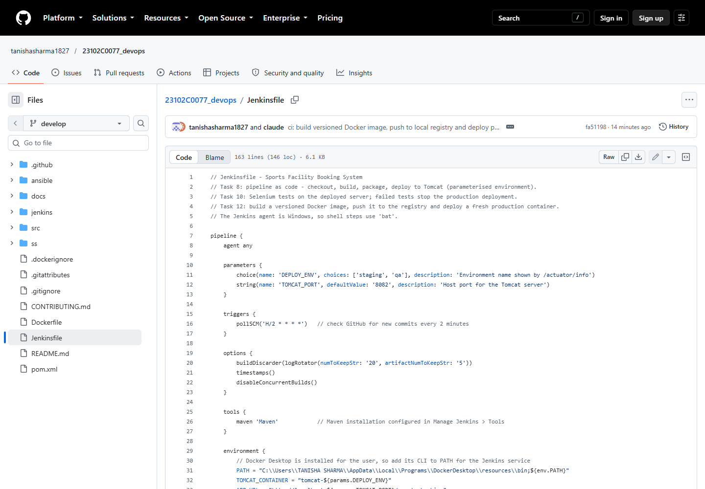 |
| 02 | Build #12: commit-to-container, all stages green: 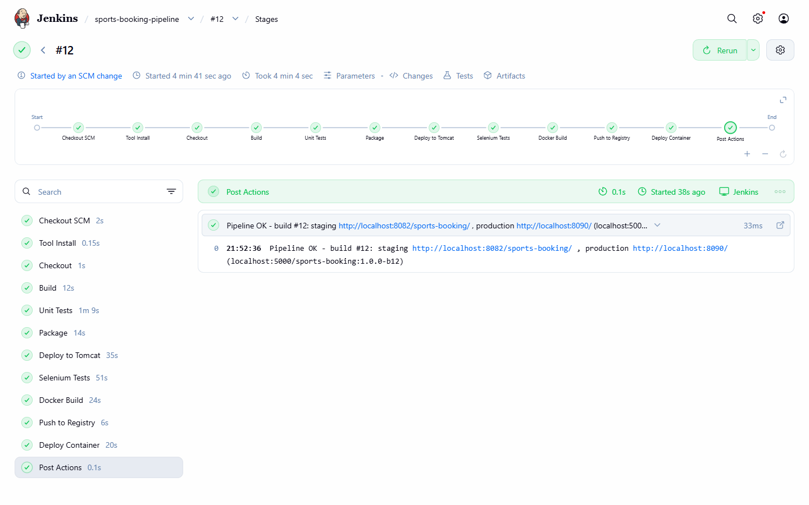 |
| 03 | Console: Docker Build: 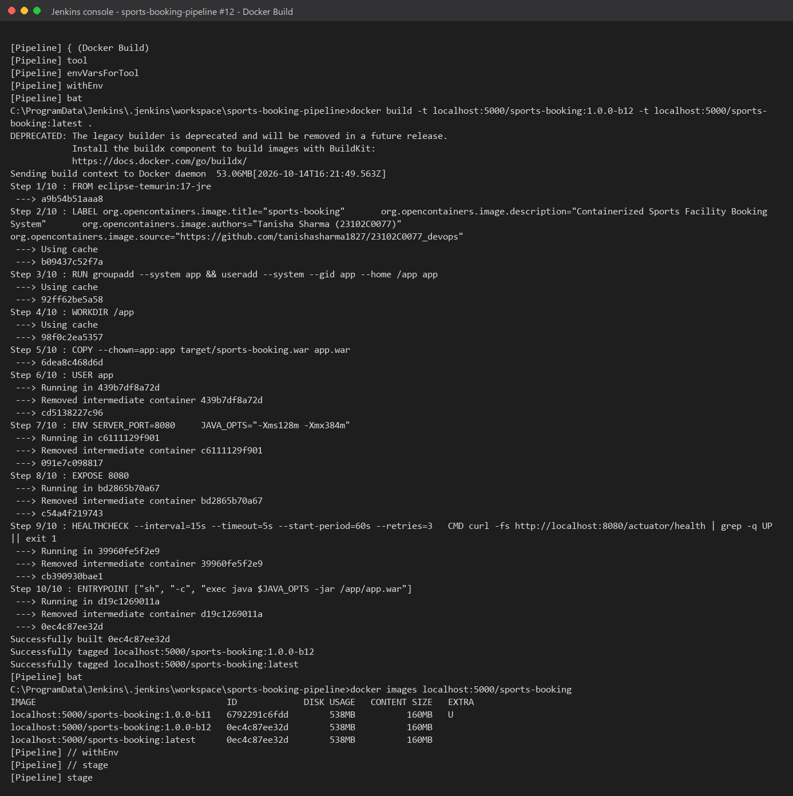 |
| 04 | Console: Push to Registry + tag list: 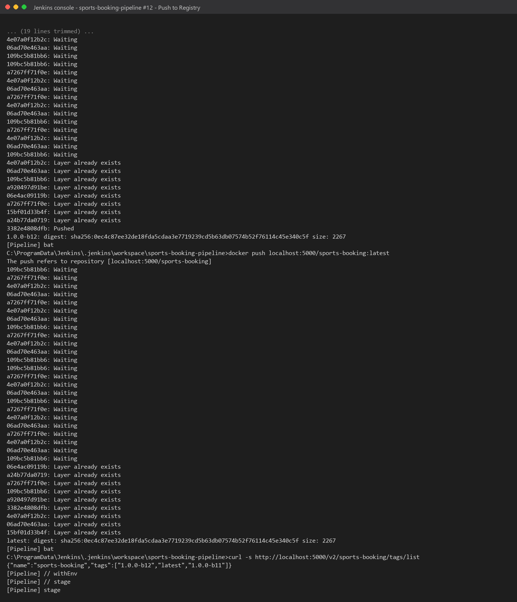 |
| 05 | Console: Deploy Container + health check: 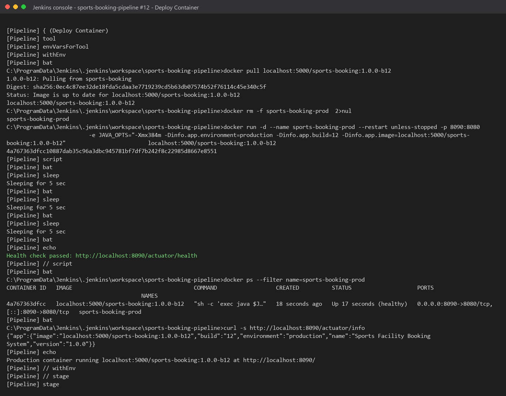 |
| 06 | Console: `Finished: SUCCESS`: 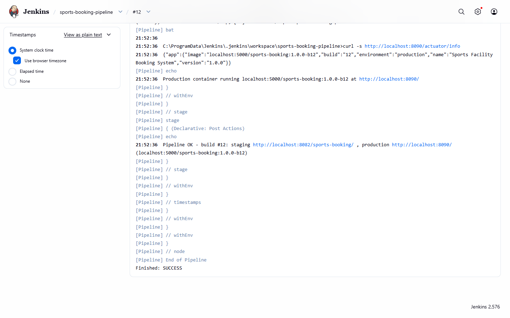 |
| 07 | Pipeline job history: 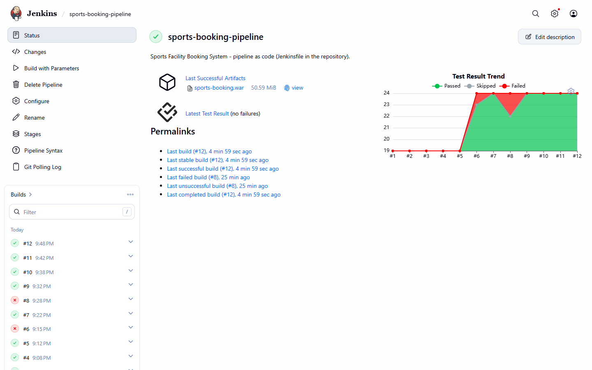 |
| 08 | Production app served by the container (port 8090): 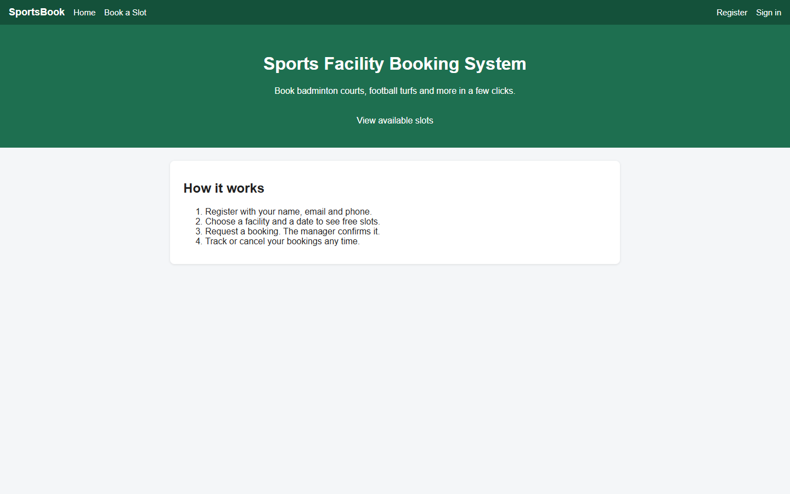 |
| 09 | Production facilities page: 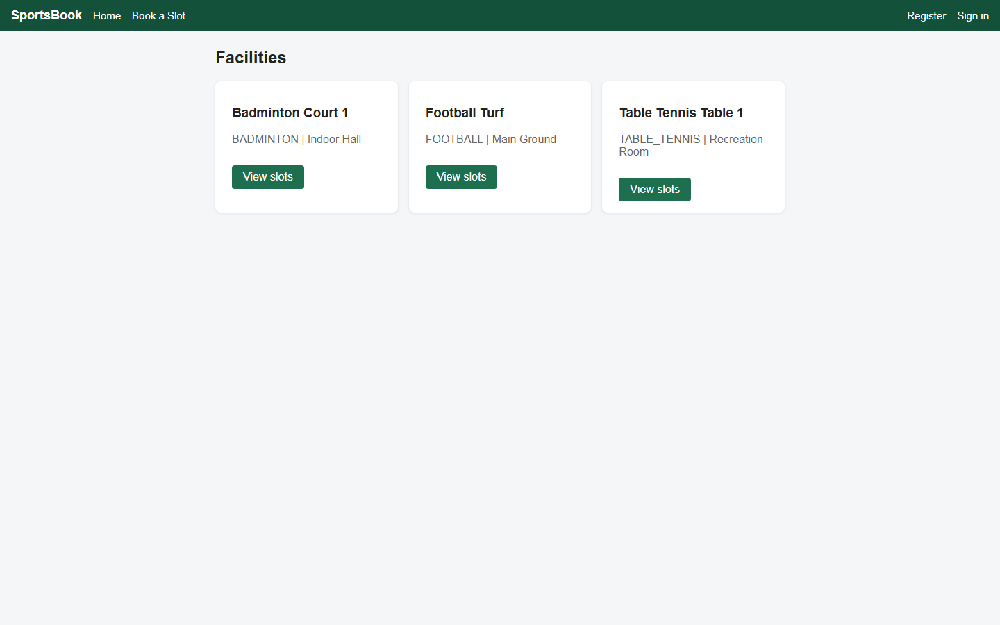 |
| 10 | Registry: catalog, versioned tags, images: 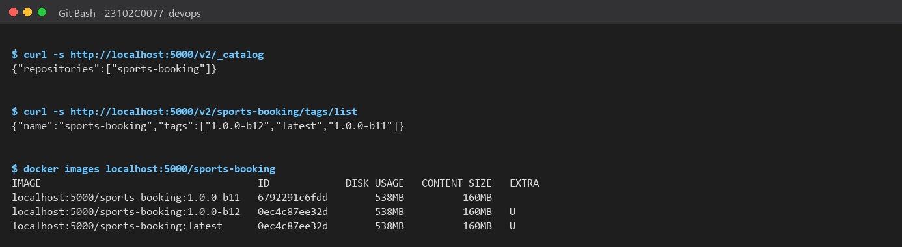 |
| 11 | Production container running and healthy: 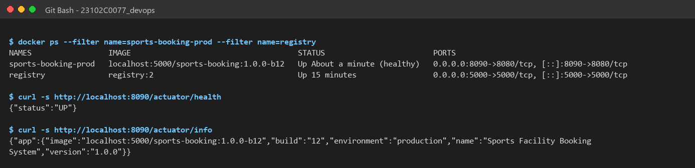 |
