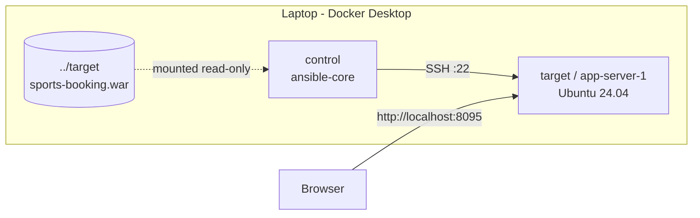
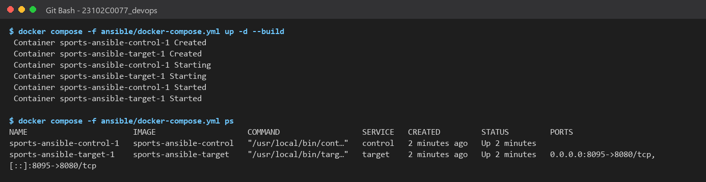
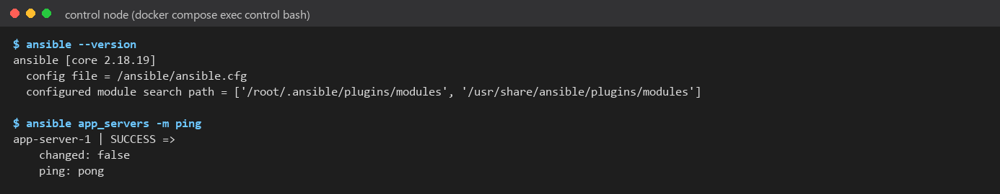
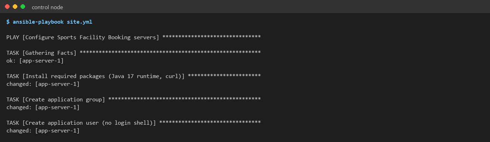
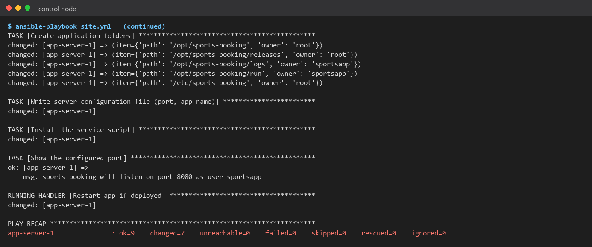
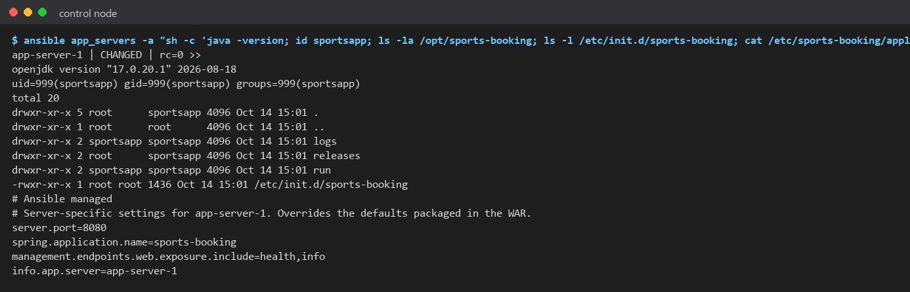

# Task 13: Configuration Management Script

> **Goal:** List everything a server needs to run the app, then write an
> Ansible playbook that sets up a server automatically.
>
> **Deliverables:** Configuration specification, Ansible inventory and YAML
> playbook, and first execution log.

---

## 1. Why configuration management?

Setting up a server by hand (install Java, create users and folders, edit
config files) is slow, and it's easy to forget a step. **Ansible** writes
these steps down as code (YAML). Running the code makes any number of servers
**exactly the same**, and running it again changes nothing if the server is
already correct (this property is called **idempotency**).

Ansible is **agentless**: it only needs SSH and Python on the server.

## 2. Configuration specification

| Area | Requirement | Value |
|------|-------------|-------|
| **Packages** | Java runtime | `openjdk-17-jre-headless` |
| | Health checks | `curl` |
| | HTTPS certificates | `ca-certificates` |
| **Users** | Service account that runs the app (no login) | user `sportsapp`, group `sportsapp`, shell `/usr/sbin/nologin` |
| | Account Ansible logs in with | `deploy` (SSH key, sudo) |
| **Folders** | App home | `/opt/sports-booking` (root:sportsapp, 755) |
| | Versioned WAR files | `/opt/sports-booking/releases` |
| | Logs | `/opt/sports-booking/logs` (owned by sportsapp) |
| | PID file | `/opt/sports-booking/run` (owned by sportsapp) |
| | Config | `/etc/sports-booking` |
| **Files** | Server config | `/etc/sports-booking/application.properties` (port, app name, endpoints) |
| | Service script | `/etc/init.d/sports-booking` (start, stop, restart, status) |
| | Active release | `/opt/sports-booking/current.war`, a link to a file in `releases/` (Task 14) |
| **Ports** | App HTTP port | **8080** on the server (published to the laptop as 8095) |
| | SSH | 22 |
| **Services** | `sports-booking` | runs `java -jar current.war` as `sportsapp`, logs to `logs/app.log` |

All values live in one place: `ansible/group_vars/app_servers.yml`.

## 3. Lab setup: two containers acting as servers

Ansible doesn't run on Windows, so the lab uses Docker Compose
(`ansible/docker-compose.yml`) to create:

| Container | Role | What's inside |
|-----------|------|---------------|
| `control` | **Ansible control node** (where playbooks run) | Python 3.12, `ansible-core` 2.18, SSH client |
| `target` (hostname `app-server-1`) | **Managed node**: a clean Ubuntu 24.04 server | Only SSH, Python 3, sudo, like a fresh cloud VM |

The control node creates an SSH key on start. The target authorises it for
user `deploy`, and Ansible then connects over SSH just like it would to a
real server.



## 4. Files

```text
ansible/
├── ansible.cfg                  # Ansible settings (inventory, SSH key)
├── inventory.ini                # which servers to manage
├── group_vars/app_servers.yml   # the configuration specification as variables
├── site.yml                     # Task 13 playbook: configure the server
├── deploy.yml                   # Task 14 playbook: deploy + health check + rollback
├── templates/
│   ├── application.properties.j2
│   └── sports-booking.init.j2   # service script
├── docker/                      # Dockerfiles for the lab control/target nodes
└── docker-compose.yml
```

### Inventory: `ansible/inventory.ini`

```ini
[app_servers]
app-server-1 ansible_host=target ansible_user=deploy

[app_servers:vars]
ansible_become=true
```

To manage more servers, add more lines under `[app_servers]`.

### Playbook: `ansible/site.yml` (summary)

| # | Task | Ansible module |
|---|------|----------------|
| 1 | Install Java 17 runtime, curl, certificates | `apt` |
| 2 | Create group `sportsapp` | `group` |
| 3 | Create user `sportsapp` (no login shell) | `user` |
| 4 | Create app, releases, logs, run and config folders with the right owners | `file` (loop) |
| 5 | Write `/etc/sports-booking/application.properties` from a template | `template` |
| 6 | Install the `/etc/init.d/sports-booking` service script | `template` |
| 7 | Restart the app **only if** config or script changed and the app is deployed | handler |

## 5. How to run

```bash
# 1. Start the lab servers
docker compose -f ansible/docker-compose.yml up -d --build

# 2. Check Ansible can reach the server
docker compose -f ansible/docker-compose.yml exec control ansible app_servers -m ping

# 3. Configure the server
docker compose -f ansible/docker-compose.yml exec control ansible-playbook site.yml
```

## 6. First execution log

```text
PLAY [Configure Sports Facility Booking servers] *****
TASK [Gathering Facts] ............................ ok
TASK [Install required packages (Java 17, curl)] .. changed
TASK [Create application group] ................... changed
TASK [Create application user (no login shell)] .. changed
TASK [Create application folders] ................. changed (5 folders)
TASK [Write server configuration file] ........... changed
TASK [Install the service script] ................ changed
TASK [Show the configured port] .................. ok
RUNNING HANDLER [Restart app if deployed] ......... changed ("not deployed yet")

PLAY RECAP
app-server-1 : ok=9  changed=7  unreachable=0  failed=0
```

Checked on the server afterwards: Java 17.0.20 is installed, user `sportsapp`
(uid 999) exists, the folders have the right owners, and the config file
contains `server.port=8080`.

**Second run:** `ok=8 changed=0`. Nothing changed because the server was
already correct. (Idempotency is shown in more detail in Task 14.)

## 7. Evidence (screenshots)

| # | Screenshot |
|---|-----------|
| 01 | Lab control and target servers started:  |
| 02 | Ansible version and `ping` to the target:  |
| 03 | First run of `site.yml` (part 1):  |
| 04 | First run of `site.yml` (part 2 + recap):  |
| 05 | Target server after configuration:  |
