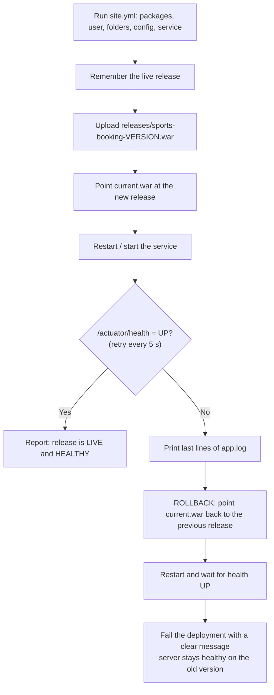
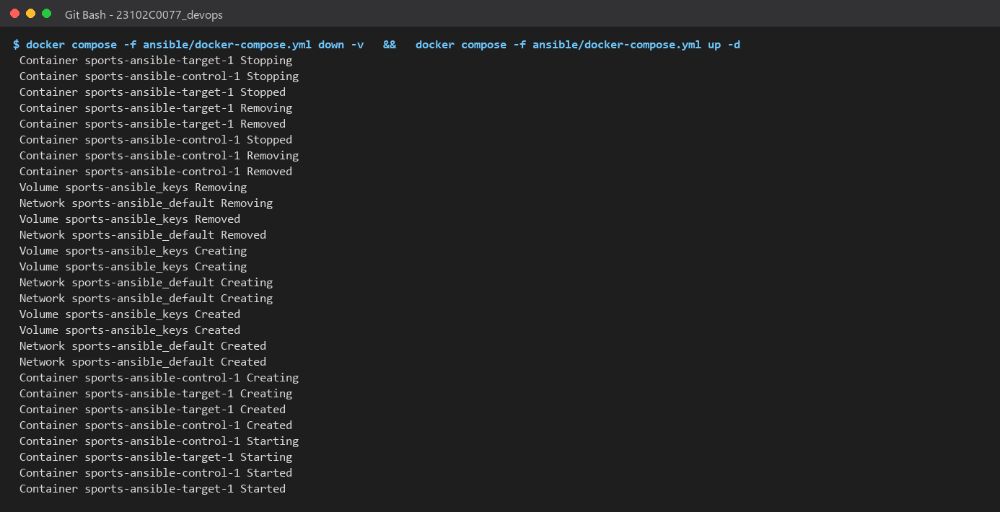
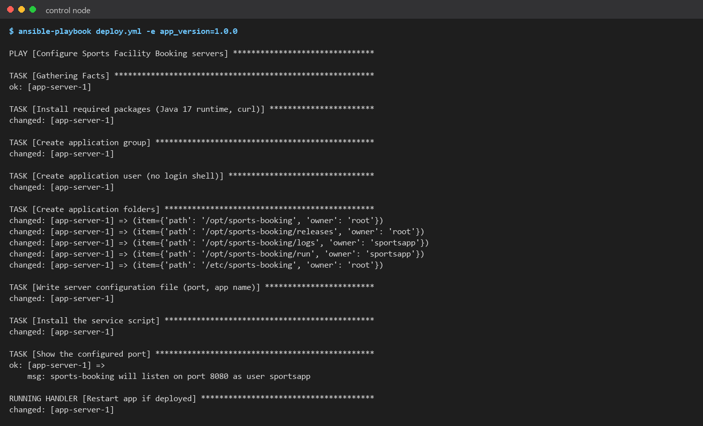
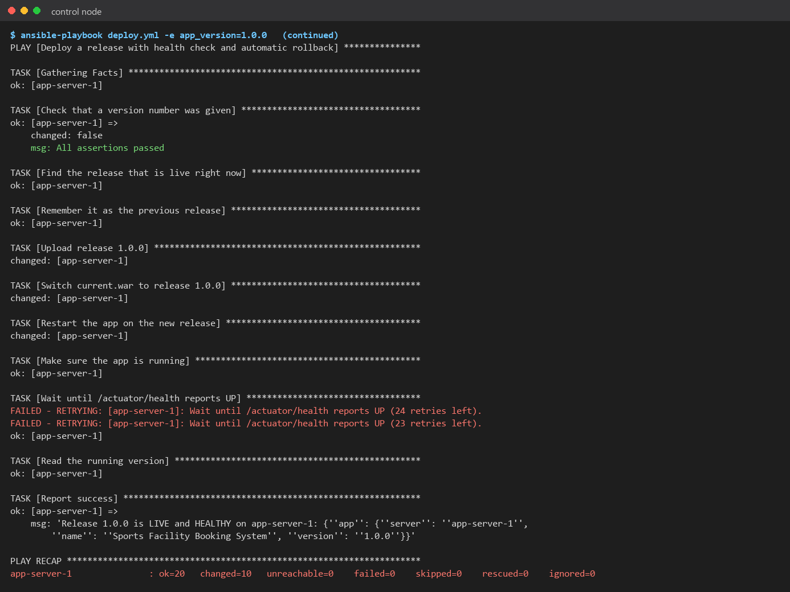
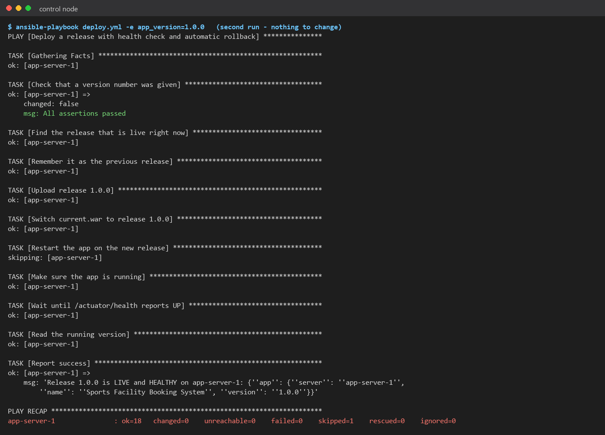
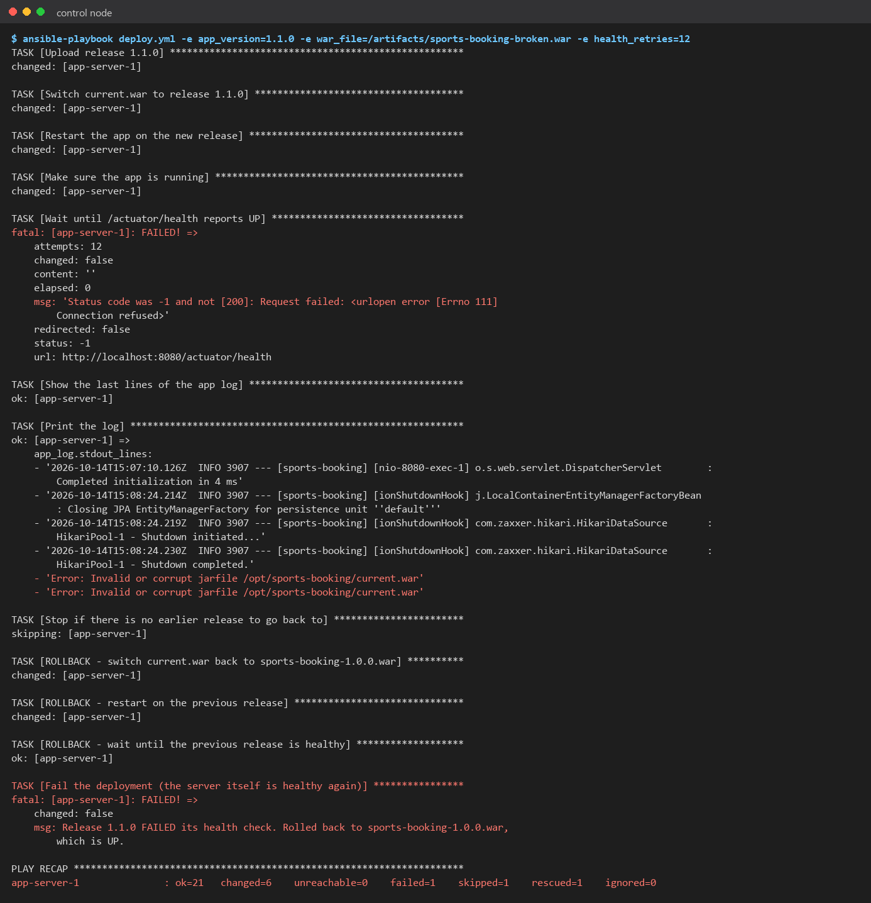
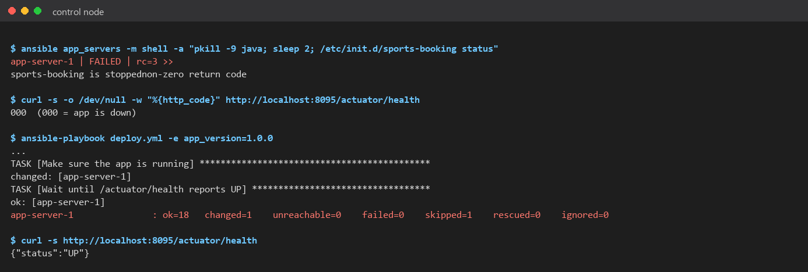
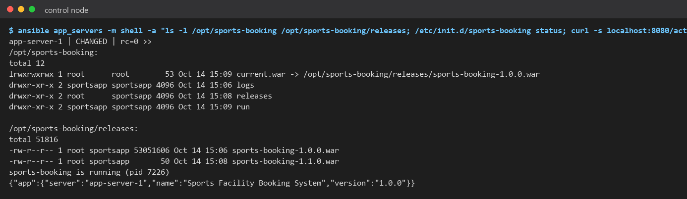
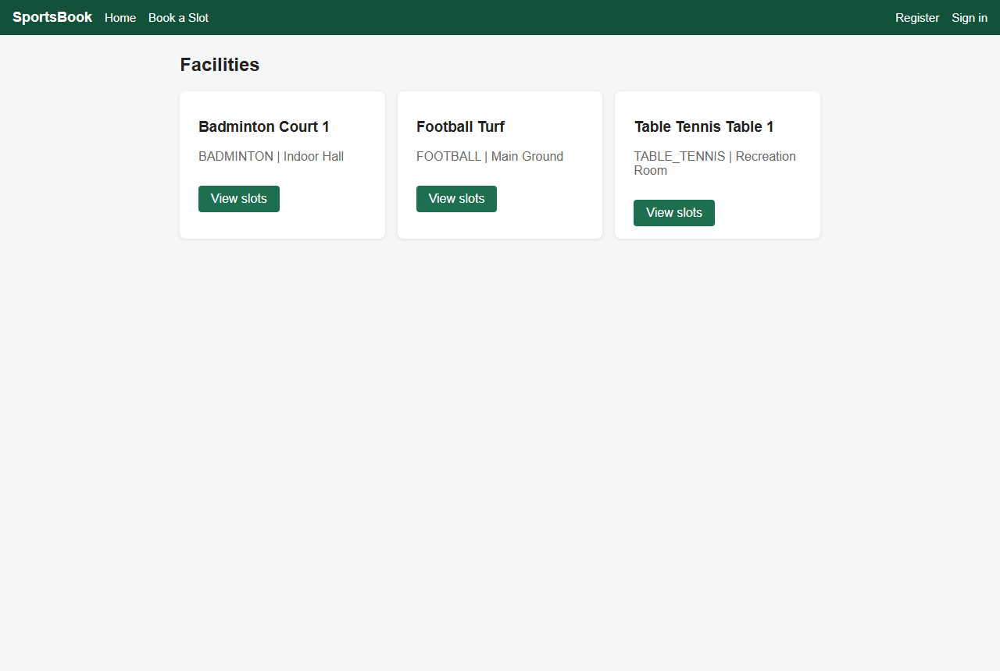

# Task 14: Automated Provisioning and Reliability Validation

> **Goal:** Build a brand-new server automatically, deploy the app, prove that
> re-running the automation is safe, check the app's health, and show that a bad
> release is rolled back to the last good one.
>
> **Deliverables:** Provisioned node, idempotency evidence, health-check result
> and rollback/recovery demonstration.

---

## 1. The deploy playbook: `ansible/deploy.yml`

`deploy.yml` first runs `site.yml` (Task 13) to **provision** the server, then
**deploys** a versioned release:



How releases are stored on the server:

```text
/opt/sports-booking/
├── current.war -> releases/sports-booking-1.0.0.war   # the live version (a symbolic link)
├── releases/
│   ├── sports-booking-1.0.0.war
│   └── sports-booking-1.1.0.war
├── logs/app.log
└── run/sports-booking.pid
```

Every version stays in `releases/`, so going back to an older version only
means moving the `current.war` link and restarting. That takes seconds.

## 2. Step 1: provision a clean environment

```bash
docker compose -f ansible/docker-compose.yml down -v   # delete the old server completely
docker compose -f ansible/docker-compose.yml up -d     # brand-new Ubuntu server
docker compose -f ansible/docker-compose.yml exec control \
    ansible-playbook deploy.yml -e app_version=1.0.0
```

Result: `ok=20 changed=10 failed=0`. Starting from a bare Ubuntu box, Ansible
installed Java, created the user, folders, config and service, uploaded the
release, started it, and the health check passed:

```text
Release 1.0.0 is LIVE and HEALTHY on app-server-1:
{'app': {'server': 'app-server-1', 'name': 'Sports Facility Booking System', 'version': '1.0.0'}}
```

The app is reachable from the laptop at <http://localhost:8095>.

## 3. Step 2: idempotency

The **same command** was run again:

```text
PLAY RECAP
app-server-1 : ok=18  changed=0  unreachable=0  failed=0  skipped=1
```

**`changed=0`**: Ansible checked every item, found the server already correct,
and changed nothing. It didn't even restart the app. This is why the
automation is safe to run as often as we like (for example, on every Jenkins
build).

## 4. Step 3: health check

The playbook calls `GET http://localhost:8080/actuator/health` on the server
and waits for `{"status":"UP"}`, retrying every 5 seconds (up to 2 minutes).

| Check | Result |
|-------|--------|
| `/actuator/health` on the server | `{"status":"UP"}` |
| `/actuator/info` | `version 1.0.0`, `server app-server-1` |
| Service status | `sports-booking is running` |

## 5. Step 4: rollback to the previous stable release

To test this we made a **bad build**: release `1.1.0` is a corrupt WAR file,
so Java can't start it.

```bash
echo "this is not a real WAR file - simulated bad build" > target/sports-booking-broken.war
ansible-playbook deploy.yml -e app_version=1.1.0 \
    -e war_file=/artifacts/sports-booking-broken.war -e health_retries=12
```

What happened (see screenshot 05):

| Step | Output |
|------|--------|
| Upload 1.1.0, switch `current.war`, restart | changed |
| Health check | **FAILED** after 12 attempts (connection refused) |
| App log | `Error: Invalid or corrupt jarfile /opt/sports-booking/current.war` |
| **ROLLBACK**: switch back to `sports-booking-1.0.0.war` | changed |
| **ROLLBACK**: restart, wait for health | **ok (UP)** |
| Final message | `Release 1.1.0 FAILED its health check. Rolled back to sports-booking-1.0.0.war, which is UP.` |

The recap shows `rescued=1`. The deployment is reported as failed (so Jenkins
or the operator knows), **but users are still served by the healthy 1.0.0**.
Afterwards `current.war → sports-booking-1.0.0.war` and `/actuator/info`
reports `1.0.0`.

## 6. Step 5: recovery after a crash

We killed the app on the server to simulate a crash:

```bash
ansible app_servers -m shell -a "pkill -9 java; /etc/init.d/sports-booking status"
#   -> sports-booking is stopped
curl http://localhost:8095/actuator/health
#   -> 000 (no response, app is down)

ansible-playbook deploy.yml -e app_version=1.0.0
#   -> "Make sure the app is running": changed   (it started the app)
#   -> health check ok, changed=1
curl http://localhost:8095/actuator/health
#   -> {"status":"UP"}
```

Re-running the same automation brings the server back to the desired state.
Only the one missing thing (the running process) was changed.

## 7. Summary

| Requirement | Evidence | Result |
|-------------|----------|--------|
| Provision a clean target environment | `down -v` → `up` → `deploy.yml` | ✅ ok=20 changed=10 failed=0 |
| Deploy the application | Release 1.0.0 live on app-server-1 | ✅ |
| Idempotency | Second run | ✅ changed=0 |
| Health check | `/actuator/health` UP, checked by the playbook | ✅ |
| Rollback to previous stable release | Broken 1.1.0 → automatic rollback to 1.0.0 | ✅ rescued=1, app UP |
| Recovery | Crash → re-run → UP | ✅ |

## 8. Evidence (screenshots)

| # | Screenshot |
|---|-----------|
| 01 | Old server deleted, clean one created:  |
| 02 | Deploy 1.0.0: provisioning part:  |
| 03 | Deploy 1.0.0: release + health check OK:  |
| 04 | Second run: `changed=0` (idempotent):  |
| 05 | Broken 1.1.0 → automatic rollback to 1.0.0:  |
| 06 | Crash and recovery:  |
| 07 | Releases folder and `current.war` link after rollback:  |
| 08 | App served by the provisioned server (port 8095):  |
