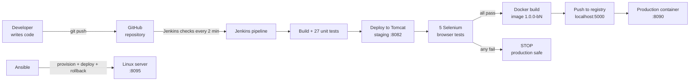
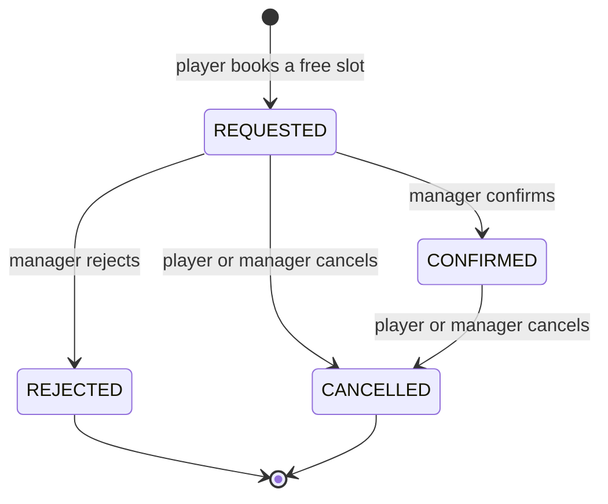

# Viva Preparation Guide

**Project:** Containerized Sports Facility Booking System
**Student:** Tanisha Sharma | **Roll No:** 23102C0077 | **Class:** BE CMPN C | **Professor:** Dr. Snehal Andhare

> **How to use this file:** read it from top to bottom once. Every section starts simple and then adds
> detail. The **bold lines** are the ones worth remembering word for word. Section 12 has ready answers
> to the questions examiners usually ask.

---

## Contents

1. [The 1-minute introduction (learn this by heart)](#1-the-1-minute-introduction-learn-this-by-heart)
2. [Problem and solution](#2-problem-and-solution)
3. [The big picture: how everything connects](#3-the-big-picture-how-everything-connects)
4. [How the application works](#4-how-the-application-works)
5. [Technologies and WHY each one was chosen](#5-technologies-and-why-each-one-was-chosen)
6. [All 14 tasks: what, how, result, why](#6-all-14-tasks-what-how-result-why)
7. [Extra improvements after the 14 tasks](#7-extra-improvements-after-the-14-tasks)
8. [Must-know concepts: Git and GitHub](#8-must-know-concepts-git-and-github)
9. [Must-know concepts: CI/CD and Jenkins](#9-must-know-concepts-cicd-and-jenkins)
10. [Must-know concepts: Testing and Selenium](#10-must-know-concepts-testing-and-selenium)
11. [Must-know concepts: Docker and Ansible](#11-must-know-concepts-docker-and-ansible)
12. [Viva question bank with answers](#12-viva-question-bank-with-answers)
13. [Numbers to remember](#13-numbers-to-remember)
14. [Problems faced and how they were solved](#14-problems-faced-and-how-they-were-solved)
15. [Live demo checklist](#15-live-demo-checklist)
16. [Glossary (one line each)](#16-glossary-one-line-each)

---

## 1. The 1-minute introduction (learn this by heart)

> "Good morning Ma'am. My project is the **Containerized Sports Facility Booking System**.
>
> **The problem:** in colleges and clubs, courts are booked in a paper register or by phone. This causes
> **double booking**, players can't see which slots are free, and the manager does a lot of manual work.
>
> **My solution has two parts.** First, a **web application** built with **Java Spring Boot** where players
> register, see free slots, and book them on a **first come, first served** basis, and the manager confirms
> or rejects requests. The system **never allows double booking** and **never allows booking a past date**.
>
> Second, a complete **DevOps pipeline**. The code is in **Git and GitHub** with a branching strategy.
> **Jenkins** automatically builds the app, runs **27 unit tests**, deploys it to a **Tomcat staging server**,
> runs **5 Selenium browser tests**, then builds a **Docker image**, pushes it to a **registry** and deploys the
> **production container**. If any test fails, production is **not** updated. Finally, **Ansible** sets up a
> server automatically and **rolls back** to the old version if a new release is broken.
>
> So one `git push` gives a tested, deployed application in a few minutes, with **zero manual steps**."

---

## 2. Problem and solution

### The problem (in simple words)

| Problem | Who suffers |
|---------|-------------|
| Courts booked in a paper register or by phone call | Players and manager |
| **Double booking:** two people get the same court at the same time | Players |
| No way to see which slots are free | Players |
| Manager spends time on calls and checking the register | Manager |
| On the developer side, building and deploying **by hand** is slow and mistakes reach users | Developer, users |

### The solution

**Part A: the web app (what users see)**
- Players **register**, **sign in**, see **free slots** for 6 facilities, **book**, **cancel**, and track status.
- The manager has a **dashboard** to confirm or reject requests, see the day's schedule, search all bookings and see players.
- Rules: **no double booking**, **first come, first served (FCFS)**, **no booking in the past**.
- An **Insights** page shows charts (bookings per day, popular facilities, peak hours).

**Part B: the DevOps pipeline (how the app is built and delivered)**
- **Git + GitHub:** version control with branches (`main`, `develop`, `feature/*`).
- **Jenkins:** automatic build, test and deploy on every change (CI/CD).
- **Selenium:** tests the website in a real Chrome browser.
- **Docker:** packs the app into a container that runs the same everywhere.
- **Ansible:** sets up a server automatically, with health check and rollback.

**Scope (MVP):** 15 items, M1 to M15. **Out of scope:** online payment, SMS, mobile app.

---

## 3. The big picture: how everything connects



**In words:** I push code → Jenkins notices → builds and unit-tests it → deploys it to a test (staging)
server → Selenium clicks through the website → if everything passes, Jenkins builds a Docker image,
stores it in a registry and replaces the production container → a health check confirms it is UP.
If any test fails, the pipeline stops and **users keep the old working version**.

### Ports used on my laptop (remember these)

| Port | What runs there |
|------|-----------------|
| **8080** | Jenkins |
| **8081** | The app when run directly on my laptop (`java -jar`) |
| **8082** | Tomcat **staging** server (deployed by Jenkins) |
| **8090** | **Production** Docker container (deployed by Jenkins) |
| **5000** | Local Docker **registry** (stores images) |
| **8095** | Ansible **target** server (Linux container) |

---

## 4. How the application works

### 4.1 Who uses it

| User | What they can do |
|------|------------------|
| **Player** | Register, sign in, see free slots, book, cancel, see **My Dashboard** (next game, upcoming, history) |
| **Manager** (`manager@sports.local`) | **Manager Dashboard:** Requests queue (confirm/reject), Schedule grid, All bookings (filters), Players list |
| **Anyone** | Home page, facilities, Insights charts |

Demo player with history: `aarav@demo.local`. Sign-in is by **email only** (kept simple for the MVP; a
real system would add passwords with Spring Security).

### 4.2 The journey of one booking



- A slot is **taken** while its booking is **REQUESTED** or **CONFIRMED**.
- **REJECTED** or **CANCELLED** frees the slot again for other players.

### 4.3 The three business rules (examiners love these)

1. **No double booking.** Before saving, the service checks: *does this slot already have an active booking?*
   If yes → error "Sorry, this slot is already booked". The method is `synchronized`, so two requests at the
   same moment cannot both pass the check.
2. **First come, first served (FCFS).** The **first** request locks the slot immediately. The manager's
   queue is sorted by **request time, oldest first** (#1, #2, ...).
3. **No booking in the past.** If a slot's start date-time is before *now*, the server refuses:
   "Booking not possible: ... is in the past". The page also shows a red **"Booking not possible for a past
   date"** banner and no Book buttons. The rule is on the **server** too, so it can't be bypassed by editing the page.

### 4.4 How the code is organised (3 layers)

```text
Browser  →  Controller   (receives the click / URL, e.g. BookingController)
         →  Service      (business rules: no double booking, FCFS, past-date check)
         →  Repository   (saves to / reads from the database using Spring Data JPA)
         →  H2 database  (in-memory: User, Facility, Slot, Booking tables)
```

**Why 3 layers?** Each layer has one job, so code is easy to test and change. Example: the
"no double booking" rule lives only in `BookingService`, so every page that books uses the same rule.

### 4.5 Data model (4 tables)

| Table | Main fields |
|-------|-------------|
| **User** | name, email (unique), phone (10 digits), role (PLAYER / MANAGER) |
| **Facility** | name, type (BADMINTON, FOOTBALL, ...), location |
| **Slot** | facility, date, start time, end time (1-hour slots) |
| **Booking** | user, slot, status, createdAt (request time, used for FCFS) |

Relations: one Facility has many Slots; one Slot can have many Bookings over time (but only **one active**);
one User has many Bookings.

### 4.6 Main pages (URLs)

| URL | Page |
|-----|------|
| `/` | Home: hero photo, live stats, facilities, how it works |
| `/register`, `/signin` | Account pages |
| `/facilities` | 6 facility cards with "free today" count |
| `/slots?facilityId=2&date=2026-10-30` | Slots of one facility on one day (Book buttons) |
| `/bookings/my` | **My Dashboard** (player) |
| `/manager/bookings` | **Manager Dashboard** (tabs: requests, schedule, all, players) |
| `/stats` | **Insights** charts |
| `/actuator/health` | Health check → `{"status":"UP"}` |
| `/actuator/info` | App name, version, build number, environment |

### 4.7 Sample data
On start, `DataLoader` creates 6 facilities, 8 one-hour slots per day from **14 days ago to 6 days ahead**,
a manager, 8 demo players and a realistic booking history (so the charts have data). The database is
**in-memory (H2)**, so data resets when the app restarts. That is fine for a demo; production would use MySQL/PostgreSQL.

---

## 5. Technologies and WHY each one was chosen

| Technology | What it does | Why I chose it (and not the alternative) |
|------------|--------------|------------------------------------------|
| **Java 17** | Programming language | LTS (long-term support) version, widely used in industry, strong typing |
| **Spring Boot 3** | Web framework | Builds a web app with very little setup; has a built-in server and health checks (Actuator) |
| **Thymeleaf** | HTML templates | Server-side pages, no separate front-end project needed (simpler than React for an MVP) |
| **H2** | Database | In-memory, no installation; easy to swap for MySQL later because we use JPA |
| **Spring Data JPA** | Database access | Write `findByEmail(...)` and Spring creates the SQL; less code, fewer bugs |
| **Maven** | Build tool | One command (`mvn package`) compiles, tests and creates the `.war`; manages libraries via `pom.xml` |
| **Git + GitHub** | Version control + hosting | Industry standard, free, branches and pull requests, history of every change |
| **Jenkins** | CI/CD server | Free, open source, runs on my laptop, huge plugin ecosystem, pipeline as code (Jenkinsfile) |
| **Apache Tomcat 10** | Web server (staging) | The standard Java web server; shows deployment of a `.war` file to a real server |
| **JUnit 5 + MockMvc** | Unit tests | Standard Java testing; MockMvc tests web pages without starting a browser |
| **Selenium 4** | Browser tests | Tests the site like a real user in Chrome; free; industry standard |
| **Docker** | Containers | "Works on my machine" problem solved; same image runs everywhere; fast to start |
| **Docker Registry** | Image store | Keeps every version (`1.0.0-b11`, `b12`...) so we can roll back |
| **Ansible** | Configuration management | **Agentless** (only needs SSH), simple YAML, idempotent. Chef/Puppet need agents on every server |

**Why Jenkins and not GitHub Actions?** The syllabus/tasks ask for Jenkins, it runs **locally** (my staging
and production also run locally, which GitHub's cloud runners can't reach), and it shows pipeline-as-code
skills that transfer to any CI tool.

**Why a `.war` file?** It can run **both** ways: inside Tomcat (Task 8) and on its own with `java -jar`
(Docker, Ansible), because Spring Boot embeds a server.

---

## 6. All 14 tasks: what, how, result, why

### Step 0: Getting started
Found my project in the college sheet (BE CMPN C, row 63), created the GitHub repo, checked that Java,
Maven, Git, Docker Desktop, Chrome and Jenkins were installed.

---

### Task 1: Problem Definition and Scope
- **What:** understand the problem before coding.
- **How:** listed pain points, stakeholders (player, manager, admin, developer, faculty), objectives and
  constraints (one semester, one person, free tools). Fixed the **MVP: 15 items, M1 to M15**.
- **Result:** clear scope; payments, SMS and the mobile app were kept **out of scope**.
- **Why:** without a fixed scope a project keeps growing and never finishes ("scope creep").

### Task 2: Agile Planning and DevOps Workflow
- **What:** plan like a real Agile team.
- **How:** wrote **7 user stories** (e.g. *"As a player, I want to book a free slot so that it is reserved
  for me"*) with acceptance criteria, a backlog (15 items, story points), a **4-sprint plan** (2 weeks each),
  a **Kanban board** (To Do → In Progress → Review → Done) and a **Definition of Done**.
- **Result:** the work was split into small, testable pieces.
- **Why:** Agile delivers working software in small steps and gets feedback early.

### Task 3: Requirements, Architecture and Technology Setup
- **What:** decide what to build and with which tools.
- **How:** functional + non-functional requirements; use-case, architecture and data-model diagrams;
  list of URLs; chose the tech stack; created the first Spring Boot skeleton and ran it.
- **Result:** a running "hello" app and a clear design (3 layers, 4 tables).
- **Why:** design first avoids rework later.

### Task 4: Git and GitHub Repository Initialization
- **What:** set up the repository properly.
- **How:** README, `.gitignore`, folder structure, issue templates (bug/feature/task), a pull request template,
  `CONTRIBUTING.md` with branch rules and commit rules (`feat:`, `fix:`, `docs:`, `test:`, `ci:`).
- **Result:** `main` and `develop` branches pushed to GitHub.
- **Why:** clear rules keep the history clean and make teamwork easy.

### Task 5: Feature Development with Branching
- **What:** build the first feature on its own branch.
- **How:** branch `feature/M3-M7-registration-availability`: registration with validation (valid email,
  10-digit phone, no duplicate email) and the slot availability page. Small commits → push → merge into `develop` with `--no-ff`.
- **Result:** **7 tests passed**, feature merged.
- **Why:** a feature branch keeps unfinished work away from the stable code.

### Task 6: MVP Completion and Git Collaboration
- **What:** finish all features, show a merge conflict, tag a release.
- **How:** two branches: `feature/M8-M13-booking-flow` (book, double-booking check, confirm, cancel,
  My Bookings) and `feature/M14-M15-navigation-health` (menu, error page, health). Both changed the **same
  menu line** → a real **merge conflict** → resolved by keeping both changes → tests re-run.
- **Result:** **19/19 tests passed**, release tag **`v1.0.0`**.
- **Why:** shows how teams combine parallel work safely.

### Task 7: Jenkins Installation and CI Job
- **What:** a robot (Jenkins) that builds and tests every change automatically.
- **How:** Jenkins on `localhost:8080`. Freestyle job **`sports-booking-ci`**: source = GitHub `develop`,
  trigger = **Poll SCM every 2 minutes**, build = `mvn clean package`, post-build = publish JUnit results and archive the `.war`.
- **Result:** a build showing **"Started by an SCM change"**, which proves it started automatically.
- **Why polling, not a webhook?** A webhook needs GitHub to reach my laptop from the internet; `localhost`
  isn't reachable, so Jenkins asks GitHub instead.

### Task 8: Pipeline as Code and Server Deployment
- **What:** write the whole process as code and deploy to a server.
- **How:** a **Jenkinsfile** (declarative pipeline) with stages Checkout → Build → Unit Tests → Package →
  **Deploy to Tomcat**. Tomcat runs in a Docker container; the `.war` is copied in; Jenkins waits for
  `/actuator/health` = UP. **Parameters:** `DEPLOY_ENV` (staging/qa) and `TOMCAT_PORT`.
- **Result:** staging on **8082** (and QA on 8084 during the task), both from the same pipeline.
- **Why a Jenkinsfile?** It lives in Git: versioned, reviewed, never lost, and the same for everyone.

### Task 9: Selenium Test Design and Local Execution
- **What:** test the website like a real user.
- **How:** 5 test cases with Selenium WebDriver in Chrome (headless):

| Test | What it checks |
|------|----------------|
| **TC-01** | A new player can register and lands on the Facilities page |
| **TC-02** | Wrong email / short phone shows clear error messages |
| **TC-03** | A player books a free slot and sees **REQUESTED** in My Bookings |
| **TC-04** | A second player **cannot** book the same slot (no double booking) |
| **TC-05** | Manager **confirms**, player **cancels**, slot becomes **free** again |

  Run with `mvn verify -Pselenium`. A **screenshot is saved automatically** if a test fails.
- **Result:** **5/5 passed**.
- **Why:** unit tests check code from inside; Selenium checks the real page from outside (links, buttons, forms).

### Task 10: Continuous Testing in Jenkins (the safety gate) ★
- **What:** run Selenium inside Jenkins and **block** bad code from production.
- **How:** added a **Selenium Tests** stage after the staging deploy; production stages come **after** it.
  **Experiment:** I changed the "My Bookings" link to a wrong URL on purpose.
- **Result:** unit tests **19/19 passed** (they didn't notice!), but **Selenium failed 2 tests** (real browser
  got an error page) → **build #8 failed → production NOT updated**. Fixed one line → **build #9 green**.
- **Why:** this proves the value of automated end-to-end tests: **bad code never reaches users**.

### Task 11: Docker Image and Container Lifecycle
- **What:** pack the app into a container.
- **How:** a **Dockerfile**: base image `eclipse-temurin:17-jre`, copy the `.war`, run as a **non-root user**,
  `EXPOSE 8080`, a **HEALTHCHECK** using `/actuator/health`. Practised the lifecycle: `build`, `run`, `ps`,
  `logs`, `exec`, `stop`, `start`, `restart`, `rm`, `rmi`.
- **Result:** container shows **(healthy)** and runs on port 8090.
- **Why:** same image runs identically on any machine; starts in seconds; isolated.

### Task 12: Jenkins-Docker Continuous Deployment
- **What:** after tests pass, Jenkins builds and deploys a Docker image automatically.
- **How:** a local **registry** (`registry:2`) on port 5000. New stages: **Docker Build** (tag
  `1.0.0-b<build number>`), **Push to Registry**, **Deploy Container** (pull exact version, replace old
  container, wait for health UP).
- **Result:** one `git push` → tested and live in production with **zero manual steps**. The registry keeps every version.
- **Why version tags?** `latest` alone can't tell you what is running; `1.0.0-b17` says exactly which build.

### Task 13: Configuration Management Script (Ansible)
- **What:** set up a Linux server with a script instead of by hand.
- **How:** Ansible doesn't run on Windows, so I made **two Linux containers with Docker Compose**: a
  **control** node (runs Ansible) and a **target** server (plain Ubuntu, reached by SSH). Wrote an
  **inventory** (`inventory.ini`), **variables** (`group_vars`), **templates** (config file, service script) and
  a **playbook** (`site.yml`): install Java, create user and folders, write config, install the service.
- **Result:** the server was configured with **0 failures**.
- **Why Ansible?** agentless (only SSH), human-readable YAML, idempotent, the same result on every server.

### Task 14: Automated Provisioning and Reliability Validation
- **What:** prove the automation is safe and can recover.
- **How:** `deploy.yml` = provision + upload a release into `releases/` + point the `current.war` **symlink** to it
  + restart + **health check**. A `block/rescue` section does the **rollback** if the health check fails.
- **Results (4 experiments):**

| Experiment | Result |
|------------|--------|
| 1. Brand-new server | Everything installed and deployed: **ok=20, changed=10**, health **UP** |
| 2. Run again (idempotency) | **changed=0**: nothing needed changing |
| 3. Deploy a broken 1.1.0 | Health check failed → **automatic rollback to 1.0.0**, app still UP |
| 4. Kill the app (crash) | Re-ran the playbook → app back **UP** |

- **Why:** real servers fail; automation must be repeatable (idempotent) and must recover by itself.

---

## 7. Extra improvements after the 14 tasks

| Improvement | What changed |
|-------------|--------------|
| **New UI** | Navy/emerald theme, real facility photos, icons, mobile friendly, 6 facilities |
| **Past-date rule** | Booking a past date/time is refused by the server and the page shows "Booking not possible" |
| **FCFS made visible** | Explained on pages; manager queue numbered #1, #2... with request time |
| **Insights page** | Charts (Chart.js, stored locally): bookings per day, by facility, peak hours, status, court usage |
| **Manager Dashboard** | Tabs: Requests (confirm/**reject**), Schedule grid, All bookings (filters + pages), Players |
| **My Dashboard** | Next-game card with countdown, personal stats, Upcoming/History tabs, Book again |
| **New status REJECTED** | Manager can decline a request; slot is freed |
| **Cache busting** | CSS/JS/image URLs get a content hash (`style-<hash>.css`) so browsers always load the newest file |

**Final test count:** **27 unit tests + 5 Selenium tests = 32, all passing.**
**Latest Jenkins:** pipeline **#17** and CI **#18** green, both **"Started by an SCM change"**; production runs image **`1.0.0-b17`**.

---

## 8. Must-know concepts: Git and GitHub

**Git** = a tool that records every change to code (version control) on my computer.
**GitHub** = a website that stores Git repositories online so others can see/share them.

| Term | Meaning (one line) |
|------|--------------------|
| Repository (repo) | The project folder plus its full history |
| Commit | A saved snapshot of changes with a message |
| Branch | A separate line of work; doesn't disturb other branches |
| Merge | Combine one branch into another |
| Merge conflict | Two branches changed the same line; a human must choose the final code |
| Pull Request (PR) | A request on GitHub to merge a branch, with review |
| Tag | A fixed name for one commit, e.g. `v1.0.0` (a release) |
| Clone / Push / Pull | Copy repo / send commits to GitHub / get commits from GitHub |
| `.gitignore` | List of files Git must not track (e.g. `target/`) |

**My branching strategy (Git Flow, simplified):**
- `main` = stable, released code
- `develop` = latest working code (Jenkins builds this)
- `feature/...` = one feature; `bugfix/...` = one fix
- Merge with `--no-ff` so the history shows where each feature was merged.

**Commands to know:**
```bash
git init / git clone <url>
git status                      # what changed?
git add .                       # stage changes
git commit -m "feat: add booking form"
git push origin develop
git checkout -b feature/x       # create and switch to a new branch
git merge --no-ff feature/x     # merge keeping a merge commit
git log --oneline --graph       # see history
git tag -a v1.0.0 -m "MVP"      # create a release tag
```

**Merge vs Rebase:** merge keeps both histories and adds a merge commit; rebase rewrites commits on top of another branch (cleaner line, but rewrites history).

---

## 9. Must-know concepts: CI/CD and Jenkins

### CI/CD in simple words
- **CI (Continuous Integration):** every change is **automatically built and tested** as soon as it is pushed.
  Problems are found within minutes, not weeks.
- **CD (Continuous Delivery):** every change that passes tests is **ready to release** (one click).
- **CD (Continuous Deployment):** every change that passes tests is **released automatically** (no click).
  **My project does Continuous Deployment** to the production container.

**Benefits:** faster releases, fewer bugs reach users, no "it worked on my machine", repeatable process,
quick feedback to the developer.

**DevOps** = Development + Operations working together, with automation across the whole life cycle:
**Plan → Code → Build → Test → Release → Deploy → Operate → Monitor** (the infinity loop).

### Jenkins
- **Jenkins** = an open-source **automation server** used for CI/CD. Written in Java, runs on port 8080, has 1,800+ plugins.
- **Job / Project:** a task Jenkins runs. I have two:
  - `sports-booking-ci`: **Freestyle** job (configured with forms in the UI). Builds + tests.
  - `sports-booking-pipeline`: **Pipeline** job (defined in a **Jenkinsfile** in Git). Full CI/CD.
- **Build:** one run of a job (#1, #2, ...). Green = success, red = failure.
- **Trigger:** what starts a build: manual, **Poll SCM** (my choice, every 2 min), webhook, cron schedule.
- **Agent / Node:** the machine that runs the build (mine: the Windows laptop, so steps use `bat`).
- **Workspace:** the folder where Jenkins checks out the code.
- **Artifact:** a file saved from a build (my `sports-booking.war`).
- **Plugins I relied on:** Git, Pipeline, JUnit (test reports and trend graph), Maven integration.

### Freestyle vs Pipeline

| Freestyle | Pipeline (Jenkinsfile) |
|-----------|------------------------|
| Configured by clicking in the UI | Written as code in a file |
| Stored only in Jenkins | Stored in **Git** (versioned, reviewable) |
| Good for simple jobs | Good for multi-stage CI/CD, parallel steps, conditions |

**Declarative vs Scripted pipeline:** declarative (`pipeline { stages { stage { steps {...}}}}`) is simpler
and structured. **I used declarative.** Scripted is full Groovy code, more flexible but harder.

### My Jenkinsfile, explained line by line (simplified)
```groovy
pipeline {
  agent any                                   // run on any available machine
  parameters { choice DEPLOY_ENV; string TOMCAT_PORT }   // options chosen per build
  triggers { pollSCM('H/2 * * * *') }         // check GitHub every 2 minutes
  options  { timestamps(); disableConcurrentBuilds() }
  environment { IMAGE_TAG = "1.0.0-b${BUILD_NUMBER}" }   // version from build number
  stages {
    Checkout → Build → Unit Tests (junit report) → Package (archive .war)
    → Deploy to Tomcat (health check) → Selenium Tests (blocks production if red)
    → Docker Build → Push to Registry → Deploy Container (health check)
  }
  post { success {...}  failure {...} }       // runs after all stages
}
```
- **`post { always { junit ... } }`** publishes test results even when tests fail (gives the trend graph).
- **`H/2`** means "every 2 minutes, at a hashed offset" so many jobs don't all start at the same second.
- **Why the Selenium stage is before production:** a failing stage stops the pipeline, so later stages (production) are **skipped**.

---

## 10. Must-know concepts: Testing and Selenium

### Types of testing (testing pyramid)
```text
          /\        UI / end-to-end tests  (Selenium: few, slow, closest to the user)
         /  \       Integration tests      (MockMvc: web layer + database)
        /____\      Unit tests             (JUnit: many, fast, test one piece)
```
| Type | My project |
|------|-----------|
| **Unit** | `BookingFlowTests`: double booking blocked, past slot refused, FCFS order, reject frees slot... |
| **Integration** | MockMvc tests that call pages (`/slots`, `/stats`, `/manager/bookings`) and check the HTML |
| **End-to-end (UI)** | Selenium TC-01 to TC-05 in real Chrome |
| **Smoke / health** | `/actuator/health` checks after every deployment |

**27 unit/integration tests** run with `mvn test` (Maven **Surefire** plugin, files `*Tests.java`).
**5 Selenium tests** run with `mvn verify -Pselenium` (Maven **Failsafe** plugin, files `*IT.java`).

### Selenium (must know)
- **Selenium** = a free tool to **automate a web browser**: open pages, type, click, read text, like a real user.
- **Components:** **WebDriver** (the API I used, controls the browser), **Selenium IDE** (record/playback
  browser extension), **Selenium Grid** (run tests on many machines/browsers in parallel).
- **ChromeDriver** = the bridge between Selenium and Chrome. **Selenium Manager** (built into Selenium 4)
  downloads the matching driver automatically.
- **Headless mode** = the browser runs without a window (needed on Jenkins, faster).
- **Locators** (how to find elements): `id`, `name`, `className`, `cssSelector`, `xpath`, `linkText`, `tagName`.
  I mostly used **ids and CSS selectors** (e.g. `#register-submit`, `button[id^='book-']`) because they are stable.
- **Waits:** pages take time to load.
  - *Implicit wait:* a global wait for all `findElement` calls.
  - **Explicit wait** (I used this): `WebDriverWait` + `ExpectedConditions.visibilityOfElementLocated(...)` → wait for one specific thing. More reliable.
  - Never use fixed `Thread.sleep` (slow and flaky).
- **Assertions:** check the result, e.g. `assertThat(flashMessage()).contains("Registration successful")` (AssertJ).
- **Page helpers:** `BaseUiTest` has `register()`, `signIn()`, `bookFirstFreeSlot()`, so tests read like a story (similar to the **Page Object Model** idea).
- **Screenshot on failure:** a JUnit extension saves a PNG when a test fails, so we can see what went wrong.

Example (simplified TC-01):
```java
driver.get(baseUrl + "/register");
driver.findElement(By.id("name")).sendKeys("Tanisha Sharma");
driver.findElement(By.id("email")).sendKeys("tanisha@test.local");
driver.findElement(By.id("phone")).sendKeys("9876543210");
driver.findElement(By.id("register-submit")).click();
assertThat(flashMessage()).contains("Registration successful");
```

---

## 11. Must-know concepts: Docker and Ansible

### Docker
- **Docker** = a tool to package an app **with everything it needs** (Java, libraries, config) into a **container**.
- **Image** = the read-only **template/recipe result** (like a class). **Container** = a **running instance** of an image (like an object).
- **Dockerfile** = text file with instructions to build an image.
- **Registry** = a store for images (Docker Hub online; mine is local `localhost:5000`).
- **Tag** = version label of an image, e.g. `sports-booking:1.0.0-b17`.
- **Layers:** every Dockerfile instruction makes a layer; unchanged layers are **cached**, so rebuilds are fast.

**Container vs Virtual Machine**

| Container | Virtual Machine |
|-----------|-----------------|
| Shares the host OS kernel | Has its own full OS |
| Small (MBs), starts in **seconds** | Large (GBs), starts in minutes |
| Lightweight isolation | Strong isolation |

**My Dockerfile instructions:** `FROM` (base image) · `LABEL` (metadata) · `RUN` (create non-root user) ·
`WORKDIR` · `COPY` (the .war) · `USER app` (not root, for security) · `ENV` · `EXPOSE 8080` ·
`HEALTHCHECK` (curl `/actuator/health`) · `ENTRYPOINT` (start Java).

**Commands to know:**
```bash
docker build -t sports-booking:1.0.0 .              # build image from Dockerfile
docker run -d -p 8090:8080 --name app sports-booking:1.0.0   # start container (host 8090 → container 8080)
docker ps            # running containers (shows "healthy")
docker ps -a         # all containers, including stopped
docker logs app      # app output
docker exec -it app sh   # open a shell inside
docker stop/start/restart app
docker rm app        # delete container      docker rmi <image>   # delete image
docker push / docker pull <registry>/<image>:<tag>
docker compose up -d # start several containers from docker-compose.yml (used for Ansible lab)
```
**`-p 8090:8080`** means: requests to my laptop's port 8090 go to port 8080 inside the container.

### Ansible
- **Ansible** = a **configuration management / automation** tool: describe the desired state of servers in YAML; Ansible makes it so.
- **Agentless:** needs only **SSH** and Python on the server (no software to install there). Puppet/Chef need agents.
- **Control node** = where Ansible runs. **Managed node / target** = the server being configured.
- **Inventory** = list of servers (`inventory.ini`, group `[app_servers]`).
- **Playbook** = YAML file with **plays** → **tasks**; each task uses a **module** (`apt`, `user`, `file`, `template`, `uri`...).
- **Variables** (`group_vars/`), **Templates** (Jinja2 `.j2` files filled with variables), **Handlers** (run only when notified, e.g. restart).
- **Idempotent** = running it again gives the same result and changes nothing if already correct (**changed=0**).
- **`block / rescue`** = like try/catch: if a task in `block` fails, `rescue` runs (my **rollback**).

**Commands:**
```bash
ansible all -m ping                 # can Ansible reach the servers?
ansible-playbook site.yml           # configure the server
ansible-playbook deploy.yml -e app_version=1.0.0   # deploy a version
```

**Rollback design:** every version is kept in `releases/`; a symlink `current.war` points to the live one.
Rollback = point the symlink back to the previous release and restart. Takes seconds.

---

## 12. Viva question bank with answers

### About the project
1. **What is your project?** A sports facility booking web app plus a complete DevOps pipeline that builds, tests and deploys it automatically.
2. **What problem does it solve?** Double booking, no visibility of free slots, manual work for the manager, and slow, error-prone manual deployment.
3. **Who are the users?** Players and the facility manager.
4. **How do you prevent double booking?** The service checks for an active booking on that slot before saving, inside a `synchronized` method; Selenium TC-04 tests it.
5. **What is FCFS here?** The first request locks the slot; the manager queue is ordered by request time, oldest first.
6. **What happens if I book a date in the past?** The server refuses it and the page shows "Booking not possible for a past date".
7. **What are the booking statuses?** REQUESTED, CONFIRMED, REJECTED, CANCELLED.
8. **What is the MVP?** The Minimum Viable Product: the smallest version that is useful, 15 items M1–M15.
9. **Which database, and why?** H2 in-memory: no installation, ideal for development and demos; can switch to MySQL by changing config, thanks to JPA.
10. **What is Spring Boot Actuator?** It adds ready-made endpoints like `/actuator/health` and `/actuator/info`, used by Jenkins, Docker and Ansible to check the app is alive.
11. **What is the architecture?** 3 layers (Controller → Service → Repository) over an H2 database, rendered with Thymeleaf.
12. **What would you add in future?** Passwords with Spring Security, MySQL, online payment, email/SMS reminders, a mobile app, cloud deployment (AWS/Azure) and Kubernetes.

### Git / GitHub
13. **Git vs GitHub?** Git is the version control tool; GitHub hosts Git repositories online.
14. **What branching strategy did you use?** Git Flow: `main`, `develop`, `feature/*`, `bugfix/*`.
15. **What is a merge conflict and how did you solve it?** Two branches changed the same menu line; I edited the file to keep both changes, then committed and re-ran the tests (19/19).
16. **Why `--no-ff`?** It creates a merge commit, so history clearly shows each feature branch.
17. **What is a tag?** A permanent name for a commit; `v1.0.0` marks the MVP release.
18. **What is a pull request?** A GitHub request to merge a branch, with review and discussion.

### CI/CD and Jenkins
19. **What is CI/CD?** CI: automatic build and test on every change. CD: automatic delivery/deployment after tests pass.
20. **Continuous Delivery vs Deployment?** Delivery = ready to release with one click; Deployment = released automatically. Mine is Deployment.
21. **What is Jenkins?** An open-source automation server for CI/CD.
22. **Freestyle vs Pipeline job?** Freestyle is configured in the UI; Pipeline is code in a Jenkinsfile stored in Git.
23. **What is a Jenkinsfile?** A text file in the repo that defines the pipeline stages (pipeline as code).
24. **What are your pipeline stages?** Checkout, Build, Unit Tests, Package, Deploy to Tomcat, Selenium Tests, Docker Build, Push to Registry, Deploy Container.
25. **How is your build triggered?** Poll SCM every 2 minutes (`H/2 * * * *`). Proof: "Started by an SCM change".
26. **Why not a webhook?** GitHub can't reach `localhost`; polling works from inside my network.
27. **What happens when a test fails?** That stage turns red and the pipeline stops; production is not touched (build #8).
28. **What is an artifact?** A file kept from a build; I archive `sports-booking.war`.
29. **What does the `post` section do?** Runs after stages: publish JUnit reports (always), print success/failure messages.
30. **What are parameters?** Inputs chosen when starting a build: `DEPLOY_ENV` and `TOMCAT_PORT`.
31. **Why `bat` and not `sh`?** Jenkins runs on Windows; `bat` runs Windows commands.
32. **Default Jenkins port?** 8080.

### Testing and Selenium
33. **What is Selenium?** A tool to automate browsers for testing web apps.
34. **Selenium components?** WebDriver, IDE, Grid.
35. **What is WebDriver?** The API that controls a real browser through a driver (ChromeDriver).
36. **Which locators did you use?** Mostly `id` and CSS selectors because they are stable.
37. **Implicit vs explicit wait?** Implicit is global; explicit waits for a specific condition. I used explicit waits (`WebDriverWait`).
38. **What is headless mode?** Running the browser without a window; required on a server like Jenkins.
39. **How many tests?** 27 unit/integration + 5 Selenium = 32, all passing.
40. **Unit test vs Selenium test?** Unit tests check code from inside and are fast; Selenium checks the real page from outside like a user.
41. **Why did unit tests pass but Selenium fail in build #8?** The bug was a wrong link in the HTML menu; only a real browser clicking it got the error page.
42. **Surefire vs Failsafe?** Surefire runs unit tests in `test` phase; Failsafe runs integration/UI tests in `verify` phase.

### Docker
43. **What is Docker?** A platform to build and run apps in containers.
44. **Image vs container?** Image = template; container = running instance.
45. **Container vs VM?** Containers share the host kernel and are light and fast; VMs have a full OS each.
46. **What is a Dockerfile?** Instructions to build an image.
47. **Why run as non-root?** Security: if the app is attacked, the attacker doesn't get root inside the container.
48. **What is HEALTHCHECK?** Docker periodically runs a command (curl `/actuator/health`) and marks the container healthy/unhealthy.
49. **What is a registry?** A storage for images; mine is local on port 5000.
50. **Why tag `1.0.0-b17`?** To know exactly which build is running and to roll back to any earlier version.
51. **What does `-p 8090:8080` mean?** Host port 8090 is forwarded to container port 8080.
52. **What is Docker Compose?** A YAML file to start several containers together; I used it for the Ansible control and target containers.

### Ansible
53. **What is Ansible?** An agentless configuration management tool that uses YAML playbooks over SSH.
54. **What is a playbook / inventory / module?** Playbook = list of tasks; inventory = list of servers; module = the unit of work (e.g. `apt`, `user`, `template`).
55. **What is idempotency?** Running the playbook again changes nothing if the server is already correct (my rerun: changed=0).
56. **How does your rollback work?** `block/rescue`: if the health check fails, `rescue` points `current.war` back to the previous release and restarts.
57. **Why Ansible over Puppet/Chef?** No agents needed, simple YAML, quick to learn.
58. **Why run Ansible in Docker?** Ansible's control node doesn't run on Windows, so I used Linux containers.

### General DevOps
59. **What is DevOps?** A culture and set of practices that unite development and operations with automation, for faster and more reliable releases.
60. **What is Infrastructure as Code?** Managing servers and pipelines with code files (Jenkinsfile, Dockerfile, Ansible playbooks) instead of manual steps.
61. **What is staging vs production?** Staging is a test copy where we verify a release; production is what real users use.
62. **What is rollback?** Returning to the last working version when a new release fails.
63. **What is a health check?** A URL/command that tells whether the app is working (`{"status":"UP"}`).

---

## 13. Numbers to remember

| Fact | Number |
|------|--------|
| Lab tasks | **14** |
| MVP items | **15** (M1–M15) |
| User stories | **7** |
| Sprints | **4** (2 weeks each) |
| Facilities | **6** (Badminton, Football, Table Tennis, Tennis, Basketball, Cricket) |
| Unit/integration tests | **27** |
| Selenium tests | **5** (TC-01 to TC-05) |
| Total tests | **32**, all passing |
| Deliberately failed build | **#8** (Selenium caught the broken link; fixed in **#9**) |
| Latest pipeline / CI build | **#17** / **#18**, both green, "Started by an SCM change" |
| Production image | **`localhost:5000/sports-booking:1.0.0-b17`** on port **8090** |
| Polling interval | every **2 minutes** |
| Ansible first run / rerun | **ok=20 changed=10** / **changed=0** |

---

## 14. Problems faced and how they were solved

| Problem | Solution |
|---------|----------|
| Jenkins couldn't find Docker (it runs as a Windows service) | Added Docker's folder to `PATH` in the Jenkinsfile `environment` |
| ChromeDriver version didn't match Chrome on Jenkins (build #6 failed) | Upgraded Selenium; **Selenium Manager** now downloads the matching driver |
| Selenium sign-out test was flaky (page not loaded yet) | Explicit wait for an element that appears only after sign-out |
| Ansible doesn't run on Windows | Ran control and target as Linux containers with Docker Compose |
| Webhook impossible on `localhost` | Used Poll SCM every 2 minutes |
| Browser showed an old cached CSS after the redesign | Content-hash file names (`style-<hash>.css`) for cache busting |
| Version in `pom.xml` didn't match the `v1.0.0` tag | Bumped the version to 1.0.0 and moved the tag |

**Good line for the viva:** *"Every problem taught me something real about DevOps: environments differ,
so we automate and test everything the same way every time."*

---

## 15. Live demo checklist

**Before Ma'am comes (10 minutes early):**
1. Open **Docker Desktop** and wait until it says *running* (production 8090 and the registry 5000 run in it).
2. Check Jenkins: **http://localhost:8080** (log in).
3. Start the local app if needed: in PowerShell, go to `C:\Users\TANISHA SHARMA\downloads\23102C0077_devops` and run `java -jar target\sports-booking.war`, then open **http://localhost:8081**.
4. Press **Ctrl + F5** once on the app pages.

**Demo order (8–10 minutes):**
1. **GitHub repo:** branches, `docs/` folder, `Jenkinsfile`, `Dockerfile`, `ansible/`.
2. **Website:** Home → Facilities → Register → book a slot → My Dashboard (REQUESTED).
3. **Past date:** on a slots page, choose 1 Oct 2026 → red "Booking not possible" banner.
4. **Manager** (`manager@sports.local`): Requests tab → Confirm/Reject → Schedule grid → All bookings filters → Players.
5. **Insights** charts.
6. **Jenkins pipeline:** stage list, green **#17**, red **#8** (bug caught), test trend rising to **32**, "Started by an SCM change".
7. **Production:** http://localhost:8090 and http://localhost:8090/actuator/info (shows image `1.0.0-b17`).
8. **Ansible:** show `ss/task-14` screenshots (changed=0 and rollback).

**If something doesn't open:** stay calm and show the `ss/` screenshots and the final report; all the evidence is there.

---

## 16. Glossary (one line each)

| Term | Meaning |
|------|---------|
| **Agile** | Building software in small steps (sprints) with regular feedback |
| **Artifact** | A file produced by a build (e.g. `.war`) |
| **Backlog** | The ordered to-do list of work items |
| **Build** | Turning source code into a runnable package (and running tests) |
| **CI/CD** | Continuous Integration / Continuous Delivery or Deployment |
| **Container** | A lightweight, isolated running package of an app |
| **Definition of Done** | Checklist an item must meet before it counts as done |
| **Endpoint** | A URL that the app responds to (e.g. `/actuator/health`) |
| **Health check** | A test that the app is alive and working |
| **Idempotent** | Running again gives the same result, no extra changes |
| **Image** | Template from which containers are created |
| **Jenkinsfile** | File that defines a Jenkins pipeline as code |
| **JPA** | Java standard for saving objects into database tables |
| **Kanban** | Board with columns showing the status of each task |
| **Maven** | Java build tool; uses `pom.xml` |
| **MVP** | Minimum Viable Product, the smallest useful version |
| **Pipeline** | Ordered stages that take code from commit to production |
| **Playbook** | Ansible YAML file of tasks |
| **Poll SCM** | Jenkins periodically checks the repository for new commits |
| **Production** | The live environment real users use |
| **Registry** | Storage for Docker images |
| **Rollback** | Going back to the previous working version |
| **Sprint** | A fixed time box (2 weeks) of planned work |
| **Staging** | A test copy of production used to verify releases |
| **Story points** | Relative size estimate of a user story |
| **Tag (Git)** | Named pointer to a commit, e.g. `v1.0.0` |
| **Tag (Docker)** | Version label of an image, e.g. `1.0.0-b17` |
| **User story** | "As a <user>, I want <goal> so that <reason>" |
| **WAR** | Web ARchive, the packaged Java web app |
| **Webhook** | GitHub calls Jenkins instantly on a push (needs a public URL) |

---

**All the best for the viva!** Remember: speak slowly, use the simple words from this file, and when you
don't know something, say what you *do* know about the related part of your project.
