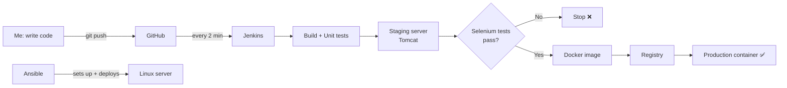

# My DevOps Project: Explained Simply

**Name:** Tanisha Sharma  |  **Roll No:** 23102C0077  |  **Class:** BE CMPN C
**Guide:** Dr. Snehal Andhare  |  **Year:** 2026-27, ODD Semester
**Project:** Containerized Sports Facility Booking System

> This file explains the whole project from start to finish in simple words:
> what the problem was, what I built, and how I did each of the 14 tasks.

---

## Part A: The Problem (Why this project?)

### The real-life problem

In colleges and housing societies, sports facilities like badminton courts and
football turfs are usually booked like this:

1. You **call** or **walk** to the sports office.
2. The person there checks a **paper register** or a WhatsApp group.
3. They write your name down by hand.

**What goes wrong:**

| Problem | Example |
|---------|---------|
| You can't see which slots are free | You have to call and ask "Is 6 pm free?" |
| **Double booking** | Two groups arrive at the same court at the same time |
| Cancellations are not shared | Someone cancels, but nobody else knows the slot is free |
| No record | Nobody knows who booked or who didn't show up |
| Too much work for the manager | The manager spends the whole day answering calls |

### The second (hidden) problem: how software is delivered

Even after we build an app, someone has to **build it, test it and put it on a
server**. If this is done **by hand**:

- "It works on my laptop" but **not on the server**.
- Someone forgets to test, and a **bug reaches users**.
- If a new version is broken, there's **no quick way to go back**.
- Every release is slow and stressful.

### Problem statement (in one line)

> Build a web app where people can **see free slots, book, cancel and track
> their booking**, and deliver it using an **automatic DevOps pipeline**, so that
> every change is **built, tested and deployed safely without manual work**.

---

## Part B: The Proposed Solution (What did I build?)

My solution has **two parts**:

### Part 1: The App (the "what")

A website called **Sports Facility Booking System**:

| Feature | What the user can do |
|---------|---------------------|
| Register | Create an account (name, email, phone) |
| View slots | Pick a facility and a date, and see free time slots |
| Book | Click **Book** on a free slot. Status becomes **REQUESTED** |
| No double booking | If a slot is taken, nobody else can book it |
| Manager confirms | The manager logs in and clicks **Confirm**. Status becomes **CONFIRMED** |
| Cancel | The user cancels, the status becomes **CANCELLED** and the slot is free again |
| My Bookings | The user sees all their bookings and their status |

**Built with:** Java + Spring Boot (the app), Thymeleaf (web pages), H2 (database), Maven (build tool).

### Part 2: The DevOps Pipeline (the "how")

An **automatic assembly line** for the software. When I change the code and push
it to GitHub, everything else happens **by itself**:

```text
 I push code to GitHub
        ↓
 Jenkins notices the change (checks every 2 minutes)
        ↓
 Build the app with Maven  →  run 19 unit tests
        ↓
 Put it on a test server (Tomcat, "staging")
        ↓
 Selenium opens Chrome and clicks through the app like a real user (5 tests)
        ↓   ❌ any test fails → STOP. Nothing goes to real users.
        ↓   ✅ all pass
 Pack the app into a Docker image (version 1.0.0-b12, for example)
        ↓
 Save the image in a registry (like a library of versions)
        ↓
 Start a fresh container for real users (production)  →  health check
```

**Plus Ansible**, which sets up a brand-new Linux server automatically and can
**roll back** to the old version if a new one is broken.

### Simple picture of the whole system



---

## Part C: Simple Meanings of the Words I Use

| Word | Simple meaning |
|------|----------------|
| **DevOps** | Developers and operations working together, using **automation** so software is released quickly and safely |
| **Git** | Saves every version of my code (like "track changes" in Word) |
| **GitHub** | A website that stores my Git project online |
| **Branch** | A separate copy of the code to work on one feature without disturbing the main code |
| **Merge** | Joining a branch back into the main code |
| **Merge conflict** | Two branches changed the **same line**, so Git asks me to choose |
| **Pull Request (PR)** | A request to merge a branch, so someone can review it first |
| **Tag (v1.0.0)** | A name stuck on one exact version, like "final version 1" |
| **Maven** | A tool that compiles Java, runs tests and creates the app file (`.war`) |
| **Jenkins** | A robot that builds and tests my code automatically |
| **CI (Continuous Integration)** | Every change is automatically built and tested |
| **CD (Continuous Delivery/Deployment)** | Every good change is automatically released |
| **Pipeline / Jenkinsfile** | The list of steps Jenkins follows, written in a file inside the project |
| **Unit test** | A small automatic check of one piece of code |
| **Selenium** | A tool that opens a real browser and clicks buttons like a human, to test the website |
| **Tomcat** | A web server that runs Java web apps |
| **Docker image** | A sealed box with my app + Java + everything it needs |
| **Container** | A running copy of that box. It runs the same way on every computer |
| **Registry** | A store of Docker images and their versions |
| **Ansible** | A tool that sets up servers automatically from a script (playbook) |
| **Idempotent** | Running the script again changes nothing if everything is already correct. Safe to repeat |
| **Health check** | A URL (`/actuator/health`) that answers "UP" if the app is healthy |
| **Rollback** | Going back to the previous working version |
| **Staging / Production** | Staging = test server. Production = real users' server |

---

## Part D: Step-by-Step Journey (Step 0 to Task 14)

### Step 0: Getting started

- Found my project in the college Excel sheet (BE CMPN C, row 63):
  **"Containerized Sports Facility Booking System"**, with 14 tasks.
- Created an empty GitHub repository: `tanishasharma1827/23102C0077_devops`.
- Checked my laptop had **Java 21, Maven, Git, Docker Desktop, Chrome and Jenkins**.

---

### Task 1: Problem Definition and Scope

**What:** Understand the problem before writing any code.

**How:**
- Listed the **pain points** (double booking, no visibility, phone calls...).
- Listed **who is affected** (stakeholders): player, facility manager, admin, me (developer), faculty guide.
- Wrote **objectives** and **constraints** (one semester, one person, free tools only).
- Fixed a **small first version (MVP)** with **15 items** (M1 to M15), and kept payments, SMS and the mobile app **out of scope**.

**One-line explanation:** *"I first understood the problem and fixed what the first version must do, so the project doesn't grow out of control."*

---

### Task 2: Agile Planning and DevOps Workflow

**What:** Plan the work like a real software team.

**How:**
- Wrote **7 user stories**, for example: *"As a player, I want to book a free slot so that it is reserved for me."*
- Each story has **acceptance criteria** (how we know it's done).
- Made a **backlog** (to-do list of 15 items, 31 story points) and a **4-sprint plan** (2 weeks each).
- Made a **Kanban board** (To Do → In Progress → Review → Done).
- Wrote a **Definition of Done** (code reviewed, build passes, tests pass...).
- Drew the **DevOps cycle**: Plan → Code → Build → Test → Release → Deploy → Operate → Monitor.

**One-line explanation:** *"I broke the work into small user stories and planned them into sprints, like a real Agile team."*

---

### Task 3: Requirements, Architecture and Technology Setup

**What:** Decide exactly what to build and with which tools.

**How:**
- Wrote **functional requirements** (register, view slots, book, cancel...) and **non-functional requirements** (fast, easy, reliable).
- Drew diagrams: **use-case** (who does what), **architecture** (layers), **data model** (User, Facility, Slot, Booking).
- Listed all **web addresses (APIs)** of the app.
- Chose the tools: **Java 17 + Spring Boot + Maven + Tomcat + Jenkins + Selenium + Docker + Ansible**.
- Created the first app skeleton and ran it on my laptop.

**App design in simple words (3 layers):**
```text
Browser  →  Controller (receives the click)
         →  Service (business rules, e.g. "no double booking")
         →  Repository (saves to / reads from the database)
```

**One-line explanation:** *"I wrote down the requirements, designed the system, picked the tools and got the app running locally."*

---

### Task 4: Git and GitHub Repository Setup

**What:** Organise the project properly on GitHub.

**How:**
- Added **README** (about the project), **.gitignore** (files Git should ignore), and a **folder structure**.
- Added **issue templates** (bug, feature, task) and a **pull request template** with a checklist.
- Wrote **branch rules** in `CONTRIBUTING.md`:
  - `main` = stable release code
  - `develop` = latest working code
  - `feature/...` = one new feature
  - `bugfix/...` = one fix
- Wrote **commit message rules**: `feat:`, `fix:`, `docs:`, `test:`, `ci:`, `chore:`.
- Made the first commits and pushed `main` and `develop`.

**One-line explanation:** *"I set up GitHub with clear rules so all future work stays organised."*

---

### Task 5: Feature Development with Branching

**What:** Build the first real feature on its own branch.

**How:**
- Made the branch `feature/M3-M7-registration-availability`.
- Built **registration** (with checks: valid email, 10-digit phone, no duplicate email) and the **slot availability page**.
- Added sample data: 3 facilities, 6 slots per day for 7 days, and 1 manager account.
- Made small commits, pushed the branch, reviewed it and **merged** it into `develop`.
- **7 tests passed.**

**Commands I used:**
```bash
git checkout -b feature/M3-M7-registration-availability
git add .   →   git commit -m "feat(M3): ..."   →   git push
git checkout develop   →   git merge --no-ff feature/...
```

**One-line explanation:** *"I built feature 1 on a separate branch and merged it only after it was tested."*

---

### Task 6: Finish the MVP + Merge Conflict + Release Tag

**What:** Finish all features, show teamwork with Git, and mark version 1.0.0.

**How:**
- Branch 1 `feature/M8-M13-booking-flow`: booking, **double-booking check**, manager confirm, cancel, My Bookings.
- Branch 2 `feature/M14-M15-navigation-health`: better menu, friendly error page, health/version page.
- Both branches **changed the same menu line**, so Git showed a **merge conflict**:
  ```text
  <<<<<<< HEAD
     (menu from branch 1)
  =======
     (menu from branch 2)
  >>>>>>> feature/M14-M15-navigation-health
  ```
- I **resolved** it by keeping **both** changes, then ran the tests again: **19/19 passed**.
- Created the release tag **`v1.0.0`**.

**One-line explanation:** *"I finished all 15 features, solved a real merge conflict between two branches, and tagged version 1.0.0."*

---

### Task 7: Jenkins and the First CI Job

**What:** Make a robot (Jenkins) build and test the code automatically.

**How:**
- Jenkins runs on my laptop at `localhost:8080`.
- Created the job **`sports-booking-ci`**:
  - **Source:** my GitHub repo, `develop` branch
  - **Trigger:** **Poll SCM** every 2 minutes ("Is there new code?")
  - **Build:** `mvn clean package` (compile + 19 tests + create the `.war` file)
  - **After build:** show test results and save the `.war` file (artifact)
- **Proof:** a build said **"Started by an SCM change"**, which means Jenkins started it **by itself** after I pushed code.

**Why polling and not a webhook?** A webhook needs GitHub to reach my laptop
from the internet, which isn't possible on `localhost`. Polling works from inside.

**One-line explanation:** *"Jenkins checks GitHub every 2 minutes and automatically builds and tests every new change."*

---

### Task 8: Pipeline as Code + Deploy to Tomcat

**What:** Write all the build steps **in a file** (Jenkinsfile) and deploy to a server.

**How:**
- Wrote a **Jenkinsfile** with stages: **Checkout → Build → Unit Tests → Package → Deploy to Tomcat**.
- The deploy stage starts a **Tomcat server**, copies the app into it, and waits until the **health check says UP**.
- Added **parameters** (settings chosen when starting a build):
  - `DEPLOY_ENV` = `staging` or `qa`
  - `TOMCAT_PORT` = which port to use
- Proof: staging ran on port **8082** and QA on port **8084**, both from the same pipeline.

**Why a file?** Because the pipeline is then **saved in Git**: it has a history, it can be reviewed, and it's never lost.

**One-line explanation:** *"I wrote the whole build-and-deploy process as code in a Jenkinsfile, and it deploys the app to Tomcat."*

---

### Task 9: Selenium Tests (Browser Testing)

**What:** Test the website like a real user, automatically.

**How:** I wrote **5 test cases** where Selenium opens Chrome and clicks around:

| Test | What it does |
|------|--------------|
| TC-01 | Registers a new user, then checks the success message |
| TC-02 | Enters a wrong email and phone, then checks the error messages |
| TC-03 | Books a slot, then checks My Bookings shows **REQUESTED** |
| TC-04 | A second user tries the same slot, which is **blocked** (no double booking) |
| TC-05 | Manager **confirms**, then the user **cancels**, and the slot becomes free again |

- Run with: `mvn verify -Pselenium` → **5/5 passed**.
- **Screenshot on failure:** if a test fails, a picture of the browser is saved automatically, so I can see what went wrong.

**One-line explanation:** *"Selenium acts like a real user in Chrome and checks the 5 most important things a user does."*

---

### Task 10: Continuous Testing in Jenkins (the Safety Gate)

**What:** Run the Selenium tests inside Jenkins, and **block** bad code from reaching users.

**How:**
- Added a **Selenium Tests** stage after the staging deployment.
- Added a **Deploy to Production** stage **after** it. If tests fail, Jenkins **skips** production.
- **The experiment (deliberate bug):**
  1. I changed the "My Bookings" menu link to a wrong address (on purpose).
  2. **Unit tests: 19/19 passed** (they didn't notice the bug!).
  3. **Selenium: 2 tests failed** (a real browser clicked the link and got a 404 page).
  4. **Production was NOT updated**, so users kept the old working version.
  5. I fixed the link (1 line). The next build was **all green** and production was updated.

**One-line explanation:** *"Jenkins runs browser tests on every change. When I added a bug on purpose, the tests caught it and stopped it from reaching users."*

---

### Task 11: Docker (Containers)

**What:** Pack the app into a **container**, so it runs the same way everywhere.

**How:**
- Wrote a **Dockerfile** (the recipe for the box):
  - Start from Java 17
  - Copy my app into it
  - Run as a normal user (not admin), for safety
  - Add a **health check**
- Commands I ran (the full **lifecycle**):
  ```bash
  docker build -t sports-booking:1.0.0 .                         # make the image
  docker run -d -p 8090:8080 --name sports-booking sports-booking:1.0.0   # start it
  docker ps        # is it running? (healthy)
  docker logs      # see what it printed
  docker exec      # look inside
  docker stop / start / restart
  docker rm / rmi  # delete container / image
  ```

**One-line explanation:** *"Docker packs my app with everything it needs into one box that runs the same on any computer."*

---

### Task 12: Jenkins + Docker (Full Automatic Deployment)

**What:** After the tests pass, Jenkins automatically makes a Docker image and deploys it.

**How:**
- Started a **local Docker registry** (a store for images) at `localhost:5000`.
- Added 3 stages to the Jenkinsfile:
  1. **Docker Build**: make the image with a version tag like `1.0.0-b12` (b12 = build 12)
  2. **Push to Registry**: save it in the registry
  3. **Deploy Container**: remove the old container, start the new version, check health
- Result: one `git push` → **tested and running in production in about 4 minutes**, with **no manual work**.
- The registry keeps **every version** (`1.0.0-b11`, `1.0.0-b12`...), so I can go back anytime.

**One-line explanation:** *"Every time I push code, Jenkins tests it, makes a new versioned Docker image and replaces the production container automatically."*

---

### Task 13: Ansible (Automatic Server Setup)

**What:** Set up a Linux server automatically using a script, instead of by hand.

**How:**
- Wrote down what the server needs: **Java**, a **user** (`sportsapp`), **folders**, a **config file**, a **service**, and **port 8080**.
- Ansible doesn't run on Windows, so I made **2 small Linux machines using Docker**:
  - **Control** (runs Ansible)
  - **Target** (a fresh, empty Ubuntu server)
- Wrote:
  - **Inventory** (`inventory.ini`): the list of servers
  - **Playbook** (`site.yml`): the steps (install Java, create user, folders, files...)
- First run: **7 changes, 0 failures**. The server was ready.

**One-line explanation:** *"Ansible sets up a new server automatically from a script, so every server is set up exactly the same."*

---

### Task 14: Reliability (Idempotency, Health Check, Rollback, Recovery)

**What:** Prove the automation is safe and can recover from problems.

**How (4 experiments):**

| Experiment | What I did | What happened |
|-----------|------------|---------------|
| **1. Fresh server** | Deleted the server and made a new one, then ran `deploy.yml` | Ansible installed everything and deployed version 1.0.0. Health check = **UP** ✅ |
| **2. Idempotency** | Ran the **same command again** | **changed=0**: nothing changed, because it was already correct ✅ |
| **3. Rollback** | Deployed a **broken version 1.1.0** on purpose | Health check failed, so Ansible **automatically went back to 1.0.0**. App still UP ✅ |
| **4. Recovery** | **Killed** the app (simulated crash) | Ran the playbook again and the app came back UP ✅ |

**How rollback works:** every version is kept in a `releases/` folder, and a link
`current.war` points to the live one. Rollback = point the link back to the old
version and restart. It takes seconds.

**One-line explanation:** *"My automation can rebuild a server from zero, is safe to run again and again, and automatically goes back to the old version if a new one is broken."*

---

## Part E: The Final Result

**What happens now when I change one line of code and push it:**

1. Jenkins notices within 2 minutes.
2. It builds the app and runs **19 unit tests**.
3. It deploys to a **staging** server.
4. Selenium runs **5 browser tests** on it.
5. If anything fails → **stop**. Users are safe.
6. If everything passes → a new **Docker image** is made, saved, and **production is updated**.
7. A **health check** confirms it's working.

**Total time:** about **4 minutes**. **Manual steps:** **zero**.

| Before (manual) | After (my DevOps pipeline) |
|-----------------|---------------------------|
| Build on my laptop by hand | Jenkins builds automatically |
| Maybe test, maybe forget | 24 tests run on every change |
| Copy files to the server by hand | Docker + Jenkins deploy automatically |
| Broken release = panic | Automatic rollback to the last good version |
| "Works on my machine" | Same container everywhere |

---

## Part F: Problems I Faced and How I Solved Them

| Problem | Solution |
|---------|----------|
| Jenkins already used port 8080 | Ran my app on 8081 locally, 8082 for staging, 8090 for production |
| Jenkins couldn't find Docker | Added Docker's folder to the PATH in the Jenkinsfile |
| Selenium failed in Jenkins: "ChromeDriver only supports Chrome 151" | Upgraded Selenium to 4.51.0, which downloads the right driver automatically |
| Jenkins was deleting old builds | A wrong setting name in the job file (`numToKeepStr` → `numToKeep`) |
| A Selenium test failed because of timing | The failure screenshot showed the page hadn't loaded yet, so I added a wait |
| Ansible doesn't run on Windows | Ran Ansible inside Docker containers |

---

## Part G: Questions My Mentor Might Ask (with simple answers)

**Q: What is DevOps?**
A: A way of working where building, testing and releasing software is **automated**, so changes reach users **quickly and safely**.

**Q: What is the difference between CI and CD?**
A: **CI** = every change is automatically **built and tested**. **CD** = every change that passes is automatically **released**.

**Q: Why did you use Jenkins?**
A: It's free, runs on my own machine, and lets me write the pipeline as code (Jenkinsfile).

**Q: Why do you need Selenium if you have unit tests?**
A: Unit tests check code pieces; Selenium checks the **real website like a user**. My Task 10 experiment proved it: the bug passed all unit tests but Selenium caught it.

**Q: What is the difference between a Docker image and a container?**
A: The **image** is the packed box (a recipe). The **container** is a **running** copy of that box.

**Q: Why Docker?**
A: The app runs **the same everywhere**, so there's no more "it works on my laptop but not on the server".

**Q: What does idempotent mean?**
A: Running the same script many times gives the same result. The second run changes nothing (`changed=0`).

**Q: How does rollback work?**
A: All versions are kept. If the new version's health check fails, Ansible switches back to the previous version automatically.

**Q: What is a merge conflict and how did you solve it?**
A: Two branches changed the same line. Git can't decide, so I opened the file, kept both changes, removed the markers, tested and committed.

**Q: How do you prevent double booking?**
A: Before saving a booking, the service checks if that slot already has an active (REQUESTED or CONFIRMED) booking. If yes, it refuses.

**Q: What happens if a test fails in the pipeline?**
A: Jenkins stops. The later stages (Docker build and production deployment) are **skipped**, so broken code never reaches users.

---

## Part H: Where to Find Everything

| What | Where |
|------|-------|
| Detailed report for each task | `docs/task-01-...md` to `docs/task-14-...md` (on the `develop` branch) |
| Screenshots | `ss/task-04/` to `ss/task-14/` |
| App code | `src/main/java/com/sportsbooking/` |
| Tests | `src/test/java/com/sportsbooking/` (Selenium tests in `ui/`) |
| Pipeline | `Jenkinsfile` |
| Docker recipe | `Dockerfile` |
| Ansible | `ansible/` |
| Final Word report | `DevOps_Project_Report_Tanisha_Sharma_23102C0077_final.docx` |

**Tech stack in one line:** Java 17 · Spring Boot · Maven · Git/GitHub · Jenkins · Tomcat · Selenium · Docker · Ansible
